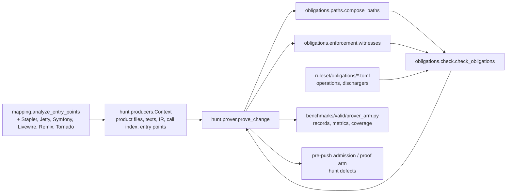

# Design Document

## Overview
**Purpose**: a deterministic prover for the access-control family: given a change checked out at head, find
every protected operation reachable from an entry point without a check dominating the path, and say what is
unchecked. **Users**: the maintainer, scoring it as an arm on the training pool; the pre-push hook and the proof
arm, consuming its findings. **Impact**: adds Java and framework entry recognition to the mapper, a path builder
and enforcement witnesses in the obligations package, a prover over the hunter's per-change context, and a
runner that scores it with the valid-benchmark metrics.

### Goals
- A finding names an entry point, the hops, the operation and the missing check; nothing else is a finding.
- Scored on the pool: recall on 23 fixes and 93 locations, false alarms per 100 ordinary pushes, seconds per change.
- Coverage stated per repository: what was recognised, reached, checked, and left unchecked by reason.

### Non-Goals
- Taint flow, the Joern engine, nesting-aware dominance, families other than access control.
- Model calls inside the prover; intent adjudication stays a separate arm.
- The unseen pilot measurement and the pre-push wiring (later increments of other specs).

## Boundary Commitments

### This Spec Owns
- Entry recognisers for Stapler, Jetty handlers, Symfony attributes, Livewire and Laravel controllers, Remix
  exports, Tornado handlers (`mapping.py` blocks, each with evidence).
- `semantic/obligations/paths.py`: `PathRecord` and `compose_paths` over the caller index.
- `semantic/obligations/enforcement.py`: router and decorator witnesses from route files and attributes.
- `hunt/prover.py`: `prove_change` and `Coverage`.
- `benchmarks/valid/prover_arm.py`: the runner and its summary.
- Operation and discharger rows added to `ruleset/obligations/{java,php,python,typescript}.toml`.

### Out of Boundary
- The facts loader and schema, `OrderDominance`, and the checker's existing decision rules (owned by
  `authorization-obligations`). One opt-in extension of the checker is allowed and owned here: the
  `assume_entries_protected` keyword and the `unguarded_path` label (see the checker block below); default off,
  every existing checker test unchanged.
- The feature table, the DSPy and hunter arms, the ablation (`hunter-learning-loop`).
- The proof arm's demonstration logic (`search-with-proof`); this spec only shapes the finding.

### Allowed Dependencies
- `openultrasast.source` (callers_of, code_index, product_files, generated_reason), `openultrasast.mapping`,
  `openultrasast.semantic.cst` and `ir`, `openultrasast.semantic.obligations` (check, facts, dominance),
  `openultrasast.hunt.producers.Context`, `benchmarks.valid.metrics`, `benchmarks.unseen.score`.
- No new third-party dependency.

### Revalidation Triggers
- A change to `EntryPointRecord` fields or `Discharge` scopes.
- A change to the replay record shape `benchmarks.valid.metrics` scores.
- A change to the hunt defect shape (`defect_from`).

## Architecture

### Existing Architecture Analysis
The checker already judges reached operations by path and witnesses by scope; the hunter's `Context` already
caches everything the prover reads. The missing pieces are the inputs: entries for Java and the pool's PHP,
TypeScript and Python frameworks; paths; witnesses from outside the function; operation rows for the pool's
protected calls. The prover is wiring plus those inputs.

### Architecture Pattern & Boundary Map

- Selected pattern: inputs assembled in the prover, decision in the existing checker.
- Existing patterns preserved: closed facts in TOML with checked headers; `_entry` recogniser blocks; per-change
  `Context`; replay record shape; counts and digests in records.
- Steering compliance: no model call, instrument gate (bytes read), plain English, standard metrics.

### Technology Stack
| Layer | Choice | Role | Notes |
|---|---|---|---|
| Analysis | Python 3.11, tree-sitter IR, regex caller index | entries, paths, operations | existing |
| Facts | TOML under `ruleset/obligations/` | operations, dischargers | existing loader |
| Scoring | `benchmarks.valid.metrics`, `benchmarks.unseen.score` | recall, false alarms per 100 | existing |

## File Structure Plan
```
src/openultrasast/
├── mapping.py                              # + recognisers: _stapler_entries, _jetty_entries, _symfony_entries,
│                                           #   _livewire_entries, _remix_exports (extend), _tornado_entries
├── semantic/obligations/
│   ├── paths.py                            # PathRecord, compose_paths(callers, entries, targets, depth, fan_out)
│   └── enforcement.py                      # witnesses(root, texts, entries, facts) -> list[Discharge]
├── hunt/prover.py                          # prove_change(root, change, ctx) -> ProverResult(findings, coverage)
└── ruleset/obligations/{java,php,python,typescript}.toml   # + operation and discharger rows, checked headers
benchmarks/valid/prover_arm.py              # run / summarize; records per change; coverage table
tests/test_mapping_frameworks.py, tests/test_obligation_paths.py, tests/test_obligation_enforcement.py,
tests/test_hunt_prover.py, tests/test_prover_arm.py
```

### Modified Files
- `src/openultrasast/mapping.py`: new recogniser blocks, registered where `analyze_entry_points` dispatches by
  language and path; `EntryPointRecord` unchanged.
- `src/openultrasast/hunt/producers.py`: `Context` exposes `entry_points` and `ir(path)` already; add nothing
  unless a cache is missing (then a `cached_property`, same pattern).
- `src/openultrasast/ruleset/obligations/*.toml`: rows only.

## System Flows
```mermaid
sequenceDiagram
  participant R as prover_arm
  participant X as Context
  participant P as prove_change
  participant PA as compose_paths
  participant EN as enforcement
  participant CK as check_obligations
  R->>X: checkout head, Context(root, change)
  R->>P: prove_change(root, change, ctx)
  P->>X: entry_points, call_index, texts, ir(path) per touched file
  P->>PA: targets = touched functions + callees holding operations
  PA-->>P: PathRecords (hops entry..operation function), unreached list
  P->>EN: route files, attributes, entries
  EN-->>P: router/decorator Discharges
  P->>CK: irs of touched + hop files, entries, facts, paths, OrderDominance(texts), extra_witnesses
  CK-->>P: ObligationResult (findings, discharges, degradations)
  P-->>R: ProverResult(findings as hunt defects with entry, hops, operation, missing; coverage)
  R->>R: record per change; metrics.summarize; coverage table
```
Gating: a file that fails to parse, a language without facts, or an unrecognised framework yields coverage
counts and no finding. A declared-public route suppresses `path_guard` only.

## Requirements Traceability
| Requirement | Components |
|---|---|
| 1.1-1.8 | mapping recognisers |
| 2.1-2.7 | enforcement.witnesses, facts rows, checker (existing) |
| 3.1-3.6 | paths.compose_paths |
| 4.1-4.6 | hunt.prover.prove_change |
| 5.1-5.5 | prover_arm |
| 6.1-6.2 | prover_arm timing, Context caches |
| 7.1-7.2 | Coverage in prove_change, prover_arm summary |
| 8.1-8.2 | finding shape in prove_change |

## Components and Interfaces

### mapping recognisers
| Field | Detail |
|---|---|
| Intent | name web-exposed methods of the pool's frameworks as `route` entries with evidence |
| Requirements | 1.1-1.8 |

Each block follows the existing pattern: scan the file text (and the IR's function spans when a method body is
needed), call `_entry(target, start, end, handler, name, kind, access, trust_boundary, evidence, conditions)`.
Stapler: class text matches `extends|implements` one of the exposed types, or a method parameter is typed
`StaplerRequest`, `StaplerRequest2`, `StaplerResponse` or annotated `@QueryParameter`/`@AncestorInPath`; method is
`public` and its name matches `^do[A-Z]`. Access `public` only for `UnprotectedRootAction`. Jetty: classes
extending `AbstractHandler`, `HttpServlet` or annotated `@Path`/`@GET`/`@POST`. Symfony: methods with
`#[Route(` or `@Route(`; classes extending `AbstractController`. Livewire: classes extending `Component`, public
methods not starting with `_`, plus `Route::` registrations naming a controller method. Remix: `export const|function
action|loader` under `app/routes`. Tornado: classes extending `RequestHandler` or `WebSocketHandler`, request
methods and `open`.

### obligations.paths
```python
@dataclass(frozen=True)
class PathRecord:
    hops: tuple[tuple[str, int | None], ...]   # ("path::function", line of the call site in the caller), entry first
    entry: str                                 # "path::function" of the entry hop
    complete: bool                             # True when hops[0] is an entry point

def compose_paths(
    *, callers: Callable[[str, str], Sequence[tuple[str, int]]],  # (path, function) -> caller sites
    entries: set[str], targets: Sequence[tuple[str, str]], max_depth: int = 3, fan_out: int = 25,
) -> tuple[list[PathRecord], list[str]]:  # complete paths, unreached "path::function" targets
```
- Preconditions: targets name functions with IR; `callers` resolves a function to its call sites through the
  cached index and the enclosing function of each site (`source.enclosing_at` or the IR spans).
- Postconditions: every path's last hop is a target; no path implies nothing; unreached targets are listed.

### checker extension (opt-in)
`check_obligations(..., assume_entries_protected: bool = False)`. With path records, no declared clause and no
sibling norm, the checker today returns no finding (gating 3 of `authorization-obligations`): nothing justified
the obligation. The prover's premise justifies it: a recognised entry is protected unless declared public. With
the keyword on, `_finding` labels such a case `unguarded_path` when the path's entry hop is an entry record whose
access is not `public` and the route is not declared public; evidence carries the entry's kind and evidence
strings and the sentence "no declared policy clause and no sibling norm; the prover assumes a recognised entry is
protected". `findings_to_static` explains the label like the others. `LABELS` gains the value.

### obligations.enforcement
```python
def witnesses(*, root: Path, texts: Mapping[str, str], entries: Sequence[EntryPointRecord], language: str) -> list[Discharge]
```
Reads Laravel route files (`routes/*.php`) for `->middleware([...])` and controller constructors for
`$this->middleware`/`authorizeResource`; Symfony attributes and `config/packages/security.yaml`
`access_control`; Tornado `@authenticated`; emits `Discharge(kind="path_guard", scope="router"|"decorator", path,
function, line=None, evidence=...)` for each covered handler. Names recognised live in the facts files' headers.

### hunt.prover
```python
@dataclass(frozen=True)
class Coverage: files_by_language, frameworks_recognised, entry_points, reached, unreached, operations_checked,
                operations_discharged, unchecked_by_reason  # all ints or dicts of ints

@dataclass(frozen=True)
class ProverResult: findings: tuple[dict, ...]; coverage: Coverage; degradations: tuple[dict, ...]

def prove_change(root: Path, change: Mapping[str, Any], ctx: Context | None = None, *, max_depth: int = 3) -> ProverResult
```
- Touched functions come from `_candidates`-style enumeration (touched head lines to function spans), build
  output left out via `source.generated_reason`.
- Targets = touched functions plus their direct callees that hold a protected operation (one hop down through
  the IR's calls and the call index).
- Findings: for each `ObligationFinding`, a hunt defect dict with `path`, `line`, `family="access_control"`,
  `function`, `evidence` (entry record summary, hops, operation id and calls, missing kind), `id` as the checker
  emits.
- Degradations and every unchecked reason land in `Coverage`.

### prover_arm
`python -m benchmarks.valid.prover_arm run POOL --repos REPOS --out DIR [--slice 1] [--only all] [--max-depth 3]`
writes `<sha256(change id)>.json` per change (replay record envelope copied from `hunter_arm`: id, case_id,
repo, kind, family, path, function_lines, files, head, instrument {changed_bytes, hook_bytes_read, head_verified},
findings, coverage, seconds, status), resumes by skipping done records, then `summarize` writes `summary.json`
(metrics from `benchmarks.valid.metrics.summarize`, per-repository and per-framework coverage, changes over 120 s,
instrument failures) and refuses when any record read zero bytes of a file git holds.

## Error Handling
- Exceptions inside `prove_change` per file are recorded as `unchecked_by_reason[type name]`; the change is
  still proved for the other files. A provider never appears (no model call). A checkout failure is an
  instrument failure on the record (`status="instrument_failure"`, reason type only).

## Testing Strategy
- Unit: each recogniser on a fixture file written in the test (not copied from clones) with positive and negative
  cases; `compose_paths` on a three-file fixture (depth 1, 2, 3, unreached, fan-out cut, same-name in two files);
  `witnesses` for a Laravel route file, a Symfony attribute, a Tornado decorator.
- Integration: `prove_change` on a git fixture with a Stapler-style class: an unguarded `doTestConnection` that
  calls `lookupCredentials` yields one finding with hops and missing `path_guard`; the same with
  `Jenkins.get().checkPermission(...)` above the call yields none; a Laravel controller behind `auth` middleware
  yields none; an unrecognised framework yields coverage only.
- Runner: a two-change fixture pool produces records the metrics summarise; a zero-byte read refuses.
