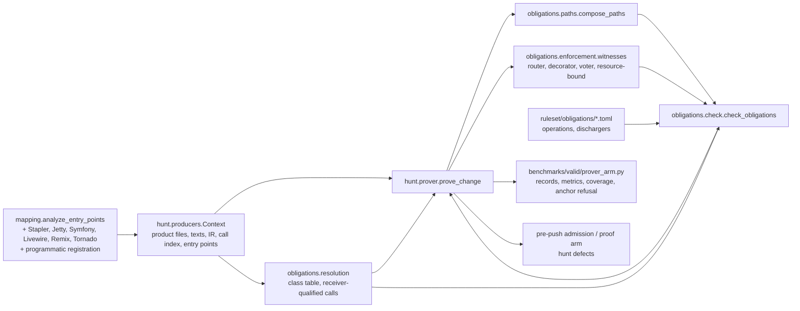

# Design Document

## Overview
**Purpose**: a deterministic prover for the access-control family: given a change checked out at head, find
every protected operation reachable from an entry point without a check dominating the path, and say what is
unchecked. **Users**: the maintainer, scoring it as an arm on the training pool; the pre-push hook and the proof
arm, consuming its findings. **Impact**: adds Java and framework entry recognition to the mapper, receiver- and signature-precise call
resolution in the obligations package `[2026-10-29]`, a path builder and enforcement witnesses in the
obligations package, a prover over the hunter's per-change context, and a runner that scores it with the
valid-benchmark metrics.

### Goals
- A finding names an entry point, the hops, the operation and the missing check; nothing else is a finding.
- Scored on the pool: recall on 23 fixes and 93 locations, false alarms per 100 ordinary pushes, seconds per change.
- Resolution precision `[2026-10-29]`: a guard discharges only the operation whose resource it binds, and a
  call resolves to the class and signature it targets; an operation declared on a base class attaches only to
  the classes that extend it.
- Coverage stated per repository: what was recognised, reached, checked, and left unchecked by reason.

### Non-Goals
- Taint flow, the Joern engine, nesting-aware dominance, families other than access control.
- Model calls inside the prover; intent adjudication stays a separate arm.
- The unseen pilot measurement and the pre-push wiring (later increments of other specs).

## Boundary Commitments

### This Spec Owns
- Entry recognisers for Stapler, Jetty handlers, Symfony attributes, Livewire and Laravel controllers, Remix
  exports, Tornado handlers, and programmatic servlet/handler registration sites `[2026-10-29]`
  (`mapping.py` blocks, each with evidence).
- `semantic/obligations/resolution.py`: the class table and receiver- and signature-qualified call
  resolution `[2026-10-29]`.
- The optional `receiver` field of `semantic/ir.py`'s `CallSite` and its capture in `semantic/cst.py`
  (additive, default `None`; every existing consumer unchanged) `[2026-10-29]`.
- `semantic/obligations/paths.py`: `PathRecord` and `compose_paths` over the caller index.
- `semantic/obligations/enforcement.py`: router, decorator, voter `[2026-10-29]` witnesses from route files
  and attributes, each carrying the resource it binds `[2026-10-29]`.
- `hunt/prover.py`: `prove_change` and `Coverage`.
- `benchmarks/valid/prover_arm.py`: the runner and its summary.
- Operation and discharger rows added to `ruleset/obligations/{java,php,python,typescript}.toml`.

### Out of Boundary
- The facts loader's existing fields, `OrderDominance`, and the checker's existing decision rules (owned by
  `authorization-obligations`). Three extensions are allowed and owned here: the handler-named operation fields
  (`handlers`, `framework`) in the facts; the `assume_entries_protected` keyword and the `unguarded_path` label
  (see the checker block below); and, `[2026-10-29]`, the optional `resource` field on `Discharge` with the
  `resource_bound` keyword and the all-kind caller-hop re-judgement in `_on_caller_hop` (see the checker block
  below). Each is additive or default-off; every existing checker test unchanged.
- The feature table, the DSPy and hunter arms, the ablation (`hunter-learning-loop`).
- The proof arm's demonstration logic (`search-with-proof`); this spec only shapes the finding.

### Allowed Dependencies
- `openultrasast.source` (callers_of, code_index, product_files, generated_reason), `openultrasast.mapping`,
  `openultrasast.semantic.cst` and `ir`, `openultrasast.semantic.obligations` (check, facts, dominance),
  `openultrasast.hunt.producers.Context`, `benchmarks.valid.metrics`, `benchmarks.unseen.score`.
- No new third-party dependency.

### Revalidation Triggers
- A change to `EntryPointRecord` fields or `Discharge` scopes.
- A change to `CallSite` fields or the caller-index keying `[2026-10-29]`.
- A change to the replay record shape `benchmarks.valid.metrics` scores.
- A change to the hunt defect shape (`defect_from`).

## Architecture

### Existing Architecture Analysis
The checker already judges reached operations by path and witnesses by scope; the hunter's `Context` already
caches everything the prover reads. The missing pieces are the inputs: entries for Java and the pool's PHP,
TypeScript and Python frameworks; paths; witnesses from outside the function; operation rows for the pool's
protected calls. The prover is wiring plus those inputs.

### Architecture Pattern & Boundary Map

- Selected pattern: inputs assembled in the prover, decision in the existing checker.
- Existing patterns preserved: closed facts in TOML with checked headers; `_entry` recogniser blocks; per-change
  `Context`; replay record shape; counts and digests in records.
- Steering compliance: no model call, instrument gate (bytes read), plain English, standard metrics.

### Technology Stack
| Layer | Choice | Role | Notes |
|---|---|---|---|
| Analysis | Python 3.11, tree-sitter IR, regex caller index | entries, paths, operations | existing |
| Facts | TOML under `ruleset/obligations/` | operations, dischargers | existing loader |
| Scoring | `benchmarks.valid.metrics`, `benchmarks.unseen.score` | recall, false alarms per 100 | existing |

## File Structure Plan
```
src/openultrasast/
├── mapping.py                              # + recognisers: _stapler_entries, _jetty_entries, _symfony_entries,
│                                           #   _livewire_entries, _remix_exports (extend), _tornado_entries,
│                                           #   _jetty_registration_entries [2026-10-29]
├── semantic/
│   ├── cst.py                              # + capture call receiver text in _call [2026-10-29]
│   ├── ir.py                               # + CallSite.receiver: str | None [2026-10-29]
│   └── obligations/
│       ├── resolution.py                   # ClassRecord, class_table, qualify — receiver/signature resolution [2026-10-29]
│       ├── paths.py                        # PathRecord, compose_paths(callers, entries, targets, depth, fan_out)
│       └── enforcement.py                  # witnesses(root, texts, entries, facts) -> list[Discharge]
├── hunt/prover.py                          # prove_change(root, change, ctx) -> ProverResult(findings, coverage)
└── ruleset/obligations/{java,php,python,typescript}.toml   # + operation and discharger rows, checked headers
benchmarks/valid/prover_arm.py              # run / summarize; records per change; coverage table; anchor refusal
tests/test_mapping_frameworks.py, tests/test_obligation_resolution.py, tests/test_obligation_paths.py,
tests/test_obligation_enforcement.py, tests/test_hunt_prover.py, tests/test_prover_arm.py
```

### Modified Files
- `src/openultrasast/mapping.py`: new recogniser blocks, registered where `analyze_entry_points` dispatches by
  language and path; `EntryPointRecord` unchanged.
- `src/openultrasast/hunt/producers.py`: `Context` exposes `entry_points` and `ir(path)` already; add nothing
  unless a cache is missing (then a `cached_property`, same pattern).
- `src/openultrasast/ruleset/obligations/*.toml`: rows only.

## System Flows
```mermaid
sequenceDiagram
  participant R as prover_arm
  participant X as Context
  participant P as prove_change
  participant PA as compose_paths
  participant EN as enforcement
  participant CK as check_obligations
  R->>X: checkout head, Context(root, change)
  R->>P: prove_change(root, change, ctx)
  P->>X: entry_points, call_index, texts, ir(path) per touched file
  P->>PA: targets = touched functions + callees holding operations
  PA-->>P: PathRecords (hops entry..operation function), unreached list
  P->>EN: route files, attributes, entries
  EN-->>P: router/decorator Discharges
  P->>CK: irs of touched + hop files, entries, facts, paths, OrderDominance(texts), extra_witnesses
  CK-->>P: ObligationResult (findings, discharges, degradations)
  P-->>R: ProverResult(findings as hunt defects with entry, hops, operation, missing; coverage)
  R->>R: record per change; metrics.summarize; coverage table
```
Gating: a file that fails to parse, a language without facts, or an unrecognised framework yields coverage
counts and no finding. A declared-public route suppresses `path_guard` only.

## Requirements Traceability
| Requirement | Components |
|---|---|
| 1.1-1.8 | mapping recognisers |
| 1.9 | mapping `_jetty_registration_entries` + `resolution.class_table` |
| 2.1-2.8 | enforcement.witnesses, facts rows, checker (existing) |
| 2.9 | facts rows (handler-named webhook and data-exposure patterns), `handlers_of` |
| 2.10 | enforcement resource tokens and voter witnesses; checker `resource_bound` |
| 3.1-3.6 | paths.compose_paths |
| 3.7 | hunt.prover target enumeration (down-call budget) |
| 3.8 | trace `guards_before_call` + checker `_on_caller_hop` all-kind re-judgement |
| 3.9 | resolution.qualify, class_table, `CallSite.receiver` |
| 3.10 | checker `_on_caller_hop` + prover witness assembly |
| 4.1-4.6 | hunt.prover.prove_change |
| 5.1-5.5 | prover_arm |
| 5.6 | prover_arm anchor refusal |
| 6.1-6.2 | prover_arm timing, Context caches |
| 7.1-7.2 | Coverage in prove_change, prover_arm summary |
| 7.3 | prove_change error reasons |
| 8.1-8.2 | finding shape in prove_change |
| 9.1-9.6 | trace serialisation in prove_change (obligations.trace) |
| 10.1-10.7 | cfg.FunctionCfg, CfgDominance |

## Components and Interfaces

### mapping recognisers
| Field | Detail |
|---|---|
| Intent | name web-exposed methods of the pool's frameworks as `route` entries with evidence |
| Requirements | 1.1-1.8 |

Each block follows the existing pattern: scan the file text (and the IR's function spans when a method body is
needed), call `_entry(target, start, end, handler, name, kind, access, trust_boundary, evidence, conditions)`.
Stapler: class text matches `extends|implements` one of the exposed types, or a method parameter is typed
`StaplerRequest`, `StaplerRequest2`, `StaplerResponse` or annotated `@QueryParameter`/`@AncestorInPath`; method is
`public` and its name matches `^do[A-Z]`. Access `public` only for `UnprotectedRootAction`. Jetty: classes
extending `AbstractHandler`, `HttpServlet` or annotated `@Path`/`@GET`/`@POST`. Symfony: methods with
`#[Route(` or `@Route(`; classes extending `AbstractController`. Livewire: classes extending `Component`, public
methods not starting with `_`, plus `Route::` registrations naming a controller method. Remix: `export const|function
action|loader` under `app/routes`. Tornado: classes extending `RequestHandler` or `WebSocketHandler`, request
methods and `open`.

Programmatic registration `[2026-10-29]` (1.9): a separate recogniser follows the call-site registration
pattern the Python route registrations and the WordPress registration table already use. It scans Java text
for registration sites -- `new ServletContextHandler(`, `new ServletHolder(`, `addServlet`,
`addServletWithMapping`, `addHandler`, `addServletMapping` -- resolves the registered class literal through
`resolution.class_table`, and emits the registered class's request methods (`doGet`, `doPost`, `service`,
`handle`) as `route` entries at the method's declaration line in the registered class's file, with the
registration site (`path:line`) and the registered class name as evidence and `registered_by` set. A
registration whose target class the repository does not define yields coverage (`registration_unresolved`)
and no entry. Framework tag: `jetty`.

### obligations.paths
```python
@dataclass(frozen=True)
class PathRecord:
    hops: tuple[tuple[str, int | None], ...]   # ("path::function", line of the call site in the caller), entry first
    entry: str                                 # "path::function" of the entry hop
    complete: bool                             # True when hops[0] is an entry point

def compose_paths(
    *, callers: Callable[[str, str], Sequence[tuple[str, int]]],  # (path, function) -> caller sites
    entries: set[str], targets: Sequence[tuple[str, str]], max_depth: int = 3, fan_out: int = 25,
) -> tuple[list[PathRecord], list[str]]:  # complete paths, unreached "path::function" targets
```
- Preconditions: targets name functions with IR; `callers` resolves a function to its call sites through the
  cached index and the enclosing function of each site (`source.enclosing_at` or the IR spans).
- Postconditions: every path's last hop is a target; no path implies nothing; unreached targets are listed.

### obligations.resolution `[2026-10-29]` (3.7, 3.9; feeds 1.9, 2.10, 3.10)
```python
@dataclass(frozen=True)
class ClassRecord:
    path: str                       # file declaring the class
    name: str
    superclass: str | None
    abstract: bool
    methods: tuple[str, ...]

def class_table(texts: Mapping[str, str], language: str) -> Mapping[str, ClassRecord]
    # bare class name -> record; one table per change, cached on the Context

def qualify(*, receiver: str | None, enclosing_class: str | None, name: str,
            arity: int | None, table: Mapping[str, ClassRecord]) -> str
    # the qualified key for a callee: "Class.name" when the receiver text names a class
    # in the table (or `this`/`self`/bare call in a class's own file), "Class.name/arity"
    # when the class declares same-name methods with distinct parameter lists and the
    # call site's arity is known, and the bare "name" when the receiver is unresolvable
    # (dynamic languages, framework objects the repository does not define).
```
- Preconditions: `receiver` is the receiver expression text captured on `CallSite` (new field; `None` for
  bare calls in dynamic languages); `class_table` covers the repository's own classes only.
- Postconditions: same-name methods on different classes yield different keys; overloads with known distinct
  arity yield different keys; unresolvable receivers fall back to the bare name and are counted
  `receiver_unresolved` in coverage, never silently merged.
- Base-class attachment rule: an operation or handler-named entry declared on a class attaches to a path only
  when the entry's (or call site's) class is that class or an in-repo subclass of it; `abstract` classes and
  framework bases never project onto unrelated routes.
- Consumers: the prover's `callers` adapter returns, for a target key `Class.name`, only caller files whose
  IR binds the callee to a receiver of that class (or subclass); the target enumeration joins callees by
  qualified key instead of trailing name. `compose_paths` and `check_obligations` consume `path::function`
  strings unchanged -- qualification happens before them, so `PathRecord` keeps its shape.
- Budget: the class table is one pass over texts (already read); resolution adds no tree walks. The target
  enumeration extends down through calls within its own budget (`down_depth`, default 2, sharing the fan-out
  bound), so an operation one call deeper than the handler is reached without unbounded descent.

### checker extension (opt-in)
`check_obligations(..., assume_entries_protected: bool = False)`. With path records, no declared clause and no
sibling norm, the checker today returns no finding (gating 3 of `authorization-obligations`): nothing justified
the obligation. The prover's premise justifies it: a recognised entry is protected unless declared public. With
the keyword on, `_finding` labels such a case `unguarded_path` when the path's entry hop is an entry record whose
access is not `public` and the route is not declared public; evidence carries the entry's kind and evidence
strings and the sentence "no declared policy clause and no sibling norm; the prover assumes a recognised entry is
protected". `findings_to_static` explains the label like the others. `LABELS` gains the value.

Resource-bound discharge `[2026-10-29]` (2.10): `check_obligations(..., resource_bound: bool = False)`. With the
keyword on, a witness whose `resource` field is set suppresses only operations whose resource token equals it
(a token computed the way `Operation.resource` already is: receiver first segment, table name, or the row's
`resource_arg`); a witness with `resource` unset keeps today's behaviour. Default off; existing tests unchanged.

Caller-hop re-judgement `[2026-10-29]` (3.8, 3.10): `_on_caller_hop` re-judges a witness on an earlier hop for
every discharger kind, not only `path_guard` and `ownership_check`: the witness is re-judged against the
operation moved to the hop's call line, by the selected dominance. A guard recorded on a hop before the call
(`guards_before_call`) participates in the same re-judgement, so a finding is never emitted when the pair's own
trace shows a dominating guard of a required kind. Router and decorator scopes keep their whole-handler
semantics.

### facts extension: handler-named operations (owned here, schema change)
`[[operation]]` rows gain two optional fields: `handlers` (a list of regular expressions over the function name)
and `framework` (a recogniser id the mapper's evidence names: `stapler`, `tornado`, `remix`, `jetty`,
`symfony`, `laravel`). A row with `handlers` and no `calls` is a handler-named operation: `find_operations`
yields it at the function's declaration line for every function whose name matches and that the caller lists as
a recognised entry of that framework (new keyword `handlers_of: Mapping[str, str] | None`, function name to
framework id; default None keeps today's behaviour). The smoke run of delivery A showed why: 15 of the 17
Jenkins fixes are form-validation and list-filling web methods whose body calls no listed operation; the
method is the operation. Jenkins documents the rule (form validation methods must check a permission).

Handler-named rows for the webhook, build-trigger and data-exposure shapes `[2026-10-29]` (2.9): the
`handlers` patterns extend to the verb families seen in the gate-1 misses -- `^doNotifyCommit$`,
`^doChange(Submit)?$`, `^doEvent$`, `^doBuild(Submit)?$` (webhook and build-trigger endpoints that act with
repository or job privileges) and `^doJson$`, `^doPython$` (protected-data exposure) -- as operation rows on
`stapler`-recognised entries, at the declaration line. The families are rows in the facts files, not code: a
new verb family is a row addition, and a row without `handlers` never matches a declaration name.

### trace: the ordered serialisation (owned here)
```python
@dataclass(frozen=True)
class Guard: kind: str; scope: str; line: int | None; provenance: str; fact_id: str
@dataclass(frozen=True)
class Hop: function: str; call_line: int | None; guards_before_call: tuple[Guard, ...]; forwarded: tuple[str, ...]
@dataclass(frozen=True)
class Trace:
    entry_kind: str; boundary: str; access: str; parameters: tuple[str, ...]
    hops: tuple[Hop, ...]                     # entry first; the last hop holds the operation
    operation_kind: str; fact_id: str; operation_line: int
    arguments: tuple[tuple[str, str], ...]   # (argument text, provenance) in call order
    guards_after: tuple[Guard, ...]
    requires: tuple[str, ...]; dominating: tuple[str, ...]; missing: str | None
    def text(self) -> str: ...               # one component per line, in order
    def record(self) -> dict: ...            # canonical JSON
```
Argument provenance: within each hop's function, follow the IR's binds backwards from the operation's argument
identifiers to the function's parameters or to a request-source fact (`request_input`), to an identity source
(`authenticated_context`), or to a literal (`constant`); a parameter that the previous hop's call site fills
from its own request-derived values keeps `request_input`; anything the walk cannot follow is `unknown`. No
inter-procedural dataflow beyond the call sites on the path. The trace never carries language, framework,
repository, size or count fields.

### cfg and CfgDominance (owned here)
`src/openultrasast/semantic/cfg.py`: `FunctionCfg.from_cst(node, language)` builds basic blocks and edges from
the tree-sitter syntax tree of one function (blocks, if/else, switch arms, loops with back edges, try/catch/
finally, return, throw, break, continue, exit) and computes dominators (`dominates(a_line, b_line)`) and the
control context of a line (`context(line) -> ControlContext(conditions, in_loop, in_try, catches, on_exception_path)`).
`src/openultrasast/semantic/obligations/cfg_dominance.py::CfgDominance` implements the `Dominance` protocol:
a statement witness dominates when its block dominates the operation's block and the operation is unreachable
from the guard's failing arm: either that arm exits (`throws`, `returns`, `exits`), or the operation lies only
inside the passing branch (`if (can(x)) { op(); }`, effect `branches`); a bare boolean whose value no branch or
exit consumes before the operation is `value_only` and never discharges; router and decorator scopes
dominate as before; along a path record, a witness on an earlier hop dominates as before. Without a graph for
a function, `CfgDominance` falls back to `OrderDominance` and records `cfg_unavailable`.
The trace's `Guard` gains `relation` (`all_paths`, `some_paths`, `none`, `after`) and `effect`
(`throws`, `returns`, `exits`, `branches`, `value_only`; `constrains` for an identity constraint or a
non-permissive value on the operation's own line, which has no failing arm; router and decorator witnesses carry
`exits`); the trace gains `operation_context: ControlContext`. Coarse spots accepted for this increment: a
ternary or switch expression is one node, several statements on one line share it, a guard's result held in a
variable is followed by name without reassignment tracking.

### obligations.enforcement
```python
def witnesses(*, root: Path, texts: Mapping[str, str], entries: Sequence[EntryPointRecord], language: str) -> list[Discharge]
```
Reads Laravel route files (`routes/*.php`) for `->middleware([...])` and controller constructors for
`$this->middleware`/`authorizeResource`; Symfony attributes and `config/packages/security.yaml`
`access_control`; Tornado `@authenticated`; emits `Discharge(kind="path_guard", scope="router"|"decorator", path,
function, line=None, evidence=...)` for each covered handler. Names recognised live in the facts files' headers.

Resource binding and voters `[2026-10-29]` (2.10): every witness this module mints carries the resource it
binds (`Discharge` gains an optional `resource: str | None`, default `None`): the route path for router
middleware, the attribute or subject expression for `IsGranted`/`denyAccessUnlessGranted`/`isGranted`, the
middleware name for `auth`-class guards (no resource -- `None`). A voter decision is a `voter` witness: when a
Symfony action (or a function it calls) calls `isGranted`/`denyAccessUnlessGranted` with an attribute, or a
voter class in the repository implements `voteOnAttribute` for that attribute, the witness is scoped to that
action's operations with the attribute as its resource. Discharge matching is the checker's
`resource_bound` keyword (above); the resource token computation is shared with `Operation.resource` so the two
sides compare like with like.

### hunt.prover
```python
@dataclass(frozen=True)
class Coverage: files_by_language, frameworks_recognised, entry_points, reached, unreached, operations_checked,
                operations_discharged, unchecked_by_reason  # all ints or dicts of ints

@dataclass(frozen=True)
class ProverResult: findings: tuple[dict, ...]; coverage: Coverage; degradations: tuple[dict, ...]

def prove_change(root: Path, change: Mapping[str, Any], ctx: Context | None = None, *, max_depth: int = 3) -> ProverResult
```
- Touched functions come from `_candidates`-style enumeration (touched head lines to function spans), build
  output left out via `source.generated_reason`.
- Targets = touched functions plus callees that hold a protected operation, joined by qualified key
  (`resolution.qualify`) and followed down through calls within the `down_depth` budget (default 2) sharing the
  fan-out bound, so an operation one call deeper than the handler is reached `[2026-10-29]` (3.7).
- The `callers` adapter resolves a target to its call sites through the caller index and keeps only callers
  whose receiver binds to the target's class (or subclass); unresolvable receivers fall back to the bare name
  and are counted `receiver_unresolved` in coverage `[2026-10-29]` (3.9).
- Findings: for each `ObligationFinding`, a hunt defect dict with `path`, `line`, `family="access_control"`,
  `function`, `evidence` (entry record summary, hops, operation id and calls, missing kind), `id` as the checker
  emits.
- Degradations and every unchecked reason land in `Coverage`.

### prover_arm
`python -m benchmarks.valid.prover_arm run POOL --repos REPOS --out DIR [--slice 1] [--only all] [--max-depth 3]`
writes `<sha256(change id)>.json` per change (replay record envelope copied from `hunter_arm`: id, case_id,
repo, kind, family, path, function_lines, files, head, instrument {changed_bytes, hook_bytes_read, head_verified},
findings, coverage, seconds, status), resumes by skipping done records, then `summarize` writes `summary.json`
(metrics from `benchmarks.valid.metrics.summarize`, per-repository and per-framework coverage, changes over 120 s,
instrument failures) and refuses when any record read zero bytes of a file git holds.

Anchor refusal `[2026-10-29]` (5.6): `_prove` validates every returned finding's `path` against the files it
actually read (`instrument.file_bytes`); a finding on an absent path marks the record
`status="instrument_failure"`, reason `stale_anchor`, findings cleared -- the same treatment as a zero-byte
read. `summarize` refuses to summarise a run containing such records, listing them by record id.

## Error Handling
- Exceptions inside `prove_change` per file are recorded under their own reason key
  `error:<exception class name>` `[2026-10-29]` (7.3), never folded into `framework_unrecognised` or any other
  quiet reason; the change is still proved for the other files. A provider never appears (no model call). A
  checkout failure is an instrument failure on the record (`status="instrument_failure"`, reason type only).

## Testing Strategy
- Unit: each recogniser on a fixture file written in the test (not copied from clones) with positive and negative
  cases; `compose_paths` on a three-file fixture (depth 1, 2, 3, unreached, fan-out cut, same-name in two files);
  `witnesses` for a Laravel route file, a Symfony attribute, a Tornado decorator. `[2026-10-29]`:
  `class_table`/`qualify` on a fixture with two same-name methods on different classes (distinct keys), two
  same-name methods with different arity (distinct keys), an unresolvable receiver (bare name +
  `receiver_unresolved` counted), an abstract base method reached through a subclass (attaches) and through an
  unrelated class (does not); a programmatic `addServlet` registration fixture yielding entries at the
  registered class's methods with registration evidence, and an unresolved registration yielding coverage only;
  a voter fixture (`isGranted` with attribute, `voteOnAttribute` implementation) yielding a `voter` witness with
  the attribute as resource; a resource-mismatch fixture (guard binds another object's resource -> operation
  stays undischarged).
- Integration: `prove_change` on a git fixture with a Stapler-style class: an unguarded `doTestConnection` that
  calls `lookupCredentials` yields one finding with hops and missing `path_guard`; the same with
  `Jenkins.get().checkPermission(...)` above the call yields none; a Laravel controller behind `auth` middleware
  yields none; an unrecognised framework yields coverage only. `[2026-10-29]`: the guard sits one call deeper
  than the handler (a helper checks permission before the operation) and discharges; a guard whose trace shows
  it dominating before the call produces no finding; an operation on a base handler class attaches to the
  subclass route only; two classes with the same method name keep separate verdicts.
- Runner: a two-change fixture pool produces records the metrics summarise; a zero-byte read refuses;
  a fixture finding anchored to an absent path refuses with `stale_anchor` `[2026-10-29]`; a fixture raising a
  recognition exception counts it under `error:<class>` and not under `framework_unrecognised`
  `[2026-10-29]`.
