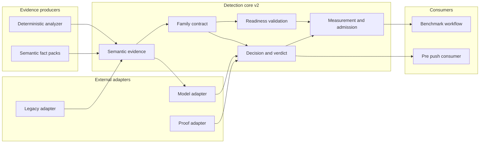
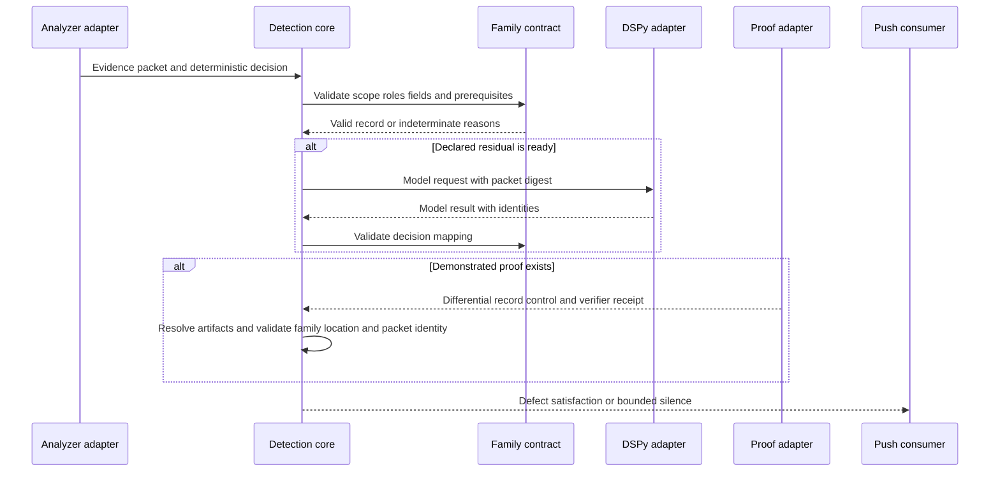
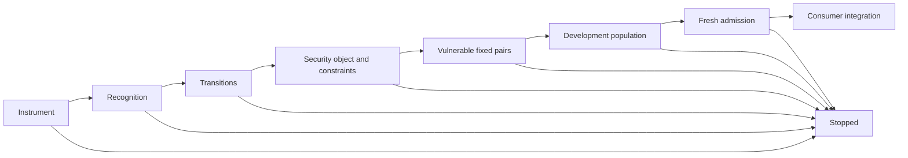
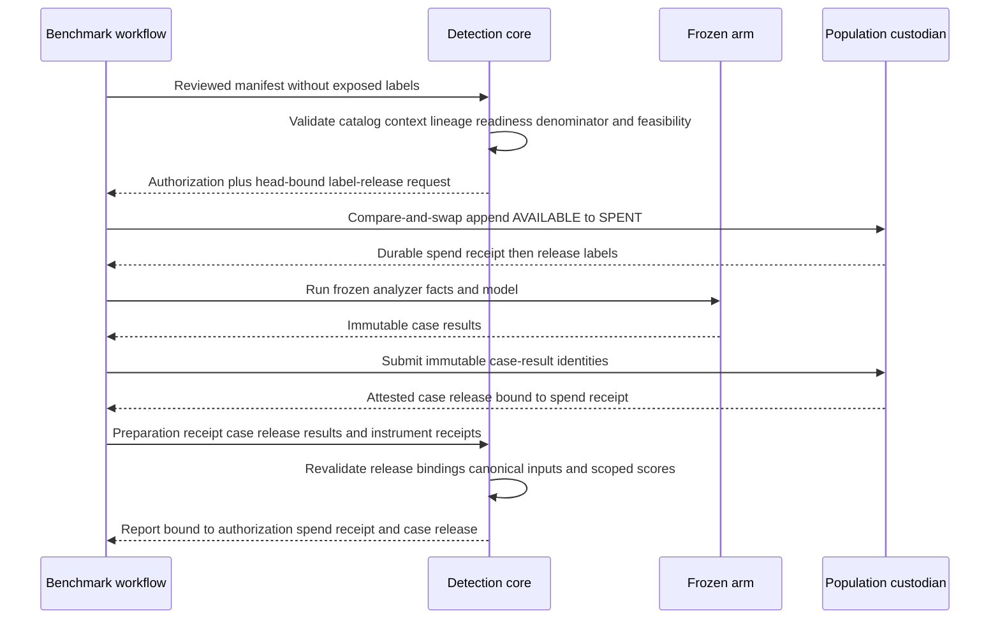

# Design Document: detection-core

## Overview

**Purpose:** detection-core provides the family-neutral, versioned contract between
deterministic program analysis, vulnerability-family reasoning, bounded model programs,
execution proof, measurement, and downstream consumers. It makes semantic incompleteness a
first-class result and stops a family at the earliest failing readiness stage.

**Users:** vulnerability-family implementers produce evidence through adapters; DSPy and
proof adapters consume immutable evidence; benchmark workflows validate readiness and
admission; pre-push and reporting consumers receive supported claims, bounded satisfaction,
and bounded silence.

**Impact:** the current authorization-shaped core becomes a temporary v1 compatibility
surface. A neutral v2 write contract replaces it through a finite adapter migration.
Authorization remains parked and supplies regression evidence only. Historical v1 artifacts
remain readable but are never rewritten or used as a v2 trend baseline.

### Goals

- Define one typed, canonical v2 evidence record whose vocabulary is independent of any
  vulnerability family.
- Let each family declare its security object, semantic roles, decisions, completeness
  rules, and model residuals without changing core code.
- Expose instrument, recognition, transition, constraint, pair, development, admission,
  and integration failures before a later gate can run.
- Restore the deterministic-evidence-to-DSPy loop through a dependency-free model handoff.
- Preserve one execution-backed route to blocking without moving proof execution or rollout
  policy into the core.
- End migration with one live write contract and two unlike reference-family conformance
  suites.

### Non-Goals

- Implementing vulnerability-family algorithms, prompts, examples, or model optimization.
- Expanding framework vocabulary or analyzing vendored dependency source.
- Running DSPy, Joern, benchmark acquisition, proof sandboxes, or pre-push transactions
  inside `openultrasast.core`.
- Reviving or re-admitting the parked authorization arm.
- Enabling any capability for advisory or blocking rollout.
- Providing cross-language canonical signatures; v2 is a Python-runtime contract.

## Boundary Commitments

### This Spec Owns

- The v2 canonical JSON profile and digest rules for core records.
- Typed semantic transitions, observations, completeness, analyzed scope, decisions,
  neutral outcomes, and evidence bases.
- The versioned family contract and validation of declared ecosystems, roles, fields,
  decisions, outcome rules, and residual questions.
- Coverage funnels, instrument refusal, measured-budget records, provenance and label
  lineage, fact-pack validation, readiness prerequisites, admission feasibility/scoring,
  and measurement schemas.
- Dependency-free model request/result contracts and proof-attachment validation.
- Push-consumer interfaces for defect claims, bounded satisfaction, and bounded silence.
- Thin adjacent-owner translation seams that prove those public contracts integrate; they
  receive existing subsystem records and perform no analysis, model, proof, or persistence
  orchestration.
- A finite v1 migration and read-only historical decoder.

### Out of Boundary

- Family analysis and abstract interpretation, including source/sink, dominance,
  sanitization, constraint, or configuration algorithms.
- Target-specific facts, framework strategies, and fact acquisition.
- DSPy execution, prompt construction, caching, optimization, and provider transport.
- Population construction, label custody, readiness-artifact persistence, and run
  orchestration.
- Proof search, sandbox execution, oracle semantics, and demonstration qualification.
- Push scoping policy, alert rendering, capability rollout, and BLOCK enablement.

### Allowed Dependencies

- `openultrasast.core` depends only on Python 3.11 standard-library modules and lower core
  modules identified by the dependency direction below.
- Core may consume immutable, typed records produced by benchmark, analyzer, model, and
  proof adapters; it never imports those packages.
- Core may call an injected read-only `ContentResolver` protocol to verify referenced bytes
  and storage receipts; concrete stores import or implement the protocol and core never
  writes through it.
- Core may read the current complete population-use chain through
  `PopulationCustodyPort`; the benchmark custodian remains the sole append-only writer.
- Authorization, DSPy, search-proof, benchmark, and push adapters may import the public core
  contract.
- Development and admission populations are read-only identities at the core boundary.
- No core module imports `openultrasast.semantic`, `openultrasast.hunt`,
  `openultrasast.search`, `openultrasast.tools`, `benchmarks`, or `dspy`.

### Revalidation Triggers

- Changing the canonical profile, v2 schema, field-kind vocabulary, relation kinds,
  outcomes, or evidence bases revalidates every family adapter and consumer.
- Changing a family contract, fact schema, model program identity, or outcome mapping
  invalidates dependent readiness receipts and starts a new measurement baseline.
- Changing readiness stage order or prerequisite rules revalidates development, admission,
  and integration workflows.
- Changing denominator policy, admission metrics, or threshold semantics requires new
  admission configuration and baseline identity.
- Changing proof-attachment identity rules revalidates search-with-proof and every
  proof-consuming verdict path.
- Adding a non-Python writer or cryptographic wire signature requires a canonicalization
  design review.

## Architecture

### Existing Architecture Analysis

The existing `src/openultrasast/core/` package already contains deterministic serialization,
budget derivation, coverage buckets, digest verification, fact-pack loading, admission
manifest refusal, probes, and consumer records. Its public `TraceRecord` requires entry,
operation, resource, authority, guard, and witness fields, while `Judgment` is exactly
`unguarded`, `discharged`, or `indeterminate`. Tests pin those fields and values.

The authorization producer converts directly from `semantic/obligations/trace.py`, and the
benchmark admission schema scores authorization judgments. A zero-shot DSPy experiment
exists in `benchmarks/valid/judge_pass.py`, but no core model handoff exists; one current
test explicitly prohibits a public model path. Production push and proof paths do not yet
consume the core end to end. The migration therefore preserves reusable mechanisms while
replacing the public domain model.

### Architecture Pattern and Boundary Map

The selected pattern is a **versioned ports-and-adapters contract with a finite compatibility
migration**. Core contracts and pure validators form the domain. External systems implement
adapters and retain execution ownership.



**Dependency direction:**

```text
canonical
  → semantics
  → provenance
  → evidence
  → family, coverage, budget
  → factpack, model
  → validation
  → readiness, verdict, probes
  → measurement
  → admission
  → consumer
```

Each core layer imports only layers to its left. `legacy.py` may import public v2 types to
decode historical input but no v2 module imports `legacy.py`. External adapters import the
public core package and their respective execution subsystem.

**Architecture integration:**

- Existing frozen dataclasses, enums, SHA-256 identities, and canonical JSON patterns are
  retained and strengthened.
- Family-specific complex structure lives in ordered transitions and observations; family
  payload fields remain shallow, closed, and typed.
- Benchmark workflows produce and persist readiness artifacts; core validates their state
  and freshness.
- The model and proof paths derive decisions tied to an unchanged deterministic packet
  digest; neither can rewrite analyzer evidence.
- Historical v1 readers remain validation-only after migration; all new writes use v2.

### Technology Stack

| Layer | Choice and Version | Role | Notes |
|---|---|---|---|
| Core contracts | Python 3.11 or newer, frozen dataclasses, enums, protocols | Typed immutable domain and validation | Standard library only; no unrestricted `Any` in public contracts |
| Serialization | UTF-8 JSON and SHA-256 | Canonical bytes, record IDs, baseline identities | Sorted keys, compact separators, sequence order retained, non-finite numbers refused |
| Adjacent model runtime | Existing optional DSPy `>=3.4,<3.5` | Hunt-owned execution of family-declared residual questions | Never imported by core; results cross `hunt/model_contract.py` |
| Artifact persistence | Existing benchmark JSON artifacts and stores | Persist readiness, development, and admission records | Core defines records but performs no I/O orchestration |
| Tests | pytest 8 or newer | Contract, adapter, migration, and readiness validation | Two unlike test-only reference families |

No new runtime dependency is introduced.

## File Structure Plan

### Directory Structure

```text
src/openultrasast/core/
├── __init__.py              # Public v2 exports only after migration
├── canonical.py             # Canonical bytes, identities, content references and read-only resolver port
├── semantics.py             # Locations, nodes, transitions, observations, completeness
├── evidence.py              # Scope, packet, decision, evidence record, neutral enums
├── family.py                # Family contract, catalog, field and decision validation
├── coverage.py              # Semantic stage funnel, relation buckets, instrument gate
├── budget.py                # Change complexity, workload derivation and elapsed-time gate
├── provenance.py            # Input/decision identities, lineage and population-use receipts
├── factpack.py              # Pack review, structural match validation and fact application
├── model.py                 # Dependency-free model request, identity and result contracts
├── validation.py            # Closed evidence context and full record revalidation seam
├── readiness.py             # Ordered stages, receipts, freshness and promotion rules
├── verdict.py               # Claims, satisfaction, silence, proof attachment and aggregation
├── probes.py                # Reviewed semantic-equivalence probes and fitted-component evidence gates
├── measurement.py           # Complete baseline identity, rates, funnel and report schema v2
├── admission_case.py        # Case results and authenticated post-spend release bindings
├── admission_metrics.py     # Evidence-derived scoped and whole-population metric algebra
├── admission.py             # Census, feasibility, report assembly and fitted-component gate
├── consumer.py              # Scoped push request and verdict consumption
└── legacy.py                # Read-only v1 trace and report decoder and validator

src/openultrasast/semantic/obligations/
└── core_adapter.py          # Authorization trace to neutral v2 evidence

src/openultrasast/hunt/
└── model_contract.py        # Translate injected executor I/O; no DSPy execution ownership

src/openultrasast/search/
└── core_adapter.py          # Demonstrated verification record to ProofAttachment

benchmarks/valid/
├── readiness_contract.py    # Construct and validate receipts; caller owns persistence/sequence
├── development_runner.py    # Produce v2 development observations
├── admission_scoring.py     # Delegate neutral scoring to core admission
├── admission_run.py         # Consume v2 manifest and readiness prerequisites
├── run_manifests.py         # Supply expanded v2 identities and lineage
└── population_custody.py    # Sole append-only writer for core-built use/spend receipts

tests/fixtures/detection_core/
├── obligation_family.json   # Test-only control and constraint family contract
├── taint_family.json        # Test-only flow and sanitization family contract
├── obligation_cases.json    # Positive, negative and missing-evidence triplet
└── taint_cases.json         # Positive, negative and missing-evidence triplet

tests/
├── test_core_canonical.py
├── test_core_evidence.py
├── test_core_family.py
├── test_core_coverage.py
├── test_core_budget.py
├── test_core_readiness.py
├── test_core_model.py
├── test_core_validation.py
├── test_core_verdict.py
├── test_core_probes.py
├── test_core_factpack.py
├── test_core_provenance.py
├── test_core_measurement.py
├── test_core_admission.py
├── test_core_consumer.py
└── test_core_migration.py
```

Files below `hunt/`, `search/`, `semantic/`, and `benchmarks/` are adjacent-owner
conformance edits, not ownership transfers. `model_contract.py` translates an already
executed provider result and never selects or runs DSPy. `readiness_contract.py` constructs
and validates canonical records while the benchmark workflow remains the sole owner of
sequencing and persistence. The search and semantic adapters translate typed records but do
not execute proof or family analysis.

### Modified and Removed Files

- `src/openultrasast/core/trace.py` — temporary v1 import shim during migration; removed
  after repository import census reaches zero. Historical decoding moves to `legacy.py`.
- `src/openultrasast/semantic/obligations/trace.py` — removes imports and conversion logic
  for core types; remains the authorization-family trace domain.
- `src/openultrasast/hunt/prover.py` — sends authorization results through
  `semantic/obligations/core_adapter.py`; it does not define neutral core types.
- `src/openultrasast/mapping/entry_packs.py` — consumes versioned typed packs and supplies
  structural match evidence.
- `src/openultrasast/ruleset/entries/express.json` — migrates metadata and fact rows to the
  v2 pack schema without changing target behavior.
- Existing `tests/test_core_*.py` files — authorization assumptions move to adapter or
  legacy tests; neutral tests use the two reference contracts.
- `tests/test_core_contract.py` — replaces the assertion that no model path exists with the
  assertion that core has no DSPy import and only exposes dependency-free model contracts.

Every new module remains within the project cap of 400 logical lines; functions remain at
or below 50 logical lines and cyclomatic complexity 10.

## System Flows

### Deterministic Evidence, Model Residual, and Proof



The deterministic packet is immutable. A model result creates a new decision referencing
the packet digest. A proof attachment may independently establish execution-backed basis
for a matching violation; it does not mark missing static relations complete.

### Readiness Promotion



Every forward edge requires a current `passed` receipt. A failed, absent, or digest-stale
predecessor routes to `Stopped` with the failing layer and correction lever. Historical
receipts are immutable; staleness is derived against current input identities.

### Admission Sequence



Core never creates, edits, labels, or persists the admission population. The benchmark
custodian performs durable append and label release as one guarded operation: a crash before
the append releases no labels, while a crash after it leaves the population spent. Concurrent
attempts race on the same custody head, and only the compare-and-swap winner receives label
bytes. The case release is constructed only after that spend. It discloses the per-case
role and pair mapping that the aggregate census deliberately withholds, and it binds those
labels to the exact immutable case-result and evidence/input identities submitted for
scoring.

## Requirements Traceability

| Requirement Criteria | Summary | Components and Interfaces | Flows |
|---|---|---|---|
| 1.1, 1.2, 1.3, 1.4 | Canonical family-neutral evidence | Canonical Codec, Semantic Evidence, Evidence Aggregate, Family Contract | Deterministic evidence flow |
| 2.1, 2.2, 2.3, 2.4, 2.5 | Neutral outcome, bounded scope and basis | Evidence Aggregate, Family Contract, Verdict | Evidence and decision validation |
| 3.1, 3.2, 3.3, 3.4, 3.5 | Family conformance and unlike reference shapes | Family Contract, Family Catalog, reference fixtures | Family registration and conformance |
| 4.1, 4.2, 4.3, 4.4 | Typed external semantic relations | Semantic Evidence, Fact Pack | Analyzer and pack ingestion |
| 5.1, 5.2, 5.3, 5.4, 5.5 | Stage and instrument coverage | Coverage Funnel, Canonical evidence receipts | Readiness promotion |
| 6.1, 6.2, 6.3, 6.4 | Measured budget and immutable change scope | Budget, Analyzed Scope, Consumer | Push consumption |
| 7.1, 7.2, 7.3, 7.4 | Defect, satisfaction and bounded silence | Verdict, Evidence Aggregate, Consumer | Decision aggregation |
| 8.1, 8.2, 8.3, 8.4, 8.5, 8.6 | Ordered readiness, fixtures and staleness | Readiness Validator, benchmark readiness contract | Readiness promotion |
| 9.1, 9.2, 9.3, 9.4, 9.5, 9.6 | Bounded model and proof roles | Model Handoff, Family Contract, Verdict, Proof Attachment | Model residual and proof flow |
| 10.1, 10.2, 10.3, 10.4 | Complete reproducibility identities | Provenance and Lineage, Fact Pack, Model Handoff | All record flows |
| 11.1, 11.2, 11.3, 11.4, 11.5, 11.6 | Reviewed semantic packs and supported scope | Fact Pack, Semantic Evidence, Measurement | Pack ingestion and reports |
| 12.1, 12.2, 12.3, 12.4, 12.5, 12.6 | Admission prerequisites, authenticated case release and scoped scoring | Admission, Readiness, Measurement | Admission sequence |
| 13.1, 13.2, 13.3, 13.4 | Development and evaluation separation | Provenance and Lineage, Probes, Admission | Freeze and admission validation |
| 14.1, 14.2, 14.3, 14.4, 14.5 | Shared consumer and family-spec contract | Consumer, Verdict, Family Capability Declaration, Legacy Adapter | Push and migration flows |
| 15.1, 15.2, 15.3, 15.4, 15.5 | Fixed versioned measurement and baseline rules | Measurement, Coverage, Readiness | Development and admission reporting |

## Components and Interfaces

| Component | Domain | Intent | Requirement Coverage | Key Dependencies | Contracts |
|---|---|---|---|---|---|
| Canonical Codec | Primitive | Produce deterministic bytes and identities | 1.4, 10.4 | Standard library | Service |
| Semantic Evidence | Evidence | Represent typed relations and observations | 1.2, 4.1–4.4, 5.2–5.3 | Canonical Codec | State |
| Evidence Aggregate | Evidence | Bind scope, deterministic packet and decision | 1.1–1.4, 2.1–2.5, 10.1 | Semantic Evidence, Provenance | State, Service |
| Family Contract and Catalog | Family | Declare, catalog, resolve, and validate family semantics | 1.3, 2.1–2.4, 3.1–3.5, 9.1, 14.5 | Evidence Aggregate | State, Service |
| Coverage Funnel | Operations | Account for every semantic stage and input | 5.1–5.5 | Semantic Evidence | State, Service |
| Budget and Scope | Operations | Validate changed scope and measured deadline | 6.1–6.4 | Evidence Aggregate | State, Service |
| Provenance and Lineage | Governance | Bind all inputs and label ancestry | 10.1–10.4, 13.1, 13.3–13.4 | Canonical Codec | State, Service |
| Fact Pack | Extension | Validate reviewed semantic knowledge | 4.1–4.4, 11.1–11.6 | Family Contract, Provenance | State, Service |
| Model Handoff | Extension | Validate dependency-free model requests/results | 9.1–9.5, 10.3, 13.1 | Evidence, Family, Provenance | Service, State |
| Evidence Validation | Composition | Revalidate provenance, family, facts, and model derivation before use | 4.4, 10.1–10.4, 12.6, 14.1 | Family, Fact Pack, Model, Provenance | Service, State |
| Readiness Validator | Governance | Gate ordered stage promotion and freshness | 8.1–8.6, 12.1, 15.5 | Coverage, Provenance | Service, State |
| Verdict and Proof | Decision | Produce bounded outputs and attach proof | 7.1–7.4, 9.4, 9.6, 14.2, 14.4 | Evidence, Model | Service, State |
| Probes | Governance | Test semantic shortcut resistance | 13.2 | Evidence, Family, Fact Pack review policy | Service |
| Measurement | Evaluation | Create baseline identity and fixed report schema | 11.6, 15.1–15.5 | Coverage, Readiness | Service, State |
| Admission | Evaluation | Validate manifests, feasibility, post-spend case release and scoped scores | 12.1–12.6, 13.4 | Readiness, Measurement, Evidence Validation, Verdict, Probes, Budget, Provenance | Service, Batch |
| Consumer | Edge | Validate push requests and return bounded verdicts | 6.4, 14.1–14.5 | Budget, Evidence Validation, Verdict, Provenance, Canonical resolver | Service |
| Legacy Decoder | Migration | Read and validate historical v1 only | 14.3, 15.3 | Canonical Codec, Evidence | Service |
| External Adapters | Integration | Translate authorization, DSPy and proof records | 3.5, 9.1–9.6, 14.2–14.3 | Public core | Service |

### Evidence Domain

#### Canonical Codec and Semantic Evidence

| Field | Detail |
|---|---|
| Intent | Define the only v2 serialization profile and family-neutral semantic vocabulary |
| Requirements | 1.2, 1.4, 4.1, 4.2, 4.3, 4.4, 5.2, 10.4 |

**Responsibilities and constraints**

- Accept only JSON-compatible scalar values, tuples, and string-keyed mappings.
- Refuse non-finite numbers, unknown enums, duplicate logical identities, and unsupported
  values before hashing.
- Sort mapping keys, preserve tuple order, use compact separators, and include schema
  version in every digestible aggregate.
- Give every relation and observation a stable identity, role, source location,
  completeness, provenance, and optional semantic fact identity.
- Represent registration, invocation, call, return, value transformation, operation effect,
  and constraint effect as a closed `RelationKind`.

**Contracts:** Service, State.

```python
JsonScalar = str | int | float | bool | None
JsonValue = JsonScalar | tuple["JsonValue", ...] | Mapping[str, "JsonValue"]

def canonical_bytes(value: JsonValue) -> bytes: ...
def content_digest(value: JsonValue) -> str: ...

class FieldKind(Enum):
    TEXT = "text"
    INTEGER = "integer"
    NUMBER = "number"
    BOOLEAN = "boolean"
    TEXT_TUPLE = "text_tuple"
    SOURCE_LOCATION = "source_location"

@dataclass(frozen=True)
class FieldValue:
    name: str
    kind: FieldKind
    value: JsonValue

@dataclass(frozen=True)
class ContentRef:
    artifact_id: str
    content_digest: str
    media_type: str
    byte_length: int
    retention_policy_digest: str
    storage_receipt_digest: str

@dataclass(frozen=True)
class StorageReceipt:
    store_identity: str
    content_digest: str
    byte_length: int
    retention_policy_digest: str
    receipt_digest: str

@dataclass(frozen=True)
class ResolvedContent:
    content: bytes
    receipt: StorageReceipt

class ContentResolver(Protocol):
    def resolve(self, reference: ContentRef) -> ResolvedContent: ...

@dataclass(frozen=True)
class SourceLocation:
    path: str
    line: int
    column: int | None
    symbol: str | None

@dataclass(frozen=True)
class SemanticNode:
    node_id: str
    role: str
    location: SourceLocation

class RelationKind(Enum):
    REGISTRATION = "registration"
    INVOCATION = "invocation"
    CALL = "call"
    RETURN = "return"
    VALUE_TRANSFORMATION = "value_transformation"
    OPERATION_EFFECT = "operation_effect"
    CONSTRAINT_EFFECT = "constraint_effect"

class RelationStatus(Enum):
    COMPLETE = "complete"
    INCOMPLETE = "incomplete"
    UNRESOLVED = "unresolved"

class ProvenanceKind(Enum):
    PRODUCT_CODE = "product_code"
    SEMANTIC_FACT = "semantic_fact"

@dataclass(frozen=True)
class EvidenceProvenance:
    kind: ProvenanceKind
    source_content_digest: str
    semantic_pack_digest: str | None
    semantic_fact_id: str | None
    fact_match: ContentRef | None

@dataclass(frozen=True)
class SemanticRelation:
    relation_id: str
    kind: RelationKind
    role: str
    source: SemanticNode
    target: SemanticNode
    location: SourceLocation
    status: RelationStatus
    conditions: tuple[str, ...]
    reasons: tuple[str, ...]
    provenance: EvidenceProvenance

@dataclass(frozen=True)
class Observation:
    observation_id: str
    role: str
    location: SourceLocation
    fields: tuple[FieldValue, ...]
    status: RelationStatus
    provenance: EvidenceProvenance
```

An unmet declared condition yields `INCOMPLETE`; conflicting complete candidates yield an
`UNRESOLVED` ambiguity relation. Neither path silently selects a winner. Semantic-fact
provenance requires the exact pack digest, stable fact ID, and resolved match reference.
Product-code provenance forbids all three fields, preventing an unattributed relation from
changing origin later.

#### Evidence Aggregate

| Field | Detail |
|---|---|
| Intent | Keep deterministic evidence immutable while decisions derive from its digest |
| Requirements | 1.1–1.4, 2.1–2.5, 6.4, 7.4, 10.1–10.4 |

**Responsibilities and constraints**

- `EvidencePacket` owns the analyzer-produced data and never contains model text or proof
  execution output.
- `Decision` owns the family decision, neutral outcome, evidence basis, bounded scope, and
  named indeterminate reasons. Its separate `DecisionProvenance` owns any model-result or
  proof-record identity; derived decisions never add those identities to the packet.
- `EvidenceRecord` binds one decision to one packet digest. Derivation creates a new record;
  it does not mutate the packet.
- `SATISFIED` requires an explicit bounded scope and complete family-required relations.
- `INDETERMINATE` requires at least one named reason.
- Deterministic basis forbids model/proof references; model-corroborated basis requires the
  complete model call and result identities; execution-backed basis requires the proof
  record and reviewed producer identities. Core validates these as a closed union.

**Contracts:** Service, State.

```python
class NeutralOutcome(Enum):
    VIOLATION = "violation"
    SATISFIED = "satisfied"
    INDETERMINATE = "indeterminate"

class EvidenceBasis(Enum):
    DETERMINISTIC = "deterministic"
    MODEL_CORROBORATED = "model_corroborated"
    EXECUTION_BACKED = "execution_backed"

@dataclass(frozen=True)
class EvidencePacket:
    schema_version: str
    family_id: str
    family_contract_digest: str
    security_object_id: str
    ecosystem: str
    scope: AnalyzedScope
    transitions: tuple[SemanticRelation, ...]
    observations: tuple[Observation, ...]
    family_fields: tuple[FieldValue, ...]
    completeness_reasons: tuple[str, ...]
    provenance: ProvenanceStamp

@dataclass(frozen=True)
class Decision:
    family_code: str
    outcome: NeutralOutcome
    basis: EvidenceBasis
    bounded_scope: AnalyzedScope
    reasons: tuple[str, ...]
    packet_digest: str
    provenance: DecisionProvenance

@dataclass(frozen=True)
class EvidenceRecord:
    packet: EvidencePacket
    decision: Decision
    record_id: str
```

### Family Domain

#### Family Contract and Catalog

| Field | Detail |
|---|---|
| Intent | Declare family semantics as immutable data and validate records without importing family algorithms |
| Requirements | 1.3, 2.1–2.4, 3.1–3.5, 7.2, 9.1, 14.5 |

**Responsibilities and constraints**

- Declare family and schema versions, ecosystems, security-object kind and fields,
  observation roles and fields, decisions, neutral mappings, required roles and relation
  statuses, named indeterminate reasons, and residual questions.
- Use a closed `FieldKind` vocabulary for text, integer, finite number, boolean, text tuple,
  and source location values.
- Keep `FamilyCatalog` immutable; constructing it re-derives every contract digest, requires
  canonical order, and refuses duplicate family/version/schema identities or digests.
- Refuse unsupported ecosystems, unknown roles/fields/decisions, undeclared reasons, and
  determinate outcomes whose required evidence is incomplete.
- Declare, per role, whether product-code relations are sufficient or excluded-dependency
  behavior requires a reviewed semantic fact. A missing reviewed dependency relation is
  incomplete evidence, never an implicit product-code relation.
- Validate test-only obligation and taint-flow contracts with the same code used by real
  family adapters.

**Contracts:** Service, State.

```python
@dataclass(frozen=True)
class FieldSpec:
    name: str
    kind: FieldKind
    required: bool

@dataclass(frozen=True)
class ObjectSpec:
    kind: str
    fields: tuple[FieldSpec, ...]
    identity_fields: tuple[str, ...]

class RelationOriginPolicy(Enum):
    PRODUCT_OR_REVIEWED_FACT = "product_or_reviewed_fact"
    EXCLUDED_DEPENDENCY_FACT_ONLY = "excluded_dependency_fact_only"

@dataclass(frozen=True)
class RoleSpec:
    role: str
    fields: tuple[FieldSpec, ...]
    allowed_relation_kinds: tuple[RelationKind, ...]
    origin_policy: RelationOriginPolicy

@dataclass(frozen=True)
class DecisionRule:
    family_code: str
    outcome: NeutralOutcome
    required_roles: tuple[str, ...]
    allowed_statuses: tuple[RelationStatus, ...]

@dataclass(frozen=True)
class ResidualQuestion:
    question_id: str
    required_roles: tuple[str, ...]
    allowed_decisions: tuple[str, ...]

@dataclass(frozen=True)
class FamilyContract:
    family_id: str
    family_version: str
    schema_version: str
    ecosystems: tuple[str, ...]
    security_object: ObjectSpec
    roles: tuple[RoleSpec, ...]
    decisions: tuple[DecisionRule, ...]
    residual_questions: tuple[ResidualQuestion, ...]
    indeterminate_reasons: tuple[str, ...]

@dataclass(frozen=True)
class FamilyCatalogEntry:
    contract: FamilyContract
    contract_digest: str

@dataclass(frozen=True)
class FamilyCatalog:
    entries: tuple[FamilyCatalogEntry, ...]
    catalog_digest: str

@dataclass(frozen=True)
class FamilyCapabilityDeclaration:
    arm_id: str
    family_contract_digest: str
    readiness_fixture_digest: str
    development_population_digest: str
    admission_boundary_digest: str

def validate_catalog(catalog: FamilyCatalog) -> None: ...
def resolve_contract(
    catalog: FamilyCatalog,
    family_id: str,
    contract_digest: str,
    ecosystem: str,
) -> FamilyContract: ...
def validate_record(contract: FamilyContract, record: EvidenceRecord) -> None: ...
def validate_capability(
    declaration: FamilyCapabilityDeclaration,
    catalog: FamilyCatalog,
) -> None: ...
```

`FamilyCapabilityDeclaration` references the family contract, readiness-fixture digest,
development boundary, and admission boundary. It is a machine-validated artifact for family
specs; the core does not parse Markdown specifications.

`resolve_contract` requires exactly one catalog entry matching family, digest, and ecosystem;
it never falls back to a different version. For a role declared
`EXCLUDED_DEPENDENCY_FACT_ONLY`, `validate_record` refuses a `COMPLETE` product-code
relation. The relation can become complete only through `SEMANTIC_FACT` provenance whose
pack, fact, and structural match are revalidated. If that knowledge is absent, the adapter
records `INCOMPLETE` with `missing_reviewed_dependency_relation`; a determinate rule that
requires the role is refused. This is the explicit vendored-source boundary required by
criterion 4.4.

### Extension Contracts

#### Model Handoff

| Field | Detail |
|---|---|
| Intent | Make the evidence-to-DSPy seam reproducible without importing DSPy into core |
| Requirements | 9.1–9.6, 10.3, 13.1 |

**Responsibilities and constraints**

- Build requests only for residual questions declared by the matching family contract.
- Present the canonical evidence record, family contract, residual-question definition,
  and per-role completeness snapshot in the request. Their redundant digests are validated
  before dispatch so an adapter cannot substitute content behind an identity.
- Require provider, model, program, prompt, configuration, and adapter identities on every
  result, including failures.
- Freeze those identities, the decision mapping, optional examples/fitted component, and
  their actual lineage manifest in a pre-execution `ModelProgramDeclaration`; a digest-only
  lineage assertion is not sufficient.
- Reject a result for a different packet, family, question, or decision mapping.
- Reject the same program identity as proposer and adjudicator on one claim path.
- Preserve the normalized response plus either redacted inline response bytes or a
  content-addressed immutable response artifact. Preserve model failure as coverage and
  measurement evidence; never convert it to satisfaction or silence without a reason.
- Permit model-corroborated outcomes only when every prerequisite of the residual question
  is complete. Model output can never set `EXECUTION_BACKED`.

**Contracts:** Service, State.

```python
class ModelStatus(Enum):
    SUCCEEDED = "succeeded"
    FAILED = "failed"

@dataclass(frozen=True)
class CompletenessItem:
    role: str
    status: RelationStatus
    reasons: tuple[str, ...]

@dataclass(frozen=True)
class ModelProgramDeclaration:
    family_contract_digest: str
    provider: str
    model: str
    program_digest: str
    prompt_digest: str
    example_set_digest: str | None
    fitted_component_digest: str | None
    configuration_digest: str
    adapter_revision: str
    decision_mapping_digest: str
    input_bundle_digest: str
    lineage_manifest_digest: str
    declaration_digest: str

@dataclass(frozen=True)
class ModelRequest:
    request_id: str
    record: EvidenceRecord
    contract: FamilyContract
    residual_question: ResidualQuestion
    completeness: tuple[CompletenessItem, ...]
    packet_digest: str
    family_contract_digest: str
    residual_question_id: str
    completeness_digest: str
    program: ModelProgramDeclaration
    lineage: LineageManifest
    custody_policy_digest: str
    proposal_program_digests: tuple[str, ...]
    trusted_response_store_identities: tuple[str, ...]
    maximum_response_bytes: int

@dataclass(frozen=True)
class PreservedModelResponse:
    schema_version: str
    normalized_fields: tuple[FieldValue, ...]
    inline_redacted_text: str | None
    artifact: ContentRef | None
    content_digest: str
    redaction_policy_digest: str

@dataclass(frozen=True)
class ModelResult:
    request_digest: str
    packet_digest: str
    identity: ModelCallIdentity
    status: ModelStatus
    response: PreservedModelResponse | None
    family_decision: str | None
    decision_mapping_digest: str | None
    failure_reason: str | None
    result_digest: str

def apply_model_result(
    record: EvidenceRecord,
    contract: FamilyContract,
    request: ModelRequest,
    result: ModelResult,
    resolver: ContentResolver,
    custody: PopulationCustodyPort,
    custody_policy: PopulationCustodyPolicy,
) -> EvidenceRecord: ...
```

`PreservedModelResponse` requires exactly one of `inline_redacted_text` or `artifact`. The
core re-derives the inline digest; for an artifact it requires `content_digest` to equal the
reference digest and validates the storage-receipt, trusted-store, byte-limit, and
retention-policy identities declared by the request. A
`ContentRef` names an opaque artifact ID, media type, byte length, retention-policy digest,
storage-receipt digest, and full SHA-256 digest; the adapter or benchmark store owns and
verifies the bytes. The normalized fields used for the decision are always inline and
canonical. This retains the response used for adjudication without making
provider transport data or credentials part of the core. A successful result requires the
response, family decision, and mapping digest; a failed result requires a named failure and
may omit response fields only when no response was received.

Before accepting either outcome, `apply_model_result` re-derives the program declaration,
input-bundle, request, and lineage digests; requires the declared custody policy; and calls
`validate_lineage` against the record population and the current complete custody chains.
The caller-specific check maps `PROMPT`, `EXAMPLE`, `FITTED_MODEL`, and
`DECISION_MAPPING` uses to required `LineageExpectation` values for the corresponding
non-null declared artifact digests, with `input_bundle_digest` as the manifest subject.
Every use must
match the purpose, source population, influenced-artifact digest, and receipt embedded in
the current chain. Omitted history, an old prefix, or use of the evaluated admission
population's labels is refused. Result provider/model/program/prompt/configuration/adapter
and decision-mapping identities must equal the frozen declaration. The derived
`DecisionProvenance` retains both the declaration and validated lineage-manifest digests.

The adjacent hunt subsystem owns prompt text, DSPy signatures, execution, caching, storage,
and policy-driven redaction. `model_contract.py` only maps its structured input/output to
the core records. Core validation treats the result as untrusted input and checks the
response, decision-mapping, request, and packet identities.
`apply_model_result` returns a new decision whose `DecisionProvenance` contains the complete
`ModelCallIdentity` and result digest; the deterministic packet remains byte-identical.

#### Fact Pack

The v2 `FactPack` carries schema version, family-contract digest, family, ecosystem,
language scope, stable fact IDs, declared roles, structural requirements, relation effects,
normalized content digest, and review identity. A match becomes a complete semantic
relation only when the adapter supplies every required structural match item. A bare name
match can at most produce incomplete evidence. Pack insufficiency preserves partial records
and named unresolved reasons.

```python
class KnowledgeEvidenceKind(Enum):
    SOURCE_CODE = "source_code"
    OFFICIAL_DOCUMENTATION = "official_documentation"
    INDEPENDENT_BEHAVIOR = "independent_behavior"

@dataclass(frozen=True)
class IndependenceAttestation:
    subject_digest: str
    producer_identity: str
    reviewer_identity: str
    conflict_disclosure: ContentRef
    attestation_digest: str

@dataclass(frozen=True)
class ReviewIndependencePolicy:
    reviewed_reviewer_digests: tuple[str, ...]
    forbidden_identity_pairs: tuple[tuple[str, str], ...]
    trusted_store_identities: tuple[str, ...]
    maximum_evidence_bytes: int
    policy_digest: str

@dataclass(frozen=True)
class KnowledgeEvidence:
    kind: KnowledgeEvidenceKind
    content: ContentRef
    producer_identity: str
    reviewer_identity: str
    independence: IndependenceAttestation
    lineage_manifest_digest: str

class StructuralRequirementKind(Enum):
    QUALIFIED_NAME = "qualified_name"
    AST_SHAPE = "ast_shape"
    RECEIVER_TYPE = "receiver_type"
    CALL_TARGET = "call_target"
    ARGUMENT_SHAPE = "argument_shape"
    CONFIGURATION = "configuration"

@dataclass(frozen=True)
class StructuralRequirement:
    requirement_id: str
    kind: StructuralRequirementKind
    field: str
    expected: JsonValue

@dataclass(frozen=True)
class RelationEffect:
    kind: RelationKind
    role: str
    source_role: str
    target_role: str
    conditions: tuple[str, ...]

@dataclass(frozen=True)
class StructuralObservation:
    requirement_id: str
    location: SourceLocation
    observed: JsonValue
    evidence: ContentRef

@dataclass(frozen=True)
class FactMatchEvidence:
    pack_digest: str
    fact_id: str
    product_location: SourceLocation
    observations: tuple[StructuralObservation, ...]
    matcher_revision: str
    matcher_behavior_digest: str
    matcher_lineage_manifest_digest: str
    match_digest: str

@dataclass(frozen=True)
class SemanticFact:
    fact_id: str
    role: str
    structural_requirements: tuple[StructuralRequirement, ...]
    relation_effects: tuple[RelationEffect, ...]

@dataclass(frozen=True)
class FactPack:
    schema_version: str
    family_contract_digest: str
    family_id: str
    ecosystem: str
    language: str
    facts: tuple[SemanticFact, ...]
    normalized_content_digest: str
    review_identity: str
    review_evidence: tuple[KnowledgeEvidence, ...]
    review_evidence_digest: str
    review_policy_digest: str

def validate_fact_pack(
    pack: FactPack,
    contract: FamilyContract,
    protected_population_digest: str | None,
    lineages: Sequence[LineageManifest],
    custody: PopulationCustodyPort,
    custody_policy: PopulationCustodyPolicy,
    review_policy: ReviewIndependencePolicy,
    resolver: ContentResolver,
) -> None: ...

def apply_fact(
    pack: FactPack,
    fact_id: str,
    match: FactMatchEvidence,
    match_reference: ContentRef,
    contract: FamilyContract,
    evaluation_population_digest: str,
    lineages: Sequence[LineageManifest],
    custody: PopulationCustodyPort,
    custody_policy: PopulationCustodyPolicy,
    review_policy: ReviewIndependencePolicy,
    resolver: ContentResolver,
) -> tuple[SemanticRelation, ...]: ...

def validate_fact_relations(
    record: EvidenceRecord,
    packs: Sequence[FactPack],
    lineages: Sequence[LineageManifest],
    custody: PopulationCustodyPort,
    custody_policy: PopulationCustodyPolicy,
    review_policy: ReviewIndependencePolicy,
    resolver: ContentResolver,
) -> None: ...
```

The normalized digest covers schema, scope, roles, every structural predicate, every
effect, and the review evidence. Validation refuses unknown fields and roles, duplicate
fact IDs, scope mismatch, missing review evidence, and a digest that cannot be re-derived.
Each knowledge item must be source code, official documentation, or independently reviewed
behavioral evidence and must reference a label-isolated lineage manifest. For behavioral
evidence, producer and reviewer must differ, the reviewer must be admitted by the
`ReviewIndependencePolicy`, the attestation subject must equal the content digest, and the
conflict disclosure must resolve and hash correctly. Vulnerability, fix-location, or
ordinary-change label ancestry spends the population and refuses the pack.
`validate_fact_pack` resolves every referenced manifest from the supplied lineage set,
requires its subject to equal `normalized_content_digest`, declares a required
`SEMANTIC_FACT` expectation and an optional `PROMOTION` expectation for that same digest,
sets `forbid_label_access=True`, and validates its uses against current custody chains.

`apply_fact` is the only route from a semantic fact to fact-derived relations. It resolves
and validates the pack with the supplied review policy and evaluation-population boundary,
then resolves each structural observation. It requires the observation IDs to equal the fact's complete
requirement-ID set, checks values against the typed predicates, and constructs relations
whose provenance contains the pack/fact identities and resolved match reference. Missing or failed predicates
produce incomplete evidence; duplicates, fabricated IDs, or ambiguity produce unresolved
evidence. A name observation cannot yield `COMPLETE` while any non-name structural
requirement is absent. The match reference must resolve to canonical bytes whose digest is
`match_digest`; record validation re-runs this join from the named pack and match.
The match digest covers the matcher revision, behavior digest, and lineage-manifest digest.
`apply_fact` and `validate_fact_relations` resolve that manifest, require subject equality
with `matcher_behavior_digest`, supply a required `MATCHING_BEHAVIOR` expectation for that
digest, and validate every receipt against the current custody chain while protecting the
record's evaluation population. Matching behavior influenced by the admission
population's labels therefore spends that population and cannot complete a relation in the
same admission run.

#### Evidence Validation Composition

| Field | Detail |
|---|---|
| Intent | Give admission and every consumer one non-bypassable composition seam for provenance, family, fact, and model validation |
| Requirements | 4.4, 10.1–10.4, 12.6, 14.1, 14.3 |

`validation.py` is later than both `factpack.py` and `model.py`; it composes their pure
validators without moving family reasoning into core. Raw `EvidenceRecord` values are data,
not proof that validation already occurred. Public scoring and consumption APIs accept the
input envelope and context below and call `validate_evidence_input` before deriving a claim,
satisfaction, silence, metric, or gate.

```python
@dataclass(frozen=True)
class EvidenceValidationContext:
    family_catalog: FamilyCatalog
    fact_packs: tuple[FactPack, ...]
    model_programs: tuple[ModelProgramDeclaration, ...]
    lineages: tuple[LineageManifest, ...]
    fact_review_policy: ReviewIndependencePolicy
    provenance_trust_policy: ProvenanceTrustPolicy
    custody_policy: PopulationCustodyPolicy
    context_digest: str

@dataclass(frozen=True)
class EvidenceValidationInput:
    record: EvidenceRecord
    named_inputs: NamedInputs
    model_request: ModelRequest | None
    model_result: ModelResult | None
    input_digest: str

def validate_evidence_input(
    value: EvidenceValidationInput,
    context: EvidenceValidationContext,
    custody: PopulationCustodyPort,
    resolver: ContentResolver,
) -> EvidenceRecord: ...
```

Validation re-derives the input/context/catalog/pack/model/lineage digests, resolves exactly
one contract, validates the seven named provenance inputs, calls `validate_record`, and
replays every fact relation through `validate_fact_relations`. A deterministic record must
omit model request/result values and model provenance. A model-corroborated record must
carry both; its declaration must be an exact context member, `apply_model_result` is rerun
from `model_request.record`, and the derived record must equal `value.record` canonically.
Execution-backed basis is added only later by the proof validator from an already validated
base record. No constructible “validated” marker is accepted as a shortcut.

### Governance and Evaluation

#### Changed Scope and Measured Budget

| Field | Detail |
|---|---|
| Intent | Bind every record to the push change and derive its deadline from disclosed measurements |
| Requirements | 6.1, 6.2, 6.3, 6.4, 14.1 |

**Responsibilities and constraints**

- The push runner supplies immutable base/head revisions and normalized changed regions;
  the core validates containment but does not discover repository scope.
- Complexity records the change identity, region count, transition count, and changed byte
  count alongside total reply time for every sample.
- A budget is derived from a nonempty measured workload class and carries sample count,
  percentile, reference workload, reference hardware, derived duration, and derivation
  digest. There is no default or static fallback budget.
- The elapsed-time gate covers preparation, deterministic analysis, optional model and
  proof handling, validation, and reporting. Failure names the change, elapsed duration,
  workload class, and derivation exceeded.

**Contracts:** Service, State.

`SourceRegion`, `AnalyzedScope`, and `validate_scope` are owned by `evidence.py`, because the
evidence packet depends on them. The remaining records and functions in this subsection are
owned by `budget.py`, which imports evidence types and never the reverse.

```python
@dataclass(frozen=True)
class SourceRegion:
    path: str
    start_line: int
    end_line: int

@dataclass(frozen=True)
class AnalyzedScope:
    base_revision: str
    head_revision: str
    change_digest: str
    regions: tuple[SourceRegion, ...]

@dataclass(frozen=True)
class ChangeComplexity:
    change_id: str
    workload_class: str
    changed_regions: int
    transition_count: int
    changed_bytes: int
    measurement: ContentRef

@dataclass(frozen=True)
class MeasuredSample:
    complexity: ChangeComplexity
    total_reply_ms: int

@dataclass(frozen=True)
class ReferenceWorkload:
    name: str
    description: str
    changed_region_range: tuple[int, int]
    transition_count_range: tuple[int, int]
    changed_bytes_range: tuple[int, int]
    sample_artifact: ContentRef
    record_digest: str

@dataclass(frozen=True)
class ReferenceHardware:
    cpu_model: str
    logical_cpu_count: int
    memory_bytes: int
    operating_system: str
    runtime_version: str
    record_digest: str

@dataclass(frozen=True)
class BudgetDerivation:
    workload_class: str
    sample_count: int
    percentile: float
    reference_workload: ReferenceWorkload
    reference_hardware: ReferenceHardware
    budget_ms: int
    derivation_digest: str

def derive_budget(
    samples: Sequence[MeasuredSample],
    workload_class: str,
    percentile: float,
    reference_workload: ReferenceWorkload,
    reference_hardware: ReferenceHardware,
) -> BudgetDerivation: ...

def validate_scope(packet: EvidencePacket, allowed: AnalyzedScope) -> None: ...
def check_budget(
    change: ChangeComplexity,
    total_reply_ms: int,
    budget: BudgetDerivation,
    resolver: ContentResolver,
) -> None: ...
```

#### Coverage, Provenance, and Readiness

| Field | Detail |
|---|---|
| Intent | Locate the first failing layer and prevent stale or failed evidence from reaching later gates |
| Requirements | 5.1–5.5, 8.1–8.6, 10.1–10.4, 13.1–13.4, 15.5 |

**Responsibilities and constraints**

- Coverage records per-stage input/output counts for reads, questions, sites considered,
  sites recognized, transitions, security objects, constraints, determinate outcomes, and
  findings.
- Every considered relation occupies exactly one complete, incomplete, or unresolved bucket.
- Zero-byte or unreadable tracked input is an `InstrumentFailure` that invalidates the run.
- A zero stage is diagnostic rather than automatically clean or failed; fixture expectations
  identify the first expected stage that produced zero.
- Packet provenance covers analyzer, family contract, fact set, acquisition, configuration,
  population, change, and semantic facts; decision provenance separately covers model and
  proof identities.
- Label lineage names all populations used for prompts, examples, thresholds, facts,
  matching behavior, mappings, and promotion. Core derives a canonical
  `PopulationUseReceipt`; label influence marks the population spent and refuses admission
  use.
- Readiness receipts contain fixture roles, identity snapshots, predecessor digests,
  measurement digest, result, and correction lever. Staleness is derived without changing
  the stored receipt.

**Contracts:** Service, State.

```python
@dataclass(frozen=True)
class ProvenanceStamp:
    analyzer_revision: str
    family_contract_digest: str
    fact_set_digest: str
    acquisition_record_digest: str
    configuration_digest: str
    population_digest: str
    change_input_digest: str

@dataclass(frozen=True)
class ModelCallIdentity:
    provider: str
    model: str
    program_digest: str
    prompt_digest: str
    configuration_digest: str
    adapter_revision: str

@dataclass(frozen=True)
class DecisionProvenance:
    model_identity: ModelCallIdentity | None
    model_result_digest: str | None
    model_declaration_digest: str | None
    proof_record_digest: str | None
    proof_producer_digest: str | None
    lineage_manifest_digest: str | None

class LineagePurpose(Enum):
    PROMPT = "prompt"
    EXAMPLE = "example"
    THRESHOLD = "threshold"
    FITTED_MODEL = "fitted_model"
    SEMANTIC_FACT = "semantic_fact"
    MATCHING_BEHAVIOR = "matching_behavior"
    DECISION_MAPPING = "decision_mapping"
    PROMOTION = "promotion"
    ADMISSION_LABEL_OPEN = "admission_label_open"

@dataclass(frozen=True)
class LineageUse:
    purpose: LineagePurpose
    source_population_digest: str
    labels_accessed: bool
    influenced_artifact_digest: str
    population_use_receipt_digest: str

@dataclass(frozen=True)
class LineageManifest:
    arm_id: str
    subject_digest: str
    uses: tuple[LineageUse, ...]
    manifest_digest: str

@dataclass(frozen=True)
class LineageExpectation:
    purpose: LineagePurpose
    influenced_artifact_digest: str
    minimum_uses: int
    maximum_uses: int | None

class PopulationStatus(Enum):
    AVAILABLE = "available"
    SPENT = "spent"

@dataclass(frozen=True)
class PopulationUseRequest:
    population_digest: str
    arm_id: str
    purpose: LineagePurpose
    labels_accessed: bool
    influenced_artifact_digest: str | None
    expected_log_digest: str

@dataclass(frozen=True)
class PopulationUseReceipt:
    request: PopulationUseRequest
    request_digest: str
    population_digest: str
    custodian_identity: str
    sequence: int
    predecessor_digest: str | None
    prior_status: PopulationStatus
    status: PopulationStatus
    reasons: tuple[str, ...]
    receipt_digest: str

@dataclass(frozen=True)
class PopulationCustodyPolicy:
    reviewed_custodian_digests: tuple[str, ...]
    policy_digest: str

@dataclass(frozen=True)
class PopulationCustodyLog:
    population_digest: str
    custodian_identity: str
    receipts: tuple[PopulationUseReceipt, ...]
    receipt_count: int
    head_receipt_digest: str | None
    status: PopulationStatus
    log_digest: str

class PopulationCustodyPort(Protocol):
    def current_log(self, population_digest: str) -> PopulationCustodyLog: ...

@dataclass(frozen=True)
class LineageDecision:
    allowed: bool
    spent_population_digests: tuple[str, ...]
    reasons: tuple[str, ...]
    decision_digest: str

class ProvenanceInputRole(Enum):
    ANALYZER = "analyzer"
    FAMILY_CONTRACT = "family_contract"
    FACT_SET = "fact_set"
    ACQUISITION = "acquisition"
    CONFIGURATION = "configuration"
    POPULATION = "population"
    CHANGE_INPUT = "change_input"

@dataclass(frozen=True)
class ProvenanceTrustPolicy:
    trusted_store_identities: tuple[str, ...]
    maximum_input_bytes: int
    policy_digest: str

@dataclass(frozen=True)
class NamedInput:
    role: ProvenanceInputRole
    identity: str
    content: ContentRef

@dataclass(frozen=True)
class NamedInputs:
    inputs: tuple[NamedInput, ...]
    manifest_digest: str

def validate_provenance(
    stamp: ProvenanceStamp,
    named_inputs: NamedInputs,
    resolver: ContentResolver,
    trust: ProvenanceTrustPolicy,
) -> None: ...
def record_population_use(
    request: PopulationUseRequest,
    prior: PopulationCustodyLog,
    custodian_identity: str,
    policy: PopulationCustodyPolicy,
) -> PopulationUseReceipt: ...

def validate_lineage(
    lineage: LineageManifest,
    expected_subject_digest: str,
    expectations: tuple[LineageExpectation, ...],
    protected_population_digest: str | None,
    forbid_label_access: bool,
    custody: PopulationCustodyPort,
    policy: PopulationCustodyPolicy,
) -> LineageDecision: ...

@dataclass(frozen=True)
class InputManifest:
    tracked_input_ids: tuple[str, ...]
    manifest_digest: str

@dataclass(frozen=True)
class InputReadReceipt:
    input_id: str
    path: str
    opened: bool
    byte_count: int
    content_digest: str | None

@dataclass(frozen=True)
class RelationStatusCount:
    status: RelationStatus
    count: int

@dataclass(frozen=True)
class ReasonCount:
    reason: str
    count: int

@dataclass(frozen=True)
class CoverageFunnel:
    inputs_read: int
    questions_formed: int
    sites_considered: int
    sites_recognized: int
    transitions_materialized: int
    security_objects_constructed: int
    constraints_evaluated: int
    determinate_outcomes: int
    findings_emitted: int
    relation_status_counts: tuple[RelationStatusCount, ...]
    unresolved_by_reason: tuple[ReasonCount, ...]

class CoverageStage(Enum):
    INPUTS = "inputs"
    QUESTIONS = "questions"
    SITES_CONSIDERED = "sites_considered"
    SITES_RECOGNIZED = "sites_recognized"
    TRANSITIONS = "transitions"
    SECURITY_OBJECTS = "security_objects"
    CONSTRAINTS = "constraints"
    OUTCOMES = "outcomes"
    FINDINGS = "findings"

@dataclass(frozen=True)
class StageExpectation:
    stage: CoverageStage
    expected_nonzero_input: bool
    expected_nonzero_output: bool

@dataclass(frozen=True)
class StageDiagnosis:
    last_verified_nonzero_stage: CoverageStage | None
    first_failed_output_stage: CoverageStage | None
    reasons: tuple[str, ...]

def validate_instrument(manifest: InputManifest, receipts: Sequence[InputReadReceipt]) -> None: ...
def diagnose_first_zero(funnel: CoverageFunnel, expected: Sequence[StageExpectation]) -> StageDiagnosis: ...

class ReadinessStage(Enum):
    INSTRUMENT = "instrument"
    RECOGNITION = "recognition"
    TRANSITIONS = "transitions"
    CONSTRAINTS = "constraints"
    PAIRS = "pairs"
    DEVELOPMENT = "development"
    ADMISSION = "admission"
    INTEGRATION = "integration"

class StageResult(Enum):
    PASSED = "passed"
    FAILED = "failed"

class FixtureRole(Enum):
    POSITIVE = "positive"
    NEGATIVE = "negative"
    AMBIGUITY = "ambiguity"

class ReadinessEvidenceUse(Enum):
    REGRESSION_FIXTURE = "regression_fixture"
    DEVELOPMENT_POPULATION = "development_population"
    REPOSITORY_HOLDOUT = "repository_holdout"
    FRESH_ADMISSION = "fresh_admission"
    CONSUMER_INTEGRATION = "consumer_integration"

@dataclass(frozen=True)
class FixtureResult:
    role: FixtureRole
    fixture_digest: str
    passed: bool
    reasons: tuple[str, ...]

@dataclass(frozen=True)
class AnalysisIdentity:
    core_schema_version: str
    semantic_vocabulary_digest: str
    analyzer_revision: str
    family_contract_digest: str
    fact_set_digest: str
    acquisition_record_digest: str
    configuration_digest: str
    model_program_digest: str | None
    outcome_mapping_digest: str

@dataclass(frozen=True)
class ReadinessResult:
    arm_id: str
    family_id: str
    ecosystem: str
    stage: ReadinessStage
    evidence_use: ReadinessEvidenceUse
    population_digest: str | None
    population_freeze_digest: str | None
    population_use_receipt_digests: tuple[str, ...]
    result: StageResult
    identity: AnalysisIdentity
    predecessor_digests: tuple[str, ...]
    fixture_results: tuple[FixtureResult, ...]
    measurement_digest: str
    correction_lever: str | None
    result_digest: str

@dataclass(frozen=True)
class StageAuthorization:
    target: ReadinessStage
    authorized: bool
    failing_stage: ReadinessStage | None
    reasons: tuple[str, ...]
    correction_lever: str | None

def authorize_stage(
    target: ReadinessStage,
    receipts: Sequence[ReadinessResult],
    current_identity: AnalysisIdentity,
) -> StageAuthorization: ...
```

The benchmark population custodian is the single writer for population-use receipts: it
reads the current log, invokes the pure core constructor with that head, and appends the
returned bytes using compare-and-swap on `expected_log_digest` and `predecessor_digest`.
Core reads the current full
log through `PopulationCustodyPort`, accepts only a reviewed custodian, recomputes every
embedded request and receipt digest, requires contiguous sequence/predecessor links, and
requires the declared head/count/status to equal the derived chain. `SPENT` is monotonic:
no later receipt or manifest can return it to `AVAILABLE`. A caller-selected prefix or an
omitted earlier spend receipt therefore fails current-head validation.

`validate_provenance` requires the closed seven-role input set exactly once, re-derives the
named-input manifest, maps every role to the corresponding `ProvenanceStamp` identity, and
resolves every `ContentRef`. The resolved bytes, digest, length, storage receipt, retention
policy, trusted store, and byte limit must all validate. A stamp cannot therefore be
accepted from identities alone when its named inputs are unreadable.

`validate_lineage` re-derives the manifest and requires the expected subject and typed
`LineageExpectation` values supplied by the caller. Every use must match an expected
purpose and influenced-artifact digest, and each expectation must satisfy its declared
minimum/maximum count. For each use the validator resolves the receipt from the current
complete custody chain and requires exact equality of purpose, source population, label
access, and influenced-artifact digest. `forbid_label_access` rejects any labelled ancestry;
otherwise labelled use is allowed only when its source is not the protected evaluation
population. For prompt, example, threshold, fitted-model,
semantic-fact, matching-behavior, decision-mapping, or promotion use, `labels_accessed`
together with an influenced artifact deterministically yields `SPENT`. A
`MATCHING_BEHAVIOR` use must name the matcher behavior digest. Legitimate one-time
admission label opening uses `ADMISSION_LABEL_OPEN`, is bound to the authorization digest,
and is durably appended before label bytes are released.

Benchmark workflows persist results. The core returns `stale` when any recorded identity or
predecessor digest differs from current inputs, including core schema, semantic vocabulary,
acquisition, or outcome mapping. Instrument through pair receipts use regression fixtures;
development uses a development population; admission requires a separately frozen,
available population and a scored admission report; integration uses consumer evidence.
An evidence-use mismatch cannot satisfy a stage, so preserved regression fixtures can never
stand in for fresh admission.

#### Fitted-component Probes

| Field | Detail |
|---|---|
| Intent | Refuse fitted components that exploit reversible surface shape instead of declared security semantics |
| Requirements | 13.2 |

A reversed-pair probe is valid only when an independent fixture review declares the two
inputs security-semantically equivalent for the family contract while their surface/diff
shape is deliberately reversed. The semantic projection includes the security object,
required roles, relations, completeness, and expected family decision; it excludes line
counts, deletion direction, filenames, and presentation order. If the projections differ,
the probe is invalid and says nothing about shortcut learning. This replaces the current
rule that treats any score difference between an arbitrary fix and its reverse as proof of
a shortcut.

```python
@dataclass(frozen=True)
class RoleProjection:
    role: str
    fields: tuple[FieldValue, ...]
    relation_kinds: tuple[RelationKind, ...]
    statuses: tuple[RelationStatus, ...]

@dataclass(frozen=True)
class SemanticProjection:
    family_contract_digest: str
    security_object_fields: tuple[FieldValue, ...]
    roles: tuple[RoleProjection, ...]
    completeness_reasons: tuple[str, ...]
    family_decision: str
    projection_digest: str

@dataclass(frozen=True)
class SemanticEquivalenceReview:
    forward_projection_digest: str
    reversed_projection_digest: str
    independence: IndependenceAttestation
    review_digest: str

@dataclass(frozen=True)
class ReversedPairProbe:
    probe_id: str
    family_contract_digest: str
    forward_record: EvidenceRecord
    reversed_record: EvidenceRecord
    forward_surface: ContentRef
    reversed_surface: ContentRef
    equivalence: SemanticEquivalenceReview
    maximum_score_delta: float

@dataclass(frozen=True)
class ProbeObservation:
    probe_digest: str
    component_digest: str
    forward_decision: str
    reversed_decision: str
    forward_score: float | None
    reversed_score: float | None

@dataclass(frozen=True)
class ProbeEvaluationInput:
    probe: ReversedPairProbe
    observation: ProbeObservation

@dataclass(frozen=True)
class ProbeResult:
    probe_digest: str
    component_digest: str
    valid: bool
    passed: bool
    reasons: tuple[str, ...]
    result_digest: str

@dataclass(frozen=True)
class FittedComponentEvidence:
    component_digest: str
    probe_result_digests: tuple[str, ...]
    fitting_lineage_manifest_digest: str
    training_population_manifest: ContentRef
    training_repository_digests: tuple[str, ...]
    repository_holdout_report_digest: str
    admission_report_digest: str

def project_semantics(record: EvidenceRecord, contract: FamilyContract) -> SemanticProjection: ...
def evaluate_probe(
    probe: ReversedPairProbe,
    observation: ProbeObservation,
    contract: FamilyContract,
    review_policy: ReviewIndependencePolicy,
    resolver: ContentResolver,
) -> ProbeResult: ...
```

Core derives both projections from the embedded records and contract, resolves both surface
artifacts, and verifies the equivalence review against the same independence policy used for
facts. The attestation subject must equal the canonical digest of both derived projections,
the family contract, and the two surface references. Validation requires distinct surface bytes, equal derived semantic projections, the
same declared family decision on both sides, and a score delta no larger than the
pre-registered finite tolerance. A caller-supplied digest cannot stand in for projection or
review content. Fitted-component authorization additionally requires all probes to pass, a
typed repository-held-out report whose repository manifest is disjoint from the resolved
training manifest, a matching fitting-lineage decision, and an untouched admission `GO`.
Probe construction and evaluation live in `probes.py`; fitted-component authorization lives
in `admission.py`, where it accepts `ProbeEvaluationInput` values and calls
`evaluate_probe` itself. Caller-supplied `ProbeResult` summaries never participate in
authorization; the derived result digests must exactly equal the fitted-component evidence.

#### Measurement and Admission

| Field | Detail |
|---|---|
| Intent | Produce comparable, family-scoped evidence and refuse impossible admission configurations |
| Requirements | 11.6, 12.1–12.6, 15.1–15.5 |

**Responsibilities and constraints**

- `BaselineIdentity` covers arm, population/freeze, family/ecosystem scope, denominator
  policy, threshold set, family contract, facts, analyzer, configuration, model program,
  and outcome mapping.
- `MeasurementRecordV2` includes neutral outcomes and bases, rates with sample counts and
  Wilson intervals, the full funnel, model failures, runtime, instrument failures, and
  every prerequisite readiness result with its digest.
- A zero or clean-looking measurement is invalid unless its instrument readiness reference
  passed over a complete tracked-input manifest and every earlier semantic-stage reference
  is present and passed.
- Trend comparison requires identical baseline identities.
- `AdmissionManifestV2` is externally produced, reviewed, label-isolated, immutable, and
  unspent. It names every frozen input, a reviewed label-blind population census, and the
  current readiness receipts. It binds a serializable validation context containing the
  actual catalog, packs, model declarations, lineages, and trust policies needed for
  revalidation; digests never substitute for those objects.
- `DenominatorPolicy` maps each registered metric to a closed numerator and denominator
  definition over explicit family/ecosystem scope. Its interval method is fixed to Wilson
  95%; a configurable confidence level is refused. Whole-population coverage is reported
  separately.
- The census exposes only reviewed aggregate cardinalities, never case identities or
  per-case labels. It is bound to the same population digest as the manifest.
- After the population is durably spent, the custodian produces an independently attested
  `AdmissionCaseRelease`. The release is bound to the population, manifest, authorization,
  preparation, exact spend receipt, and custodian identity. Its bindings associate each
  case identity with one scope, role, scoped pair identity where applicable, result digest,
  evidence-input digests, change-input digests, and input-manifest digest.
- Before labels open, feasibility enumerates the arithmetically possible counts using pair,
  case, semantic-site, and model-call capacities and applies count, rate, per-100, or
  Wilson-bound statistics. Every threshold group must have an attainable joint count. An
  impossible group is a configuration refusal, not a measured no-go result.
- Scoring is a pure function over immutable post-opening case results carrying the actual
  evidence, fact packs/matches, claims/proof attachments, coverage, instrument receipts, model results,
  complexity, budget, and timing. Counts and gates are derived; no opaque aggregate supplied by the runner is
  trusted. The scorer re-runs record/fact/verdict validation and refuses supplied
  claims/satisfaction/silence that differ from the derived result. Core never persists or
  relabels cases.
- Scoring treats the post-spend case release as the sole authority for case roles and pair
  membership. It re-derives each case result and its operational projection, requires an
  exact one-to-one binding, and refuses missing, extra, duplicate, substituted, swapped, or
  cross-scope cases before producing any metric.
- Admission authorization produces a custody-head-bound label-release request. The
  benchmark custodian must durably spend the population before releasing label bytes;
  scoring revalidates that exact current-chain receipt and never emits a post-scoring spend
  request.

**Contracts:** Service, Batch, State.

`measurement.py` owns `ScopeKey`, baseline identity, the closed metric algebra, interval and
gate results, readiness references, `MeasurementRecordV2`, and
`RepositoryHoldoutReport`. `admission.py` imports those types and owns census, metric rules,
thresholds, manifests, case inputs, authorization, scoring, admission reports, and fitted
component authorization. Measurement never imports admission.

```python
@dataclass(frozen=True)
class ScopeKey:
    family_id: str
    ecosystem: str

@dataclass(frozen=True)
class BaselineIdentity:
    arm_id: str
    population_digest: str
    freeze_digest: str
    claimed_scopes: tuple[ScopeKey, ...]
    family_contract_digests: tuple[str, ...]
    family_contract_set_digest: str
    fact_schema_digest: str
    fact_set_digest: str
    acquisition_record_digest: str
    analyzer_revision: str
    configuration_digest: str
    model_program_digests: tuple[str, ...]
    model_program_set_digest: str | None
    denominator_policy_digest: str
    threshold_set_digest: str
    outcome_mapping_digest: str

@dataclass(frozen=True)
class ScopeCensus:
    scope: ScopeKey
    total_cases: int
    pair_count: int
    vulnerable_side_count: int
    fixed_side_count: int
    ordinary_case_count: int
    semantic_site_capacity: int
    model_call_capacity: int

@dataclass(frozen=True)
class PopulationCensus:
    population_digest: str
    rows: tuple[ScopeCensus, ...]
    case_labels_exposed: bool
    census_payload_digest: str
    review: IndependenceAttestation
    census_digest: str

class MetricId(Enum):
    PAIRED_CORRECTNESS = "paired_correctness"
    VULNERABLE_RECALL = "vulnerable_recall"
    FIXED_FALSE_ALARM_RATE = "fixed_false_alarm_rate"
    ORDINARY_FALSE_ALARMS_PER_100 = "ordinary_false_alarms_per_100"
    PRECISION = "precision"
    SEMANTIC_STAGE_COVERAGE = "semantic_stage_coverage"
    MODEL_SUCCESS_RATE = "model_success_rate"

class NumeratorKind(Enum):
    CORRECT_PAIRS = "correct_pairs"
    VULNERABLE_VIOLATION_CASES = "vulnerable_violation_cases"
    FIXED_DEFECT_CASES = "fixed_defect_cases"
    ORDINARY_DEFECT_CASES = "ordinary_defect_cases"
    TRUE_DEFECT_CASES = "true_defect_cases"
    SITES_RECOGNIZED = "sites_recognized"
    SUCCESSFUL_MODEL_CALLS = "successful_model_calls"

class DenominatorKind(Enum):
    PAIRS = "pairs"
    VULNERABLE_SIDES = "vulnerable_sides"
    FIXED_SIDES = "fixed_sides"
    ORDINARY_CASES = "ordinary_cases"
    ALL_DEFECT_CASES = "all_defect_cases"
    SITES_CONSIDERED = "sites_considered"
    MODEL_CALLS = "model_calls"

@dataclass(frozen=True)
class MetricRule:
    metric_id: MetricId
    scopes: tuple[ScopeKey, ...]
    numerator: NumeratorKind
    denominator: DenominatorKind

class IntervalMethod(Enum):
    WILSON_95 = "wilson_95"

@dataclass(frozen=True)
class DenominatorPolicy:
    rules: tuple[MetricRule, ...]
    interval_method: IntervalMethod
    policy_digest: str

class Statistic(Enum):
    COUNT = "count"
    RATE = "rate"
    PER_100 = "per_100"
    WILSON_LOWER = "wilson_lower"
    WILSON_UPPER = "wilson_upper"

class Comparator(Enum):
    AT_LEAST = "at_least"
    AT_MOST = "at_most"

@dataclass(frozen=True)
class Threshold:
    metric_id: MetricId
    statistic: Statistic
    comparator: Comparator
    target: float

@dataclass(frozen=True)
class AdmissionValidationContext:
    evidence: EvidenceValidationContext
    admission_review_policy: ReviewIndependencePolicy
    proof_trust_policy: ProofTrustPolicy | None
    context_digest: str

@dataclass(frozen=True)
class AdmissionManifestV2:
    manifest_payload_digest: str
    review: IndependenceAttestation
    label_isolated: bool
    labels_opened: bool
    identity: BaselineIdentity
    census: PopulationCensus
    readiness_digests: tuple[str, ...]
    custody_log_digest: str
    denominator: DenominatorPolicy
    thresholds: tuple[Threshold, ...]
    threshold_set_digest: str
    threshold_lineage_manifest_digest: str
    validation_context_digest: str
    manifest_digest: str

class AdmissionCaseRole(Enum):
    VULNERABLE = "vulnerable"
    FIXED = "fixed"
    ORDINARY = "ordinary"

@dataclass(frozen=True)
class AdmissionCaseResult:
    case_id_digest: str
    scope: ScopeKey
    role: AdmissionCaseRole
    pair_id_digest: str | None
    evidence_inputs: tuple[EvidenceValidationInput, ...]
    defect_claims: tuple[DefectClaim, ...]
    satisfactions: tuple[BoundedSatisfaction, ...]
    silence: tuple[BoundedSilence, ...]
    proof_attachments: tuple[ProofAttachment, ...]
    coverage: CoverageFunnel
    input_manifest: InputManifest
    input_receipts: tuple[InputReadReceipt, ...]
    complexity: ChangeComplexity
    budget: BudgetDerivation
    total_reply_ms: int
    result_digest: str

@dataclass(frozen=True)
class ReleasedCaseBinding:
    case_id_digest: str
    scope: ScopeKey
    role: AdmissionCaseRole
    pair_id_digest: str | None
    case_result_digest: str
    evidence_input_digests: tuple[str, ...]
    change_input_digests: tuple[str, ...]
    input_manifest_digest: str
    binding_digest: str

@dataclass(frozen=True)
class AdmissionCaseRelease:
    schema_version: str
    population_digest: str
    manifest_digest: str
    authorization_digest: str
    preparation_digest: str
    label_release_receipt_digest: str
    custodian_identity: str
    bindings: tuple[ReleasedCaseBinding, ...]
    release_payload_digest: str
    review: IndependenceAttestation
    release_digest: str

@dataclass(frozen=True)
class MetricResult:
    metric_id: MetricId
    numerator: int
    denominator: int
    value: float | None
    interval_method: IntervalMethod
    interval_lower: float | None
    interval_upper: float | None

@dataclass(frozen=True)
class OutcomeCount:
    outcome: NeutralOutcome
    count: int

@dataclass(frozen=True)
class BasisCount:
    basis: EvidenceBasis
    count: int

class GateKind(Enum):
    INSTRUMENT = "instrument"
    BUDGET = "budget"
    QUALITY = "quality"
    READINESS = "readiness"

@dataclass(frozen=True)
class GateResult:
    kind: GateKind
    gate_id: str
    passed: bool
    reasons: tuple[str, ...]
    evidence_digests: tuple[str, ...]

class AdmissionDecision(Enum):
    GO = "go"
    NO_GO = "no_go"

@dataclass(frozen=True)
class ReadinessReference:
    stage: ReadinessStage
    result: StageResult
    result_digest: str

@dataclass(frozen=True)
class MeasurementRecordV2:
    identity: BaselineIdentity
    family_decision_vocabulary: tuple[str, ...]
    family_decision_counts: tuple[ReasonCount, ...]
    neutral_outcome_counts: tuple[OutcomeCount, ...]
    evidence_basis_counts: tuple[BasisCount, ...]
    metrics: tuple[MetricResult, ...]
    stage_funnel: CoverageFunnel
    instrument_failures: tuple[str, ...]
    model_outcome_counts: tuple[ReasonCount, ...]
    model_failures: tuple[str, ...]
    runtime_ms: int
    prerequisite_readiness: tuple[ReadinessReference, ...]
    record_digest: str

@dataclass(frozen=True)
class RepositoryHoldoutReport:
    component_digest: str
    role: ReadinessEvidenceUse
    training_population_manifest: ContentRef
    holdout_population_manifest: ContentRef
    training_repository_digests: tuple[str, ...]
    holdout_repository_digests: tuple[str, ...]
    fitting_lineage_manifest_digest: str
    measurement: MeasurementRecordV2
    report_digest: str

@dataclass(frozen=True)
class AdmissionReportV2:
    identity: BaselineIdentity
    census_digest: str
    validation_context_digest: str
    authorization_digest: str
    label_release_receipt_digest: str
    case_release_digest: str
    case_result_digests: tuple[str, ...]
    in_scope_case_count: int
    whole_population_case_count: int
    measurement: MeasurementRecordV2
    instrument_results: tuple[GateResult, ...]
    budget_results: tuple[GateResult, ...]
    readiness_results: tuple[GateResult, ...]
    quality_results: tuple[GateResult, ...]
    decision: AdmissionDecision
    report_digest: str

@dataclass(frozen=True)
class AdmissionAuthorization:
    manifest_digest: str
    validation_context_digest: str
    readiness_digests: tuple[str, ...]
    custody_log_digest: str
    feasibility_digest: str
    authorization_digest: str

@dataclass(frozen=True)
class AdmissionPreparation:
    authorization: AdmissionAuthorization
    label_release_request: PopulationUseRequest
    preparation_digest: str

def authorize_admission(
    manifest: AdmissionManifestV2,
    readiness: Sequence[ReadinessResult],
    context: AdmissionValidationContext,
    custody: PopulationCustodyPort,
    resolver: ContentResolver,
) -> AdmissionPreparation: ...

def score_admission(
    manifest: AdmissionManifestV2,
    preparation: AdmissionPreparation,
    label_release_receipt: PopulationUseReceipt,
    case_release: AdmissionCaseRelease,
    cases: Sequence[AdmissionCaseResult],
    context: AdmissionValidationContext,
    custody: PopulationCustodyPort,
    resolver: ContentResolver,
) -> AdmissionReportV2: ...

def authorize_fitted_component(
    evidence: FittedComponentEvidence,
    probe_inputs: Sequence[ProbeEvaluationInput],
    context: AdmissionValidationContext,
    fitting_lineage: LineageManifest,
    repository_holdout: RepositoryHoldoutReport,
    admission: AdmissionReportV2,
    custody: PopulationCustodyPort,
    resolver: ContentResolver,
) -> None: ...
```

`PopulationCensus.case_labels_exposed` and `AdmissionManifestV2.labels_opened` must both be
false during validation. The census and manifest payload digests exclude their review
attestations but include every substantive field; each `IndependenceAttestation.subject_digest`
must equal its payload digest. Producer and reviewer identities must differ and satisfy the
context's admission-review policy and forbidden-pair rules; the reviewer must be admitted,
and the conflict disclosure must resolve under the policy's store and byte limits. A
self-review, unknown reviewer, fabricated digest, or review copied from another payload is
refused before feasibility.

`AdmissionCaseRelease` is a post-spend contract, not part of the label-blind census or
manifest. Its payload digest includes every substantive field except the review attestation;
the release digest includes both. The review producer must equal both the declared custodian
and the validated spend receipt's custodian, while the reviewer must be distinct and admitted
by the context's admission-review policy. The attestation subject must equal the release
payload digest, and its conflict disclosure is resolved under the same store and byte limits.
The release population, manifest, authorization, preparation, and receipt digests must match
the exact values being scored.

The manifest identity, census population, claimed scopes,
contract-set, facts, acquisition, analyzer, configuration, model-program set, denominator,
threshold set, and outcome mapping must all match. `authorize_admission` re-derives the
validation-context digest and validates the actual family catalog, fact packs, model
declarations, lineages, and policies. The catalog's exact sorted contract-digest set—not a
superset—must equal `BaselineIdentity.family_contract_digests`, and
`catalog_digest` must equal `family_contract_set_digest`; every
claimed scope resolves exactly once to a contract that declares the ecosystem. Fact and
model sets are re-derived from the context and must equal the baseline identities. The
baseline outcome-mapping digest is re-derived from the exact ordered decision rules in
those contracts.

The manifest's sorted thresholds must re-derive both its and the baseline's
`threshold_set_digest`. The named threshold lineage must be present in the context, target
that digest, satisfy a required `THRESHOLD` expectation for that same digest, and validate
against current complete custody chains while protecting the admission population.
All other referenced prompt, example, fitted-model, fact, matcher, mapping, and promotion
lineages in `context.evidence` are similarly validated before label opening. This makes requirement 13.1 an
object-level check rather than a claimed digest.

The manifest custody-log digest must equal the current complete reviewed-custodian log and
that log must leave the population available. `authorize_admission` also validates every
named readiness receipt from instrument through development, performs label-blind threshold
feasibility, and returns an `AdmissionPreparation`. Its `ADMISSION_LABEL_OPEN` request has
`labels_accessed=True`, names the authorization digest as the influenced artifact, and
commits to the authorization's exact custody-log head. The benchmark custodian durably
compare-and-swap appends the derived `AVAILABLE` to `SPENT` receipt before releasing labels;
it never restores availability. A crash before append releases no labels, a crash after
append leaves the population spent, and concurrent losers receive no label bytes.

`score_admission` requires that spend receipt to be the current-chain direct successor of
the authorization head and to match the preparation byte for byte. It refuses a different
manifest, context, readiness set, census, case population, receipt, or case release. It
validates the case release only after the spend receipt has been revalidated. Release
bindings are canonically ordered by case identity and unique; vulnerable and fixed cases
require one pair identity qualified by their `ScopeKey`, ordinary cases prohibit one, and
every scoped pair contains exactly one vulnerable and one fixed binding. For each supplied
case, scoring re-derives `result_digest`, the sorted evidence-input digests, the distinct
change-input digests from validated packet provenance, and the input-manifest digest and
requires exact equality with its release binding. The supplied scope, role, and pair must
also equal the binding. Missing, extra, duplicate, substituted, role-swapped, payload-swapped,
or cross-scope bindings fail before metrics. For every case it
calls `validate_evidence_input` for every `evidence_inputs` member, then performs instrument
and budget validation, and verdict/proof validation using the context-bound policies.
Proof attachments are applied only to those validated base records and the resulting claims
must equal the supplied claims canonically.
Every case model declaration must be an exact member of `context.evidence.model_programs`; every
pack and lineage reference must resolve to the context-bound object rather than an embedded
substitute.
Claims, satisfaction, silence, decision vocabulary, metrics, and gates are then derived
from those revalidated objects. A forged family decision, substituted contract, invalid
fact review or match, contaminated lineage, or untrusted proof fails before any metric or
gate is produced. The final report binds the validation context, authorization, and
pre-label spend receipt, and authenticated post-spend case release; there is no
post-scoring population-use request.

The report validates case counts back to the census, reports paired vulnerable/fixed
behavior and ordinary false alarms through registered metrics, imports semantic-stage and
model-call outcomes, and stratifies findings by evidence basis so model-corroborated and
deterministic claims are not silently merged. Policy validation fixes the standard metric
algebra: correct pairs are pairs with a vulnerable-side defect and no fixed-side defect;
recall is vulnerable cases with a defect over vulnerable cases; fixed and ordinary false
alarms are cases with at least one defect over their respective case denominators (ordinary
is scaled per 100); precision is vulnerable defect cases over all defect cases; semantic
coverage is recognized over considered sites; and model success is successful over attempted
calls. Success thresholds are `AT_LEAST` for correctness, recall, precision, coverage, and
model success, and `AT_MOST` for false alarms; reversed comparators are refused. Every rate
publishes numerator, denominator, and Wilson 95% interval. A zero denominator is serialized
with null value/bounds, never as zero or clean, and cannot pass a threshold.

Fitted-component authorization requires `RepositoryHoldoutReport.role` to be exactly
`REPOSITORY_HOLDOUT`, resolves both population manifests, proves their repository sets are
disjoint, matches component/training/lineage/report digests, validates current custody for
the fitting lineage with subject `component_digest` and a required `FITTED_MODEL`
expectation for that digest, and requires
the admission report to be a `GO` produced from a population that was untouched before its
bound label-release spend. It re-derives `context.context_digest`, requires it to equal the
report's validation-context digest, and requires exactly one baseline-listed declaration in
`context.evidence.model_programs` whose `fitted_component_digest` equals
`evidence.component_digest`. The selected declaration supplies the family-contract digest;
each probe's two embedded records must agree on family and ecosystem, both probe and record
contract digests must equal the declaration, and that exact contract is resolved from
`context.evidence.family_catalog`. It also requires nonempty unique probe inputs, checks every probe and
observation against that component and resolved contract, calls `evaluate_probe` with the actual
records, surfaces, `context.evidence.fact_review_policy`, and resolver, and validates fitting
lineage with `context.evidence.custody_policy`. Every derived result must be
valid and passed. The derived digest tuple must equal
`FittedComponentEvidence.probe_result_digests`; a fabricated passed summary cannot
authorize the component.

Every admission report must contain `PAIRED_CORRECTNESS`, `VULNERABLE_RECALL`,
`FIXED_FALSE_ALARM_RATE`, `ORDINARY_FALSE_ALARMS_PER_100`, `PRECISION`, and
`SEMANTIC_STAGE_COVERAGE` with nonzero pre-registered denominators, plus model success when
applicable. It must also contain evidence-backed instrument, budget, readiness, and quality
gate results. `GO` is invalid if any mandatory metric or gate is absent, any instrument
receipt failed, or any required gate did not pass.

### Decision and Consumer Edge

#### Verdict, Proof Attachment, and Consumer

| Field | Detail |
|---|---|
| Intent | Turn validated evidence into bounded outputs and attach independently demonstrated proof |
| Requirements | 6.4, 7.1–7.4, 9.4, 9.6, 14.1–14.5 |

**Responsibilities and constraints**

- `DefectClaim` carries the complete evidence record, evidence basis, exact defect location,
  and a change anchor inside the analyzed scope. Its basis must equal the record decision's
  basis.
- `BoundedSatisfaction` carries complete question IDs, supporting records, and its exact
  bounded scope. `BoundedSilence` carries affected questions, named reasons, record digests,
  and a coverage digest.
- Incomplete paths remain silence unless another complete deterministic path or a matching
  demonstrated proof independently supports a claim.
- A proof attachment contains a canonical differential proof record: reviewed producer,
  sandbox and oracle identities; typed affected and safe observations; and a
  content-addressed witness. Core re-derives its digest and requires the producer in the
  supplied immutable trust policy. Only `demonstrated` with affected-only observation may
  derive execution-backed basis.
- Proof attachment does not enable blocking; it supplies the evidence basis consumed by
  downstream capability policy.
- `PushRequest` supplies the immutable analyzed scope, workload class, measured budget, and
  measured `ChangeComplexity`, and request identity. Core validates region and transition
  counts against scope/records, resolves the changed-byte measurement, and validates every
  claim anchor and record location. The measurement bytes must bind the same base, head,
  change digest, regions, transition count, and changed size; core does not choose regions.
- All work, including optional model and proof attachment processing, is accounted against
  the measured push budget supplied by the consumer.

**Contracts:** Service, State.

```python
@dataclass(frozen=True)
class DefectClaim:
    record: EvidenceRecord
    basis: EvidenceBasis
    location: SourceLocation
    change_anchor: SourceRegion

@dataclass(frozen=True)
class BoundedSatisfaction:
    question_ids: tuple[str, ...]
    records: tuple[EvidenceRecord, ...]
    scope: AnalyzedScope

@dataclass(frozen=True)
class BoundedSilence:
    question_ids: tuple[str, ...]
    reasons: tuple[str, ...]
    evidence_record_digests: tuple[str, ...]
    coverage_digest: str

@dataclass(frozen=True)
class ProofProducerIdentity:
    producer_id: str
    verifier_revision: str
    sandbox_profile_digest: str
    oracle_contract_digest: str
    review_digest: str

class ProofOutcome(Enum):
    DEMONSTRATED = "demonstrated"
    INCONCLUSIVE = "inconclusive"
    FAILED = "failed"

@dataclass(frozen=True)
class ProofSideResult:
    input_digest: str
    observed: bool
    observation_digest: str
    run_count: int
    result_digest: str

@dataclass(frozen=True)
class ControlBinding:
    affected_change_input_digest: str
    safe_input_digest: str
    control_manifest: ContentRef
    reviewer_identity: str
    binding_digest: str

@dataclass(frozen=True)
class DifferentialProofRecord:
    schema_version: str
    producer: ProofProducerIdentity
    affected: ProofSideResult
    safe: ProofSideResult
    control: ControlBinding
    witness: ContentRef
    outcome: ProofOutcome
    record_digest: str

@dataclass(frozen=True)
class ProofVerificationReceipt:
    producer_identity_digest: str
    proof_record_digest: str
    affected_result_digest: str
    safe_result_digest: str
    witness_content_digest: str
    attestation: ContentRef
    receipt_digest: str

@dataclass(frozen=True)
class ProofTrustPolicy:
    reviewed_producer_digests: tuple[str, ...]
    reviewed_control_reviewer_digests: tuple[str, ...]
    trusted_store_identities: tuple[str, ...]
    maximum_artifact_bytes: int
    policy_digest: str

@dataclass(frozen=True)
class ProofAttachment:
    proof_id: str
    family_id: str
    packet_digest: str
    location: SourceLocation
    proof: DifferentialProofRecord
    verification: ProofVerificationReceipt

@dataclass(frozen=True)
class PushRequest:
    request_id: str
    scope: AnalyzedScope
    workload_class: str
    complexity: ChangeComplexity
    budget: BudgetDerivation

@dataclass(frozen=True)
class PushVerdict:
    request_digest: str
    defects: tuple[DefectClaim, ...]
    satisfactions: tuple[BoundedSatisfaction, ...]
    silence: tuple[BoundedSilence, ...]
    input_record_digests: tuple[str, ...]
    complexity: ChangeComplexity
    total_reply_ms: int
    budget_derivation_digest: str

def attach_proof(
    claim: DefectClaim,
    attachment: ProofAttachment,
    trust: ProofTrustPolicy,
    resolver: ContentResolver,
) -> DefectClaim: ...

def consume_records(
    request: PushRequest,
    inputs: Sequence[EvidenceValidationInput],
    validation_context: EvidenceValidationContext,
    custody: PopulationCustodyPort,
    total_reply_ms: int,
    resolver: ContentResolver,
    attachments: Sequence[ProofAttachment] = (),
    proof_trust: ProofTrustPolicy | None = None,
) -> PushVerdict: ...
```

`attach_proof` validates the existing claim's packet, family, exact location, reviewed
producer, control reviewer, canonical proof and verification-receipt digests, and the
differential condition `affected.observed is True` and `safe.observed is False`. The
affected input must equal the packet's `change_input_digest`; the safe input must equal the
reviewed control binding. The resolver must return witness, control-manifest, attestation,
and storage bytes whose hashes, lengths, receipts, retention policies, and trusted store
identities match. An opaque reference or self-asserted producer is insufficient. The
function returns a new immutable claim whose derived record carries proof and producer
digests in `DecisionProvenance`, leaving the packet untouched.

`consume_records` first calls `validate_evidence_input` for every raw input and creates base
claims only from the returned records, then applies matching attachments through
`attach_proof`; nonempty attachments require the trust policy, and the shared resolver also
verifies the complexity measurement. It preserves every bounded-silence
reason verbatim, rejects records outside the request scope, and applies `check_budget`
before returning a verdict that retains the same complexity and derivation. A missing or
non-positive elapsed or complexity measurement is an instrument failure, never an implied
fast run.

### Migration Components

`legacy.py` decodes and validates historical v1 traces and reports. It never constructs v2
determinate outcomes without a family adapter and never emits a new v1 artifact.
Authorization conversion moves to `semantic/obligations/core_adapter.py`, where old fields
map to the authorization family contract. Missing per-hop completeness remains incomplete.
The DSPy and search adapters similarly map external typed records without leaking their
dependencies into core.

## Data Models

### Domain Model and Invariants

| Aggregate | Authoritative identity | Invariants |
|---|---|---|
| `EvidencePacket` | Digest of canonical deterministic evidence | No model/proof data; all roles declared; every relation has one status |
| `Decision` | Packet digest plus family decision, basis and decision provenance | One neutral outcome; bounded satisfaction; named indeterminate reasons; model/proof identity retained outside packet |
| `EvidenceRecord` | Digest of packet and decision | Decision packet digest matches; immutable derivation only |
| `FamilyContract` | Family, version and canonical contract digest | Closed fields, roles, decisions, residuals and reasons |
| `FamilyCatalog` | Canonically sorted exact contract set | Every digest re-derived; unique family/version/schema; exact ecosystem resolution |
| `FactPack` | Contract digest plus normalized pack and review identity | Stable fact IDs; reviewed content; valid scope and structural requirements |
| `FactMatchEvidence` | Pack, fact, exact structural observations, matcher behavior and lineage | Complete relation only from the full validated requirement set and current uncontaminated matcher lineage |
| `ReadinessResult` | Stage, analysis identity and predecessor digests | Positive, negative and ambiguity evidence; exact evidence use; no skipped predecessor |
| `ModelResult` | Request, packet, response and program identities | Preserved response; frozen program declaration and validated lineage; declared mapping; no evidence rewrite or role collision |
| `EvidenceValidationInput` | Record, named inputs, optional model derivation and input digest | Full provenance/fact/model replay before any claim, metric, or gate |
| `ReversedPairProbe` | Reviewed semantic projections and component digest | Equal security semantics, reversed surface shape and pre-registered tolerance |
| `PopulationCustodyLog` | Embedded requests, contiguous receipts and current head | Complete current history; reviewed custodian; spent status is monotonic |
| `PopulationCensus` | Population, scope cardinalities, payload and independent review attestation | Aggregate and label-blind; no case IDs; same population as manifest; no self-review |
| `BaselineIdentity` | Arm, population/freeze, claimed scopes, contract set, fact schema/set, acquisition, analyzer, configuration, model set, denominator, threshold set and outcome mapping | Any changed field creates a new baseline |
| `AdmissionPreparation` | Manifest/context authorization and expected custody head | Feasible pre-registration; label-release request spends before bytes open |
| `AdmissionCaseRelease` | Population, manifest, authorization, preparation, spend receipt, custodian and attested case bindings | Post-spend only; exact one-to-one case/result/evidence/change/input binding; scoped roles and pairs |
| `AdmissionReportV2` | Baseline, validation context, authorization, spend receipt, case release and case/result digests | Canonical input revalidation; in-scope scoring; all gates reported |
| `RepositoryHoldoutReport` | Component, disjoint repository manifests and measurement | Explicit holdout role; matches fitting lineage and component identity |
| `DifferentialProofRecord` | Reviewed producer, control-bound sides and resolved witness/verification receipt | Affected change identity, reviewed safe control, trusted producer/store policy |
| `PushVerdict` | Request and record digests | No unbounded clean result; proof basis does not imply rollout permission |

### Canonical Data Contract

- Wire format is JSON object schema `openultrasast.detection-core.v2`.
- Enum values use their declared lowercase strings.
- Mappings serialize in key order; semantic sequences retain declared order.
- Sets are prohibited at the wire boundary and normalized to sorted tuples before record
  construction.
- Non-finite numbers, duplicate IDs, unknown fields, and unknown schema versions are
  refused.
- SHA-256 digests use the full lowercase hexadecimal representation in v2. Legacy truncated
  identities remain confined to the v1 decoder.

No database schema is introduced. Benchmark workflows choose storage and preserve canonical
bytes and digests.

## Error Handling

### Error Strategy

Invalid contracts or identities fail fast. Expected analysis uncertainty becomes a typed
indeterminate record. Readiness and admission failures are state outcomes, not exceptions
that can be mistaken for a clean scan.

| Category | Examples | Core response |
|---|---|---|
| Instrument failure | Unreadable or zero-byte tracked input | Invalidate run; emit no clean or satisfied result |
| Contract violation | Unknown field, role, decision, schema, or ecosystem | Refuse record with exact field and contract identity |
| Semantic uncertainty | Missing relation, ambiguous match, unmet condition | Preserve partial packet; return indeterminate with named reasons |
| Model failure | Timeout, parse error, identity mismatch | Preserve deterministic decision; record model failure and coverage |
| Proof failure | Inconclusive, mismatched side, missing witness | Refuse attachment; preserve prior basis |
| Readiness failure | Failed, missing, or stale predecessor | Stop promotion; report layer and correction lever |
| Admission configuration | Impossible threshold or wrong denominator | Refuse before label opening; do not report no-go measurement |
| Budget failure | Elapsed time exceeds derived budget | Name change, elapsed time and derivation; return bounded failure |
| Provenance mismatch | Any digest cannot be re-derived | Refuse affected result and dependent later receipts |
| Review mismatch | Self-review, unknown reviewer, copied attestation, or unreadable disclosure | Refuse before feasibility or semantic use |
| Custody mismatch | Old/incomplete log, broken chain, or prior spend | Refuse use/admission; preserve monotonic spent status |
| Case release mismatch | Pre-spend release, wrong custodian/receipt, missing/extra case, role/pair swap, or operational payload substitution | Refuse before metric production |

### Monitoring

Measurement artifacts carry stage counts, missing reasons, model-call failures, instrument
failures, runtime, and identity digests. They do not contain secrets, raw model credentials,
exploit payloads, or repository contents. Operator notification wiring remains outside this
spec and consumes only status, counts, and digests.

## Testing Strategy

### Unit Contract Tests

- `test_core_canonical.py`: deterministic bytes under mapping-order variation; sequence
  order retention; non-finite number and unsupported-value refusal (`1.4`, `10.4`).
- `test_core_evidence.py`: all relation kinds, per-relation status, product/fact provenance,
  packet-decision binding, and immutable derivation (`1.1–1.3`, `2.1–2.5`, `4.1–4.3`).
- `test_core_family.py`: family registration matrix, canonical catalog and exact resolution,
  ecosystem/schema refusal, closed roles/fields/decisions, required evidence, residual
  prerequisites, and a complete `FamilyCapabilityDeclaration` whose contract, readiness
  fixture, development population, and admission boundary fields are each removed or
  corrupted parametrically and refused (`3.1–3.4`, `9.1`, `14.5`).
- `test_core_coverage.py`: exact stage counts, relation-bucket exclusivity, nonzero read
  proof including a missing receipt, and first failed-output diagnosis at every stage
  (`5.1–5.5`).
- `test_core_budget.py`: transition-based complexity, derivation metadata, deterministic
  class budget, resolved changed-byte measurement, absent/zero timing or complexity, scope
  escape, and named gate failure (`6.1–6.4`).
- `test_core_verdict.py`: exact claim location, bounded satisfaction, reasoned silence,
  mixed complete/incomplete paths, proof trust/store/control binding, and internal
  attachment aggregation (`7.1–7.4`, `9.6`).
- `test_core_readiness.py`: exact stage order, fixture triplets, stopped promotion,
  schema/vocabulary/outcome-mapping transitive staleness, and enforced
  regression/development/fresh-admission/integration evidence-use separation (`8.1–8.6`).
- `test_core_model.py`: request/result identities, packet binding, actual program lineage,
  current custody-chain validation, allowed mappings,
  inline and content-addressed response retention, proposer/adjudicator separation, model
  failure, and basis limits (`9.1–9.5`, `10.3`, `13.1`).
- `test_core_validation.py`: full context/input digest reconstruction, exact catalog and
  pack/model membership, resolver-backed provenance, deterministic/model derivation replay,
  and proof that admission and consumer entry points cannot bypass the same validator with
  a raw record (`4.4`, `10.1–10.4`, `12.6`, `14.1`).
- `test_core_provenance.py`: complete stamp, field-by-field tamper refusal, lineage
  acceptance, reviewed custody, canonical use/spend receipts, contamination, and
  refusal of omitted/old-prefix spend history. A matcher-specific case proves that
  label-influenced matching behavior creates a chained `SPENT` receipt and a later claimed
  `AVAILABLE` state cannot re-admit the population; wrong influenced-artifact expectations
  are refused even when manifest subjects match (`10.1–10.4`, `13.1`, `13.3–13.4`).
- `test_core_factpack.py`: schema/scope/review matrix, structural match, name-only negative
  control, exact requirement-ID observations, fabricated match refusal,
  source/documentation/independent-behavior review and lineage, ambiguity, and partial-pack
  behavior. For a dependency-fact-only role it refuses product provenance, preserves a
  missing fact as incomplete/indeterminate, and accepts the same effect only from a reviewed
  pack plus valid structural match. Direct `apply_fact` use with an unreviewed pack, wrong
  review policy, or protected-population matcher contamination is refused (`4.4`, `10.4`,
  `11.1–11.5`, `13.3–13.4`).
- `test_core_admission.py`: consume-only refusal order, readiness prerequisites, threshold
  feasibility over label-blind census capacities and Wilson bounds, the historical
  impossible-denominator regression, scoring derived from full case evidence, fixed
  precision/Wilson-95 schema, and refusal of missing standard metrics or gates. It also
  covers spend-before-label crash/concurrency order and refuses a forged family decision,
  substituted contract, invalid fact review, or contaminated model/threshold/matcher
  lineage before metrics or gates. Manifest and census self-review, unknown reviewers,
  copied attestations, and unresolved conflict disclosures fail before feasibility. A
  post-spend release matrix rejects a wrong custodian or receipt, missing/extra/duplicate
  bindings, cross-scope pairs, role swaps, result swaps, and rehashed evidence/change/input
  substitutions before metric production
  (`12.1–12.6`, `13.1`, `13.4`).
- `test_core_measurement.py`: required schema, basis stratification, Wilson counts, baseline
  mutation matrix, zero receipts, and prerequisite stage result/digest references. A
  two-arm case over one population keeps family/ecosystem scope, census rows, denominator
  rules, and reports isolated and refuses cross-arm aggregation as one baseline
  (`11.6`, `15.1–15.5`).
- `test_core_probes.py`: reject unequal semantic projections as invalid; catch a
  deletion-count component on core-derived, independently reviewed
  equal-semantics/reversed-surface pairs; reject digest-only review; accept a relation-based
  component; reject a fabricated passed summary by re-evaluating the canonical probe
  inputs; and require disjoint resolved repository holdout, fitting lineage, and untouched
  admission (`13.2`).

### Reference-Family Conformance

Both test-only families run the same positive, negative, and missing-evidence contract:

- Obligation family: operation plus required constraint; exercises control and constraint
  relations.
- Taint-flow family: source, transformations, sink, and sanitizer state; exercises ordered
  value flow.

Each family must produce violation, bounded satisfaction, and indeterminate records without
adding a family-specific field to a core module (`3.5`, `8.2`). These fixtures are regression
data only and do not establish product capability or admission.

### Adapter and Integration Tests

- Authorization adapter converts existing traces conservatively; missing per-hop
  completeness remains indeterminate and no target vocabulary enters core (`14.3`).
- Hunt contract adapter translates a fake executor result; core imports no DSPy and accepts
  only a matching, declared result. DSPy/provider execution remains hunt-owned and outside
  this spec (`9.1–9.5`).
- Search adapter accepts a canonical demonstrated differential record from a reviewed
  producer and trusted resolver with matching change/control, side, receipt, store, and
  witness digests; rejects self-asserted, opaque, inconclusive, same-side, or mismatched
  records (`9.6`, `14.2`).
- Push request scope through evidence and verdict preserves silence reasons and accounts for
  the measured deadline (`6.4`, `14.1`, `14.4`).
- Readiness failure prevents development, admission, and integration calls; a semantic
  digest change makes every dependent receipt stale (`8.3–8.5`, `12.1`).
- Benchmark custody integration proves the guarded operation durably appends the exact
  head-bound spend before releasing label bytes; injected crashes before/after append and
  two concurrent preparations release labels to at most the compare-and-swap winner
  (`12.2`, `13.4`).
- Legacy and v2 validators coexist by explicit schema version; committed historical reports
  remain byte-unchanged and cannot be written through the v2 API (`14.3`, `15.3`).

### End-to-End Readiness Test

One small authored repository per reference family runs through:

```text
nonzero input read
→ semantic recognition
→ typed transitions
→ security object and constraints
→ vulnerable and fixed pair
→ development report
→ synthetic admission manifest
→ guarded label-release spend
→ consumer verdict
```

Each run injects one expected failure at every stage and confirms later stages refuse to
act. Synthetic admission manifests test orchestration without spending a real population.

### Performance and Load Tests

- Canonicalization and validation measure elapsed time against relation and observation
  counts and publish the workload sample; no static latency claim is introduced.
- Budget derivation uses recorded changed regions, transitions, bytes, total elapsed time,
  sample count, percentile, workload, and hardware.
- Large transition sets verify linear validation behavior and bounded memory without
  loosening semantic checks.
- Optional model calls and proof attachment processing remain inside the total push deadline.

## Security Considerations

- Model outputs, fact packs, manifests, and proof attachments are untrusted until validated
  against their contract and identities.
- A raw evidence record is likewise untrusted; admission and consumer paths both replay the
  shared evidence-validation composition before deriving output.
- Content-addressed model-response, fact-match, review, complexity, control, and
  proof-witness references are accepted only when
  their full digest, byte length, media type, retention policy, storage receipt, and
  trusted producer/store policy match; an opaque location alone is never evidence.
- Source text in an evidence packet is data, never an instruction channel; the hunt-owned
  DSPy runtime uses structured signature fields and preserves prompt/program identities.
- No model response can create a semantic relation, claim execution-backed basis, or bypass
  readiness/admission.
- Fact review binds normalized content, schema, scope, structural matches, independent
  reviewer attestation, and review evidence in one digest.
- Label lineage is declarative and reviewable; the core can detect declared contamination
  but cannot discover undisclosed training data. External review remains the trust boundary.
- Admission labels open only after analyzer, facts, matcher behavior, model, configuration,
  readiness, scope, denominator, thresholds, and the current complete custody head are
  frozen, independently reviewed where required, and validated. The custodian durably appends the head-bound spend before releasing
  labels; scoring accepts only that current-chain receipt.
- Proof attachment verifies resolved identity, producer receipt, reviewed control binding,
  and differential outcome; trusted search infrastructure retains sandbox and oracle
  execution responsibility.

## Performance and Scalability

- Core validation is proportional to fields, transitions, observations, receipts, or cases
  supplied to the corresponding contract; no whole-repository traversal occurs in core.
- Resolver-backed artifacts are length-checked before loading and bounded by the applicable
  provenance, response, review, or proof policy; oversized content is refused before parsing.
- Change scoping is supplied by the push runner and recorded immutably. The core rejects
  evidence or claim anchors outside that scope.
- Budget is derived per workload class from measurements and includes preparation, analysis,
  model, proof attachment, validation, and reporting time.
- A changed canonical schema, complexity vocabulary, or workload-class assignment starts a
  new baseline.

## Migration Strategy

```mermaid
flowchart LR
    V1[Legacy v1 writes] --> V2[Add v2 contracts]
    V2 --> References[Reference conformance]
    References --> AuthAdapter[Authorization adapter]
    AuthAdapter --> Benchmarks[Readiness and measurement v2]
    Benchmarks --> Consumers[Model proof and push conformance]
    Consumers --> StopV1[Stop v1 writes]
    StopV1 --> RemoveV1[Remove v1 exports]
    RemoveV1 --> LegacyRead[Read only legacy decoder]
```



1. **Foundation:** add canonical, semantics, evidence, family, and reference-family
   contracts without changing v1 consumers.
2. **Adapter migration:** move authorization conversion out of engine trace code and emit v2
   in development. Preserve conservative incomplete hops and existing family behavior.
3. **Governance migration:** add readiness, measurement, admission, lineage, and model v2;
   historical v1 validation remains separate. This creates a new baseline.
4. **Consumer conformance:** add DSPy and proof adapters and validate push consumption with
   synthetic/reference records. Downstream rollout remains disabled.
5. **Single-writer cutover:** stop v1 writes after repository import and artifact-writer
   censuses reach zero. Remove authorization-shaped top-level exports and the `trace.py`
   shim.
6. **Historical retention:** retain `legacy.py` read-only validation for committed v1
   artifacts. It exposes no analyzer or writer API.

Rollback is allowed before the single-writer cutover by keeping existing consumers on v1.
After cutover, rollback means reverting the complete migration change; it must not restore
parallel v1 writes. No migration phase re-runs authorization admission or changes its parked
status.

## Supporting References

- [Research and design decisions](research.md)
- [Python JSON documentation](https://docs.python.org/3.11/library/json.html)
- [DSPy signatures](https://dspy.ai/3.0.4/learn/programming/signatures/)
- [DSPy modules](https://dspy.ai/3.0.4/learn/programming/modules/)
