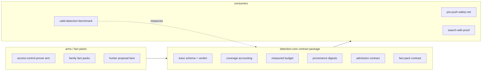
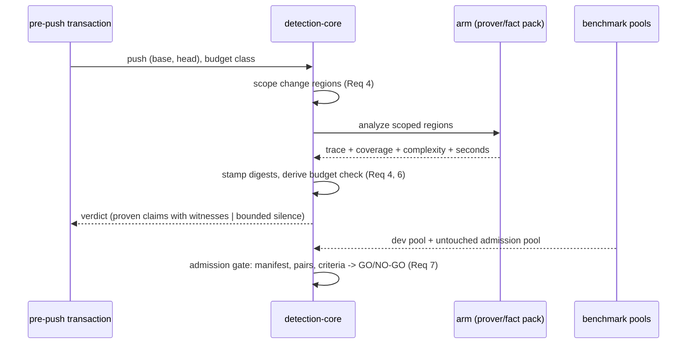

# Design Document: detection-core

## Overview

**Purpose:** detection-core specifies the single security object every detection arm reuses:
the canonical trace with its verdict, coverage, budget, provenance, and admission contracts.
It extracts what `access-control-prover` already implements for one family into a
family-agnostic contract, so arms, fact packs, and consumers stop maintaining parallel
runner contracts.

**Users:** spec authors and implementers of detection arms (prover, hunter, push hook,
proof arm) consume the contract; the maintainer reads admission GO/NO-GO over it.

**Impact:** replaces per-arm envelopes with one contract; existing behavior stays
byte-identical per consumer during migration (the 2026-10-30 admission suite is the
regression gate).

### Goals
- One canonical trace schema and three-way verdict vocabulary shared by all arms (Req 1, 2, 5).
- Coverage accounting that makes every zero explainable (Req 3); instrument rule enforced at core level.
- A measured, per-workload-class time budget instead of a static constant (Req 4).
- Provenance digests on every analysis, with refusal on mismatch (Req 6).
- A generalized admission gate over untouched populations (Req 7), no fitting on labels with
  reversed-pair probes (Req 8), models bounded to residuals (Req 9), families as fact packs
  with scope disclosure (Req 10), consumer contracts (Req 11), fixed measurement schema (Req 12).

### Non-Goals
- New vulnerability families or their fact content.
- The pre-push transaction itself (pre-push-safety-net consumes this core).
- Fitted models anywhere in the core path.
- Engine/graph internals (contributor-scan).

## Boundary Commitments

### This Spec Owns
- The canonical trace schema (entry, hops, operation, witnesses, guards, judgment, completeness, digests) and its deterministic serialization.
- The verdict contract: proven claim (witness attached) vs bounded silence (coverage reason attached); indeterminate never converts to clean.
- Coverage accounting schema (entry recognition, per-call resolution buckets, unchecked reasons) and the zero-byte instrument refusal.
- The measured-budget contract: complexity features recorded per change, per-workload-class budget derivation published with sample/percentile/hardware, configurable budget.
- Provenance stamping (analyzer/fact/acquisition/configuration/population/input digests) and refusal on digest mismatch.
- The generalized admission contract: consume-only manifest validation, paired scoring, gates, GO/NO-GO report schema, family-scope disclosure.
- The fact-pack admission contract (reviewed facts, provenance stamping, family tag).
- The consumer interface for the pre-push transaction and the proof layer.

### Out of Boundary
- Pre-push hook transaction, rollout policy, capability registry (pre-push-safety-net).
- Family fact content (fact-pack specs, starting from access-control-prover's rulesets).
- Hunter/proposer internals and proof-arm internals (they consume the contract).
- Engine/CPG internals (contributor-scan).

### Allowed Dependencies
- `valid-detection-benchmark` pools and freeze artifacts (read-only; never label-tuned).
- Existing prover implementation as the first contract implementation.
- Steering rules in `detection-quality.md` (no fitting on pool labels; instrument rule; stop conditions).

### Revalidation Triggers
- Trace schema or verdict vocabulary changes → every arm and consumer re-validates.
- Admission report schema changes → every admission gate re-runs.
- Budget derivation method changes → new baseline under Req 12 (not a trend).
- Fact-pack admission contract changes → all fact packs re-reviewed.

## Architecture

### Existing Architecture Analysis
Today each arm owns its envelope: `prover_arm.py` (records + summarize), `development_runner.py`
(bundle + funnel + gates), `arm_regression.py` (arm records), `admission_run.py` (manifest +
paired scoring). The trace itself (`Trace`, `ProverResult`) exists in the prover. The gap is
the missing shared contract layer, not missing analysis code.

### Architecture Pattern & Boundary Map

Pattern: **thin core contract package; existing implementations adopt it incrementally**
(hybrid option C from research.md). The core owns contracts only — no analysis logic.



### Technology Stack

| Layer | Choice | Role | Notes |
|---|---|---|---|
| Core contract | Python, frozen dataclasses + canonical JSON | trace/verdict/coverage/budget/admission schemas | mirrors existing Trace.record() conventions |
| Runners | existing benchmark runners | adopt core contracts incrementally | behavior byte-identical per consumer |
| Tests | pytest | contract conformance per consumer | admission suite is the regression gate |

## File Structure Plan

### Directory Structure
```
src/openultrasast/core/          # NEW: the contract package (no analysis logic)
├── __init__.py                  # public contract exports
├── trace.py                     # canonical trace schema, deterministic serialization (Req 1, 2)
├── verdict.py                   # proven-claim vs bounded-silence contract (Req 5)
├── coverage.py                  # entry/resolution/unchecked accounting + zero-byte refusal (Req 3)
├── budget.py                    # measured budget: complexity features, per-class derivation (Req 4)
├── provenance.py                # digest stamping + mismatch refusal (Req 6)
├── admission.py                 # manifest validation, paired scoring, gates, GO/NO-GO schema (Req 7, 10)
├── probes.py                    # reversed-pair / holdout probes for fitted components (Req 8)
└── factpack.py                  # family fact-pack admission contract (Req 10)
tests/test_core_trace.py         # conformance tests per contract module
tests/test_core_admission.py
tests/test_core_budget.py
```

### Modified Files
- `src/openultrasast/hunt/prover.py`, `semantic/obligations/trace.py` — implement/re-export
  the core trace contract for access_control (Req 1, 2, 5); behavior unchanged.
- `benchmarks/valid/prover_admission.py`, `admission_scoring.py`, `admission_run.py` — become
  thin consumers of `core/admission.py` (Req 7); existing refusal order and report schema preserved.
- `benchmarks/valid/development_runner.py`, `arm_regression.py`, `prover_arm.py` — adopt
  `core/coverage.py`, `core/budget.py`, `core/provenance.py` (Req 3, 4, 6, 11, 12).
- `benchmarks/valid/run_manifests.py` — bundle digests feed `core/provenance.py` (Req 6).

## System Flows



## Requirements Traceability

| Req | Summary | Components | Contracts |
|---|---|---|---|
| 1 | canonical trace | core/trace.py | Trace schema, deterministic record() |
| 2 | three-way judgment | core/trace.py, core/verdict.py | Judgment enum; indeterminate-never-clean rule |
| 3 | coverage accounting | core/coverage.py | funnel + resolution buckets + zero-byte refusal |
| 4 | measured budget | core/budget.py | complexity features; per-class derivation; gate names derivation |
| 5 | verdict contract | core/verdict.py | proven claim w/ witness; bounded silence w/ reason |
| 6 | provenance | core/provenance.py | digest stamping; mismatch refusal |
| 7 | admission gate | core/admission.py | consume-only manifest; paired scoring; GO/NO-GO |
| 8 | no fitting on labels | core/probes.py + admission | reversed-pair probes; holdout; no pool-label tuning |
| 9 | bounded models | core/verdict.py contract | zero-shot judge over trace; BLOCK only via proof |
| 10 | fact packs | core/factpack.py + admission family tag | reviewed facts, provenance, family-scope in reports |
| 11 | consumer contract | core/__init__.py | push-consumer and proof-consumer interfaces |
| 12 | measurement schema | core/admission.py report schema | digests, vocabulary, rates+n+Wilson, coverage, instrument, runtime |

## Components and Interfaces

| Component | Intent | Req | Key contracts |
|---|---|---|---|
| core/trace.py | canonical trace + judgment | 1, 2 | `TraceRecord.record() -> canonical JSON` |
| core/verdict.py | verdict contract | 5, 9 | `Verdict = ProvenClaim(witness, location) | BoundedSilence(reason)` |
| core/coverage.py | coverage accounting | 3 | `Coverage{entry_recognition, resolution_buckets, unchecked_reasons}` |
| core/budget.py | measured budget | 4 | `Complexity{regions, calls, changed_bytes}`; `derive_budget(samples, percentile, hardware) -> Budget` |
| core/provenance.py | digests | 6 | `stamp(bundle, population, change) -> digests`; mismatch raises |
| core/admission.py | admission gate | 7, 10, 12 | `validate_manifest` (consume-only), `admission_report(...) -> GO/NO-GO` |
| core/probes.py | anti-shortcut probes | 8 | `reversed_pair_probe(component, fix, reversed_fix)` |
| core/factpack.py | family packs | 10 | `admit_fact_pack(facts, review) -> stamped pack` |

## Data Models

- **TraceRecord**: entry identity; hops (each with call-target completeness); operation
  (kind, resource, authority); witnesses (provenance + match relations); guards (effects);
  completeness reasons; judgment; digests. Canonical JSON, sorted keys (existing convention).
- **Verdict**: `ProvenClaim{trace_ref, witness, path, line, family}` or
  `BoundedSilence{path, reason, coverage}`. Never a bare "clean".
- **Coverage**: entry points + frameworks recognized; per-call exactly one of
  complete/incomplete/unresolved; unchecked operations with named reasons.
- **BudgetSample**: change complexity + measured seconds; **Budget**: per-class percentile
  derivation with n and hardware disclosed; configurable, never a single constant.

## Error Handling
- Zero-byte or unreadable input → instrument failure; the run is invalid, never clean (Req 3).
- Digest mismatch → refuse the result (Req 6).
- Manifest unreviewed / label-exposing / acquisition-changed / spent → ordered refusal, no fallback (Req 7).
- Budget exceeded → gate failure naming change, elapsed time, and the derivation exceeded (Req 4).
- Indeterminate evidence → indeterminate verdict with reasons; never converted (Req 2).

## Testing Strategy
- Unit: trace serialization determinism; verdict rules; coverage bucket exclusivity; budget
  derivation (fixed samples → fixed budget); digest refusal; manifest refusal order.
- Contract conformance: prover's existing Trace satisfies core/trace.py; admission suite
  output byte-identical before/after adoption (regression gate).
- Probes: reversed-pair probe catches a shape-only component (deletion-count control).
- Measurement: admission suite re-run on the pilot pool must reproduce the 2026-10-30
  NO-GO numbers exactly (instrument check).

## Performance & Scalability
- Budget is measured (Req 4): fit the complexity→reply-time relation on the dev (483) and
  pilot (264) record sets as measurement only; publish per-class budgets (n, percentile,
  hardware). The static 120s remains as a provisional default until the first derivation
  is published; changing it starts a new baseline (Req 12).

## Security Considerations
- Label isolation: the core never reads pool/admission labels except through the validated
  admission path; forbidden markers enforced at manifest validation (Req 7, 8).
- Repository identity masked in shared summaries (existing convention preserved).

## Migration Strategy
1. Create `core/` contract package mirroring existing shapes (no behavior change).
2. Prover re-exports core types; conformance tests prove equivalence.
3. Runners adopt coverage/budget/provenance one at a time; admission suite re-run after each.
4. Admission modules become thin consumers of core/admission.py; 2026-10-30 NO-GO reproduced.
5. Fact-pack contract adopted by ruleset loader; family-scope appears in reports.
