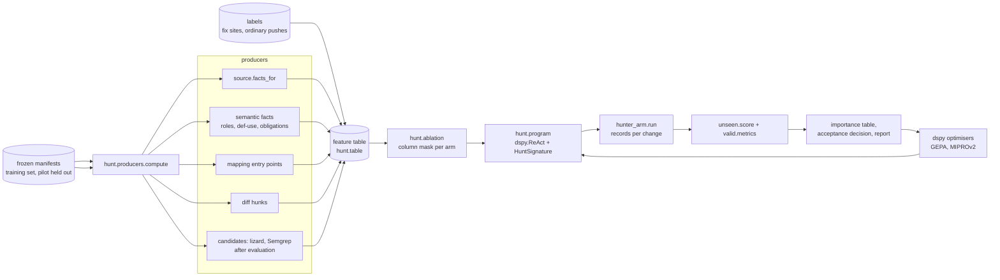
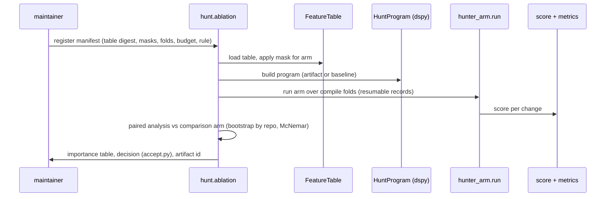

# Design: hunter-learning-loop

> **Amendment 2026-10-14.** The feature table below is the shape of the first round and is superseded as the
> model's input by the ordered trace of `access-control-prover` (design sections "trace: the ordered
> serialisation" and "cfg and CfgDominance"). The feature table remains the screen's instrument and the
> ablation's bookkeeping; the decision strategy is the one stated in requirements.md, "Decision strategy,
> corrected 2026-10-14": a rule over the trace, a zero-shot judge for the residual question, the pool for
> measurement only.

## Overview
**Purpose**: turn the LLM hunter from a hand-written prompt into a measured search stage whose inputs are an
engineered feature table and whose prompt is optimised by a program runtime, judged on held-out folds.
**Users**: the maintainer runs the loop locally on the research host; the pre-push safety net consumes its output
later (not in this spec).
**Impact**: adds a research package `src/openultrasast/hunt/` and one research dependency (DSPy); reuses the
learn harness for labels, folds, leak audit and paired analysis; reuses `benchmarks/valid/hunter_arm.py` as the
runner and `benchmarks/unseen/score.py` plus `benchmarks/valid/metrics.py` as the only scorekeepers. The hook,
its urllib client and the core install are untouched.

### Goals
- A feature table with named, switchable columns is the contract between producers, ablation and the program (3, 4).
- The hunter is a DSPy program over that table plus the changed hunks; its instruction and demonstrations are
  proposed by DSPy optimisers and accepted only by our rule on held-out folds (5, 6).
- Every annotation's worth is a paired, pre-registered ablation with intervals; the importance table is the output
  the maintainer reads (4).
- Search recall and suspicions per push improve on the held-out pilot, reported with the pilot's own scorer (7, 8).

### Non-Goals
- Thresholds or operating points (4.7); the hook's LLM tier (pre-push-safety-net); the proof arm (search-with-proof);
  retraining the classifier (7.5); replacing the quick-rule engine with Semgrep (separate decision, brief pending);
  migrating `learn/labels.py` to pandas (statistics item, separate).

## Boundary Commitments
### This spec owns
- `src/openultrasast/hunt/`: the feature table schema, the producer list, the hunt program, the ablation runner,
  the acceptance rule, the run artifact.
- The training-set recipe (which advisories, folds, digests) and its records under `benchmarks/measurements/`.
- The importance table and the before/after report on the pilot.
### Out of boundary
- Label semantics (`benchmarks/valid/catalog.py`, `verify.py`, `learn/labels.py`): consumed as they are.
- The scorer and metrics (`benchmarks/unseen/score.py`, `benchmarks/valid/metrics.py`): never edited to fit.
- The hook, `tool_hunter.py`'s shipped prompt, the classifier program, Semgrep adoption, lizard adoption (each a
  producer candidate that enters only through the producer contract after its own evaluation).
### Allowed dependencies
- `openultrasast.source`, `semantic` facts, `mapping` entry points, `learn.folds`, `learn.leaks`,
  `learn.experiments` (paired bootstrap, McNemar), `learn.labels` readers, `benchmarks.valid.hunter_arm` (runner),
  `benchmarks.unseen.score`; `dspy` (research extra `[hunt]`), `pandas` (table), `scipy`/`statsmodels` once the
  statistics item lands (until then `learn.experiments`).
- Dependency direction: data (manifests, labels) → producers → feature table → program → runner → scorer → report.
  Nothing to the right imports to the left; producers never import `hunt.program`; nothing in `hunt/` imports
  `push/` or `cli.py`.
### Revalidation triggers
- The feature table schema version changes; a producer's output shape changes; the scorer's tolerance changes;
  DSPy minor version changes; the pilot manifest digest changes.

## Architecture
### Existing architecture analysis
The hunter (`tool_hunter.run_tool_hunter`) is a tool loop with a four-sentence prompt and no diff
(01-flowcharts/U6-hunter-client.md). The runner `hunter_arm.run` already walks a frozen manifest, checks out
each head, proves bytes read, runs the hunter, classifies each finding with the decision-engine classifier and
writes one record per change; `combine` joins with the replay. The harness has grouped folds, a leak audit and
paired analysis. The missing pieces are the table, the switchable inputs and the optimisable program.

### Pattern and boundary map

- Selected pattern: a table-centred pipeline; the program is a replaceable consumer of the table.
- Existing patterns preserved: the runner's record shape and resumability; the scorer; folds by repository; the
  instrument proof (bytes read, base and head verified).

### Technology stack (changed layers only)
| Layer | Tool | Role |
|---|---|---|
| Program runtime | `dspy==3.4.*` (pulls litellm, openai, gepa, diskcache) as extra `[hunt]` | signature, ReAct tool loop, optimisers, cache, usage |
| Model access | `dspy.LM("openai/deepseek-flash", api_base=DEEPSEEK_BASE_URL, api_key=env)` | one client for the research side; prices registered from `model/endpoint.py:55` |
| Table | `pandas` as extra `[hunt]` | the feature table, masks, joins with labels and scores |
| Statistics | `learn.experiments` now; `scipy`/`statsmodels` after the statistics item | paired bootstrap, McNemar |

## File structure plan
```
src/openultrasast/hunt/
  __init__.py
  table.py        FeatureTable: schema v1, columns, masks, read/write (jsonl + parquet), digest
  producers.py    PRODUCERS: fixed list of (name, fn, columns, needs); compute(root, change) -> rows
  program.py      HuntSignature, HuntProgram(dspy.Module: ReAct + tools), render_row, parse_output
  metric.py       search_metric(example, prediction) -> score, feedback text (GEPA), per-change outcome
  ablation.py     Manifest (pre-registered), arms as masks, run(arm) -> records, analyse -> importance table
  accept.py       the acceptance rule (6.1-6.8) over compile folds and held-out folds
  artifact.py     RunArtifact: program id, schema version, masks, data digests, usage, versions
benchmarks/valid/hunter_arm.py   --program <artifact> and --mask <arm> options; everything else unchanged
benchmarks/valid/training_set.py sourcing recipe apart from the pilot (catalog + verify + assemble, pilot excluded)
tests/test_hunt_*.py             table, producers (planted-advisory test), program with a scripted LM, metric,
                                 ablation masks, acceptance rule, artifact
```

### Rule: a pattern engine's miss is never evidence
Maintainer, 2026-10-13: "what does not work is that we dismiss things just because semgrep cannot find the bug.
if semgrep was enough we'd use it." A Semgrep (or quick-rule, or engine) match is positive evidence and may enter
the table as a feature ("matched here, rule X"). The absence of a match is not recorded as a feature, is never a
filter, a demotion, a down-weight or a gate on a hunter suspicion, and no acceptance rule may count it. The
Semgrep arm on the pilot is a comparison arm only.

## Components and interfaces
| Component | Intent | Requirements | Depends on | Contract |
|---|---|---|---|---|
| FeatureTable | one row per candidate location with named columns | 3.1, 3.5, 4.2 | pandas | `columns: feature.<producer>.<name>`, `label`, `provenance.*`, `fold`, `schema_version` |
| producers | compute facts from the repository only | 3.2, 3.3, 3.4, 3.7 | source, semantic, mapping | `compute(root, change) -> list[dict]`; absent feature = `None` + `provenance.<name>.reason` |
| HuntProgram | the search | 3.5, 3.6, 5.1 | dspy, producers (rendered row) | input: rendered row + hunks; output: list of `{path, line, family ∈ FAMILY_IDS, confidence, rationale, cited_lines}` |
| search_metric | per-change score and feedback | 4.3, 7.1 | unseen.score tolerance | hit on fix site with right family = 1; ordinary push suspicions counted; feedback text names misses |
| ablation | arms as masks, paired runs | 4.1 to 4.6, 4.8 | table, program, runner, experiments | manifest: table digest, masks, folds, seed, budget, rule |
| accept | train and holdout rule | 6.1 to 6.8 | ablation results | returns accepted|rejected with both fold results and the regression budget check |
| RunArtifact | the record of a run | 5.1, 5.2, 5.5, 9.5 | dspy save | content-addressed JSON + the saved program + the DSPy cache directory copied |

### FeatureTable schema v1 (one row per candidate location)
| Column group | Columns | Producer |
|---|---|---|
| key | `change_id`, `repo`, `head`, `path`, `line`, `kind` (vulnerability or ordinary), `fold` | manifest |
| label | `label` (1 fix site, 0 ordinary, null unknown), `family`, `fix_span` | labels |
| diff | `feature.diff.hunks` (list of (start, end) at head), `feature.diff.on_changed_line`, `feature.diff.distance` | producers.diff |
| source | `feature.source.function`, `.span`, `.callers` (list of (path, line)), `.entry_points`, `.language` | source.facts_for |
| semantic | `feature.semantic.roles` (source/sink/sanitizer per identifier), `.def_use` (binds and calls in the function), `.obligations` | semantic facts |
| taxonomy | `feature.taxonomy.families` (closed list with one-line definitions) | ruleset/families.toml |
| provenance | `provenance.<producer>.{version, ok, reason, bytes_read}` | each producer |
A candidate location is every function the change touched at head (ordinary pushes) or the labelled fix site plus
every other touched function (positives; the non-site rows carry `label` null, 1.3).

### HuntSignature
Inputs (each an `InputField`, present only when its column is unmasked): `change_summary`, `hunks`,
`function_text`, `callers`, `entry_points`, `roles`, `def_use`, `obligations`, `families`. Output: `findings`
(JSON list, the classifier's answer structure). Tools (ReAct, `max_iters` bounded by the budget): `read_file`,
`grep_repo`, `find_refs` from `hunter_tools`, path-clamped. An answer with a family outside `FAMILY_IDS` or a
cited line outside the shown text is recorded `unknown` and scores against the program (3.6, 3.7).

### Optimisation and acceptance (one change per round, 6.8)
1. Compile folds and held-out folds come from `learn.folds` by repository (2.5); the pilot is refused by digest.
2. A round changes one thing: a producer mask (ablation), an instruction (GEPA or MIPROv2 proposal), or a
   demonstration set (BootstrapFewShot). DSPy proposes; `search_metric` scores on compile folds.
3. `accept` scores the candidate on held-out folds, per family, with intervals from the paired bootstrap; keeps
   it only if compile and held-out are both non-negative, one strictly positive, no family below its regression
   budget, instruction under the length cap; ties rejected; rejected candidates kept visible to the next round;
   held-out never shown to the proposer (6.2 to 6.7).
4. The artifact records both fold results and the rule (6.7).

## System flows


## Data flow and storage
- Tables, records and DSPy caches live outside the checkout under `$OUSAST_RESULTS/hunt/<run>/` (9.4); the run
  artifact and the importance table are copied into `benchmarks/measurements/<date>-hunt-<run>/`.
- Budgets: money and calls per run through `dspy.track_usage()` and litellm prices (9.1, 9.5); errors recorded by
  type (9.2); records resumable by `(change_id, input_digest, program_id, mask)` (9.3).

## Error handling
- A producer that cannot compute writes `provenance.<name>.ok=false` with a reason; the row stays (3.4).
- A change with nothing readable is an instrument failure, never a clean result (8.4); more than 5% invalidates
  the run (8.5).
- A parse rejection in `source.ranges` is recorded as a provenance reason, not swallowed.

## Testing strategy
- Unit: table masks and digests; each producer on a fixture repository; the planted-advisory test (3.7); the metric
  on scorer fixtures; the acceptance rule on synthetic fold results (every clause of 6.1 to 6.8).
- Program: a scripted `dspy.LM` (DSPy's dummy LM) drives ReAct through the three tools; no network in tests.
- Integration: one ablation round on a five-change fixture manifest with the scripted LM; the artifact round-trips.
- Live, budgeted: the pilot run once per accepted program (8.6), recorded under `benchmarks/measurements/`.

## Requirements traceability
| Requirement | Components |
|---|---|
| 1.1, 1.2, 1.3, 1.4, 1.5, 1.6 | FeatureTable label columns, search_metric, training_set.py (verification record next to the label) |
| 2.1, 2.2, 2.3, 2.4, 2.5, 2.6, 2.7 | training_set.py, learn.folds, learn.leaks audit over table columns, RunArtifact digests, pilot refusal in ablation |
| 3.1, 3.2, 3.3, 3.4, 3.5, 3.6, 3.7, 3.8 | FeatureTable schema v1, producers (planted-advisory test for 3.7), HuntSignature, program output check |
| 4.1, 4.2, 4.3, 4.4, 4.5, 4.6, 4.7, 4.8 | ablation (manifest, masks, paired runs, importance table, curve), search_metric |
| 5.1, 5.2, 5.3, 5.4, 5.5, 5.6 | HuntProgram, RunArtifact, DSPy cache per run, scorer and labels outside the editable surface, length cap in accept |
| 6.1, 6.2, 6.3, 6.4, 6.5, 6.6, 6.7, 6.8 | accept |
| 7.1, 7.2, 7.3, 7.4, 7.5 | search_metric (search stage), hunter_arm classification (second stage, unchanged), report |
| 8.1, 8.2, 8.3, 8.4, 8.5, 8.6 | hunter_arm `--program`, measurements record, instrument proof in records |
| 9.1, 9.2, 9.3, 9.4, 9.5 | RunArtifact, dspy.track_usage, error types, results directory, resumable records |

## First increment (what task group 1 builds)
`hunt/table.py`, `hunt/producers.py` with the four existing producers, `hunt/program.py` with the baseline
signature equal to today's hunter prompt plus the hunks, `hunt/metric.py`, `--program` in `hunter_arm.py`, the
scripted-LM tests, and one baseline run over the 12 pilot positives compared with the pilot's hunter records to
prove the plumbing before any optimisation.
