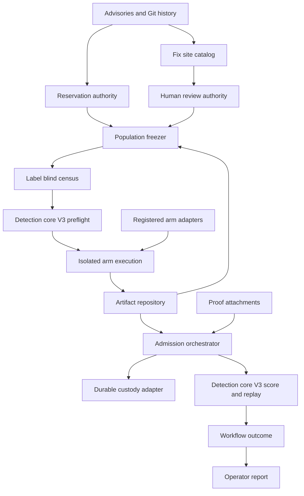
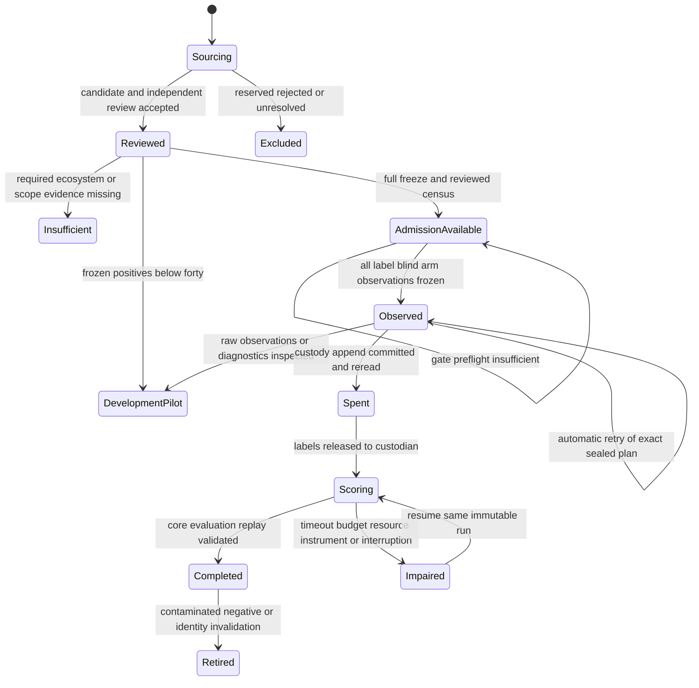
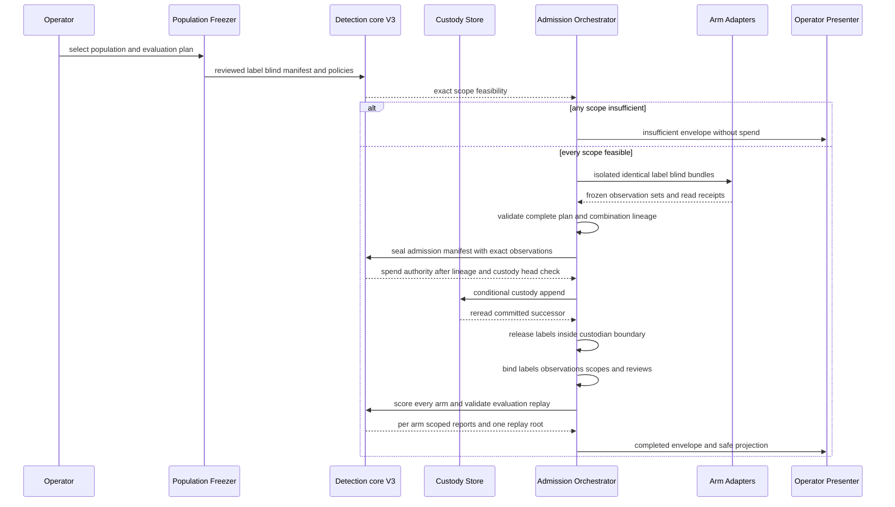
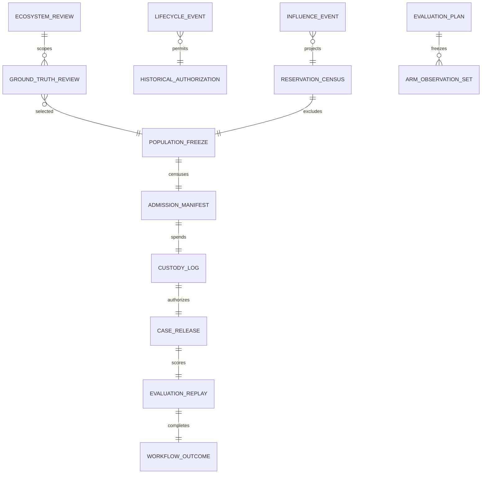

# Technical Design: Valid Detection Benchmark

## Overview

This feature replaces the withdrawn 2026-10-12 pilot with a reproducible, independently reviewed benchmark for measuring detector behavior on unseen Python and JavaScript/TypeScript application repositories. It establishes fix-derived positives, representative ordinary pushes, permanent reservation, label-isolated admission, exact family-and-ecosystem metrics, differential-proof reporting, and durable operator outcomes.

The design preserves detection-core as the only authority for admission algebra and replay. The benchmark owns the population and workflow around that authority. An approved and validated `detection-core` amendment exporting `openultrasast.detection-core.evaluation-admission.v3` is an explicit predecessor deliverable because the current V2 root pools all claimed scopes into one metric result and cannot safely authorize per-scope or multi-arm claims. Task generation for this spec is blocked until that predecessor exists; valid-benchmark tasks never edit core-owned files.

Maintainers and independent reviewers use the workflow to source, review, freeze, spend, execute, and report a population. Detector owners supply immutable arm registrations and label-blind adapters; product specifications consume eligible scoped outcomes but do not receive rollout authority from this feature.

### Goals

- Freeze a replacement population with at least 40 accepted positives across both initial ecosystems and at least two vulnerability families.
- Preserve one permanent-reservation authority, human-authoritative labels, and durable spend-before-read custody.
- Produce exact family-and-ecosystem quality decisions, separate whole-population coverage, and explicit insufficient or impaired outcomes.
- Evaluate shipped, experimental, and pre-registered combined arms over identical changes without modifying detector behavior.
- Make every result reproducible from digest-bound artifacts and replayable through detection-core.

### Non-Goals

- Adding or tuning detectors, facts, prompts, judges, thresholds, or framework vocabularies.
- Wiring an arm into the pre-push product, enabling rollout, or changing BLOCK policy.
- Reactivating or requalifying the parked access-control arm.
- Owning AX, Kubernetes, worker, network, or object-store administration.
- Migrating pooled V2 reports into per-scope V3 reports.
- Implementing Discord transport; this design produces a safe operator projection for a separately owned notifier.

## Boundary Commitments

### This Spec Owns

- Repository influence events, permanent-reservation census projection, and exact-file historical authorizations used by benchmark population construction.
- Canonical repository ecosystem review, fix-derived ground-truth review, ordinary-change selection, exclusions, and population classification.
- Deterministic public/private population freeze artifacts, label-blind census construction, sealed-label references, and replacement lifecycle records.
- A durable S3-compatible compare-and-swap adapter for the existing benchmark custody protocol, including capability and recovery probes.
- A versioned content-addressed artifact repository for reservation, population, lifecycle, observation, workflow, and final-report artifacts.
- Immutable arm registrations, pre-registered combination plans, label-blind arm execution, case binding, and general benchmark orchestration.
- Benchmark workflow envelopes and redacted JSON/text operator reports.
- Consumption and conformance testing of the detection-core V3 admission contract.

### Out of Boundary

- Metric algebra, scope validation, feasibility algebra, quality gates, admission decisions, proof validation, and authoritative replay; detection-core owns these.
- Implementation of the V3 predecessor contract. This design specifies the consumer contract and readiness gate; the `detection-core` amendment owns delivery and validation.
- Detector implementation and detector-specific interpretation. The new workflow does not import access-control site-judgment helpers.
- Repository/framework recognition vocabularies; concrete targets are population evidence, not implementation tasks.
- Product eligibility installation, advisory rollout, BLOCK enablement, and pre-push UX.
- Infrastructure health and bucket creation, lifecycle mutation, credential provisioning, cluster scheduling, and retry policy for AX workers.
- Partial-scope or partial-arm custody. One evaluation plan spends one whole population only after every planned arm and claimed scope is feasible and every label-blind observation set is durably frozen.

### Allowed Dependencies

- The validated `openultrasast.detection-core.evaluation-admission.v3` predecessor for canonical identities, per-arm exact-scope policies, shared feasibility, one shared custody receipt, V3 case-release validation, per-arm scoped reports, and one multi-arm evaluation replay root.
- Existing V2 core contracts only for historical replay and compatibility tests; the replacement admission path does not score through V2.
- `benchmarks/unseen/` sourcing, fix-site extraction, ordinary-history draw, Git identity resolution, and bucket-first persistence patterns.
- `benchmarks/valid/artifact_contract.py` for canonical envelopes, sequence identities, atomic local materialization, and conflict refusal.
- boto3/botocore `>=1.35,<2` as already declared; the locked `1.43.107` model exposes conditional `PutObject` parameters.
- A versioned S3-compatible durable store whose exact conditional-write and lifecycle behavior passes the benchmark capability probe.
- Search-with-proof artifacts only through detection-core `ProofAttachment` validation.

Dependency direction is fixed:

`detection-core contracts → artifact repository and reservation/review/freeze artifacts → isolated arm execution → custody and admission orchestrator → workflow envelope → operator presenter`

Core never imports benchmark modules. Presenters and notifications never influence admission. Detector adapters never receive label bytes.

### Revalidation Triggers

- Any detection-core V3 schema, digest, scope, feasibility, result, report, or replay contract change.
- A change to canonical ecosystem values, review policy, alias/fork resolution, influence projection, license policy, or historical authorization semantics.
- A change to population, freeze, sealed labels, claimed scopes, denominator policy, thresholds, analyzer, facts, vocabulary, combination rule, or outcome mapping.
- A change to conditional-write tokens, custody transition semantics, object-store version visibility, retention rules, or restart recovery.
- A change that lets an arm see labels, lets presentation affect scoring, or moves detector-specific knowledge into benchmark/core components.
- A change to the multi-arm evaluation-plan root, shared-spend binding, V3 case-release graph, isolated arm-execution boundary, or observation checkpoint identity.
- A change to proof attachment matching or the advisory/BLOCK interpretation consumed by downstream product specifications.

## Architecture

### Existing Architecture Analysis

The current valid benchmark has reusable fix-site cataloging, model-assisted review, deterministic 20:1 negative draws, artifact envelopes, V2 custody, proof attachments, and V2 core scoring. Its admission runner and some metrics remain access-control-specific or legacy. The permanent reservation authority exists mainly as test logic, and the production custody store is only a protocol.

Detection-core V2 validates claimed scopes but assigns every metric rule the complete scope tuple, sums capacities across scopes, emits one unscoped result per metric, and binds one arm identity to one replay. This design keeps all V2 schemas immutable and requires a separate upstream V3 evaluation root. No post-spend projection or legacy benchmark scorer may substitute for that root.

### Architecture Pattern and Boundary Map

The selected pattern is a versioned contract core with benchmark-owned ports and adapters. Append-only reviewed artifacts form the population control plane; the admission path is a fail-closed state machine around one irreversible custody transition.



Key decisions:

- Reservation, review, and lifecycle state are append-only reviewed records with deterministic projections.
- The population freezer binds public material, opaque private references, review records, and a label-blind census without exposing label bytes to arms.
- Every planned arm and claimed scope must pass V3 feasibility before execution. Insufficiency leaves custody available.
- Every arm runs in an isolated label-blind process before spend. Its immutable observations are durably frozen and combined without label access.
- One V3 evaluation manifest binds all per-arm plans, frozen observation sets, one custody receipt, V3 case releases, independently valid per-arm reports, and one evaluation replay root.
- The custodian opens labels only after every planned observation is complete, commits the one spend, and then joins observations to ground truth.
- Completed quality decisions come only from detection-core V3. The benchmark envelope represents orchestration status, including failures that occur before a core report exists.

### Technology Stack

| Layer | Choice / Version | Role in Feature | Notes |
|---|---|---|---|
| Language | Python 3.11+ | Typed contracts, orchestration, and CLI | Frozen dataclasses, enums, protocols, and boundary validation |
| Admission authority | detection-core V3 | Exact-scope feasibility, metrics, gates, report, replay | Upstream prerequisite; V2 remains historical |
| Local artifacts | Canonical JSON and JSONL | Review, lifecycle, freeze, plans, outcomes | Reuses benchmark artifact envelopes |
| Durable storage | S3 API via boto3/botocore `>=1.35,<2` | Versioned population, custody, provenance, and transient runs | Conditional create/update required; capability-tested |
| Arm isolation | Existing subprocess or container lanes | Execute serialized label-blind bundles before spend | Allowlisted environment; no custody/private-label credentials |
| Execution | Existing Docker, local, or AX arm adapters | Runs immutable label-blind cases | Execution-plane health remains external |
| Presentation | Deterministic JSON and plain text | Operator status, counts, digests, gates | Safe input to future notifier transport |

No new third-party dependency is introduced.

## File Structure Plan

### Directory Structure

```text
benchmarks/
├── unseen/
│   ├── reservation.py                         # Reservation Authority and production guard API
│   └── reservations/
│       ├── pilot-2026-10-12-withdrawn.json    # Exact historical inventory and withdrawal event
│       └── pilot-2026-10-12-replacement.json  # Later replacement binding event
└── valid/
    ├── review.py                              # Review Authority contracts and validation
    ├── lifecycle.py                           # Baseline Lifecycle Authority and retirement projection
    ├── population.py                          # Population Freezer and label-blind census builder
    ├── object_store.py                        # Artifact Repository for durable content-addressed records
    ├── custody_store.py                       # Durable Custody Store and capability probe
    ├── arm_contract.py                        # Arm Registry contracts and label-blind adapter protocol
    ├── arm_executor.py                        # Isolated Arm Executor and observation checkpoints
    ├── arm_combination.py                     # Combination Planner over preserved observations
    ├── admission_orchestrator.py              # Admission Orchestrator state machine and case binding
    ├── workflow_journal.py                    # CAS workflow head, leases, and causal heartbeat chain
    ├── workflow_outcome.py                    # Workflow Outcome canonical envelope
    ├── operator_report.py                     # Operator Presenter JSON and text projection
    └── run.py                                 # Benchmark-only operator entry point
tests/
├── test_unseen_reservation.py                 # Reservation projection and exact authorization
├── test_valid_review.py                       # Ecosystem and ground-truth review authority
├── test_valid_lifecycle.py                    # Withdrawal, replacement, and retirement projections
├── test_valid_population.py                   # Freeze, classification, license split, and census
├── test_valid_object_store.py                 # Content-addressed persistence and scratch-loss recovery
├── test_valid_custody_store.py                # Conditional writes, concurrency, restart, retention
├── test_valid_benchmark_arm_contract.py       # Arm identity and combination plan
├── test_valid_benchmark_orchestrator.py       # Spend ordering, isolation, resume, and scoring
├── test_valid_benchmark_workflow_outcome.py   # Closed status/reason and redaction
├── test_valid_benchmark_workflow_journal.py   # Lease ownership, CAS resume, and stalled projection
├── test_valid_benchmark_operator_report.py    # Deterministic operator projection
├── test_valid_benchmark_proof_reporting.py    # Differential proof binding
└── test_valid_benchmark_e2e.py                # Synthetic two-ecosystem multi-family lifecycle
```

### Modified Files

- `benchmarks/valid/catalog.py` — retain package ecosystem, language, license, repository identity, and source-evidence digests while building fix-site candidates.
- `benchmarks/valid/verify.py` — record model assistance separately and delegate authoritative acceptance to `review.py`.
- `benchmarks/valid/assemble.py` — remain a legacy/development facade; replacement admission delegates to `population.py` and cannot emit an authorizing legacy manifest.
- `benchmarks/valid/population_custody.py` — bind the production store adapter and V3 spend authority without weakening committed-reread-before-label ordering.
- `benchmarks/valid/admission_scoring.py` — expose a V3 delegation seam and mark legacy aggregate helpers non-authorizing for the replacement.
- `tests/test_independent_population.py` — call `reservation.py` rather than owning reservation exceptions in test code.
- `.env.example` — list benchmark S3 setting names blank if new names are required; no credentials or endpoints are committed.

### Upstream Prerequisite Files

These paths remain owned and changed only by the `detection-core` amendment that exports `openultrasast.detection-core.evaluation-admission.v3`. They appear here to make the predecessor contract explicit, not to widen this spec's implementation boundary. Valid-benchmark task generation remains blocked until that amendment is approved, implemented, and independently validated.

- `src/openultrasast/core/measurement.py` — exact-scope `DenominatorPolicyV3` and scope-qualified thresholds.
- `src/openultrasast/core/admission_review.py` — V3 multi-arm evaluation manifest and per-arm plan bindings.
- `src/openultrasast/core/admission_feasibility.py` — per-scope sufficiency and atomic `may_spend`.
- `src/openultrasast/core/admission_context.py` — V3 identity and policy validation.
- `src/openultrasast/core/admission_metrics.py` — exact-scope derivation and unique-push whole coverage.
- `src/openultrasast/core/admission_case.py` — exact V3 per-arm case-release graph bound to the shared receipt.
- `src/openultrasast/core/admission_report.py` — independently valid per-arm scope results, non-authorizing aggregates, and reports.
- `src/openultrasast/core/_admission_replay.py` — one exact-schema V3 evaluation replay containing the shared spend and every planned arm report.
- `src/openultrasast/core/admission_fitted.py` — consumer dispatch for V2 and V3 roots.
- `tests/test_core_admission_*.py` — V3 algebra, compatibility, and replay conformance.

Every named component maps to one of the files above. No component shares authority across benchmark and core paths.

## System Flows

### Population Lifecycle



`DevelopmentPilot` and `Insufficient` are non-authorizing classifications. A pre-spend failure permits only an automatic retry with the exact plan, arms, inputs, budgets, execution environment, and admission identity while raw observations and diagnostics remain custodian-sealed. A workflow identifier alone never authorizes reuse. Human inspection or any configuration/plan change appends `development_opened` plus influence events and permanently disqualifies the population from admission. `Impaired` after spend never restores `AdmissionAvailable`; recovery resumes the same digest-bound run or records a terminal impaired outcome. `Retired` is an append-only lifecycle projection, never a mutation of the freeze.

### Admission Sequence



The arm call occurs before label release in an isolated process or container. Its serialized bundle carries no labels, review judgments, expected outcomes, custody credentials, private-label references, or label-store settings. Each observation set is content-addressed and immutable; resume reuses a matching completed set and never reruns it silently under the same plan identity.

## Requirements Traceability

| Requirement | Summary | Components | Interfaces | Flows |
|---|---|---|---|---|
| 1.1, 1.2, 1.3, 1.4, 1.5, 1.6, 1.7, 1.8 | General two-ecosystem multi-family population and insufficiency | Review Authority, Population Freezer, Scoped Admission V3 | `RepositoryEcosystemReviewV1`, `PopulationFreezeV3`, `AdmissionFeasibilityV3` | Population lifecycle |
| 2.1, 2.2, 2.3, 2.4, 2.5, 2.6 | Fix-derived, reachable, human-authoritative ground truth | Catalog, Review Authority, Population Freezer | `GroundTruthReviewV1`, `ModelAssistanceRef`, exact scope tuple | Sourcing to reviewed freeze |
| 3.1, 3.2, 3.3, 3.4, 3.5, 3.6 | Same-repository ordinary pushes and contamination handling | Population Freezer, Baseline Lifecycle Authority, Scoped Admission V3 | `OrdinarySelectionV1`, scoped policy, `PopulationLifecycleEventV1` | Population lifecycle |
| 4.1, 4.2, 4.3, 4.4, 4.5, 4.6, 4.7, 4.8, 4.9, 4.10 | Permanent reservation and withdrawn pilot | Reservation Authority, Baseline Lifecycle Authority | `InfluenceEventV1`, `ReservationCensusV1`, `PopulationLifecycleEventV1`, `HistoricalAuthorizationV1` | Reservation projection before freeze |
| 5.1, 5.2, 5.3, 5.4, 5.5, 5.6, 5.7, 5.8, 5.9 | Development/admission separation and spend-before-read | Population Freezer, Artifact Repository, Isolated Arm Executor, Durable Custody Store, Admission Orchestrator | reviewed evaluation manifest, frozen observations, custody CAS, V3 case release | Admission sequence |
| 6.1, 6.2, 6.3, 6.4, 6.5, 6.6, 6.7 | Exact scoped denominators, aggregates, and feasible gates | Arm Registry, Scoped Admission V3 | `DenominatorPolicyV3`, `AdmissionFeasibilityV3`, `ScopeAdmissionResultV3` | Preflight and core scoring |
| 7.1, 7.2, 7.3, 7.4, 7.5, 7.6, 7.7, 7.8 | Reproducible freeze and durable resumable custody | Population Freezer, Artifact Repository, Durable Custody Store, Workflow Outcome | content identities, create-only objects, custody CAS, retention profile | Lifecycle and restart recovery |
| 8.1, 8.2, 8.3, 8.4, 8.5, 8.6 | Complete measurement and failure visibility | Scoped Admission V3, Workflow Outcome, Operator Presenter | scope report, whole coverage, instrument receipt, baseline identity | Score or impaired outcome |
| 9.1, 9.2, 9.3, 9.4, 9.5, 9.6, 9.7 | Separate arms, combinations, and demonstrated evidence | Arm Registry, Isolated Arm Executor, Combination Planner, Admission Orchestrator, Scoped Admission V3 | `EvaluationPlanV1`, frozen observations, `ProofAttachment`, evaluation replay | Pre-spend arm execution and one shared spend |
| 10.1, 10.2, 10.3, 10.4, 10.5, 10.6 | Operator outcomes and ownership boundaries | Workflow Outcome, Operator Presenter, Admission Orchestrator | closed status/reason enums and redacted projection | Completion and impairment reporting |

## Components and Interfaces

| Component | Domain | Intent | Requirements | Key Dependencies | Contracts |
|---|---|---|---|---|---|
| Scoped Admission V3 | Upstream core | Authoritative exact-scope feasibility, scoring, gates, and replay | 1.7, 3.3, 3.4, 6.1–6.7, 8.1–8.6, 9.3–9.7 | Core canonical and V2 contracts P0 | Service, State |
| Reservation Authority | Population governance | Project reviewed influence into permanent reservation and exact historical authorization | 4.1–4.10, 7.1, 7.7 | Git identity resolver P0, artifact contract P1 | Service, State |
| Review Authority | Curation | Decide ecosystem and ground truth independently of model assistance | 1.1–1.8, 2.1–2.6 | Catalog P0, core review policy P1 | Service, State |
| Baseline Lifecycle Authority | Population governance | Project withdrawal, replacement completeness, and immutable retirement | 3.6, 4.5–4.10, 7.7 | Reservation P0, artifact repository P0 | Service, State |
| Population Freezer | Population | Draw, classify, split, freeze, and census the replacement | 1.1–1.8, 3.1–3.6, 5.1–5.5, 7.1–7.7 | Reservation and review P0 | Service, Batch, State |
| Artifact Repository | Persistence | Persist immutable content-addressed authorities and recover after scratch loss | 4.6–4.9, 7.1–7.8, 10.1–10.3 | S3 versioning P0 | Service, State |
| Durable Custody Store | Persistence | Commit and recover monotonic custody transitions | 5.7, 7.3–7.5, 7.7, 7.8 | S3 conditional writes P0 | Service, State |
| Arm Registry and Combination Planner | Evaluation plan | Bind arm identities, scopes, and label-blind combination rules | 5.5, 6.1, 9.1, 9.2 | Core identities P0 | Service, State |
| Isolated Arm Executor | Execution adapter | Freeze complete label-blind observations before spend | 5.6, 8.4, 8.5, 9.1, 9.2 | Arm registry P0, execution lane P1 | Service, Batch, State |
| Admission Orchestrator | Workflow | Enforce preflight, spend, isolation, execution, release, score, and resume | 5.3–5.9, 8.4, 8.5, 9.1–9.7, 10.4–10.6 | Core V3 P0, custody P0, arms P0 | Service, Batch, State |
| Workflow Outcome | Operations | Persist completed, insufficient, and impaired workflow status | 8.3–8.6, 10.1–10.3 | Artifact contract P0 | State |
| Operator Presenter | Presentation | Render safe deterministic status without becoming authority | 8.1–8.3, 10.1–10.3, 10.6 | Workflow outcome P0 | Service |

### Upstream Core

#### Scoped Admission V3

**Responsibilities and constraints**

- Own a two-stage root: `EvaluationPlanManifestV3` binds the reviewed label-blind population, a canonical tuple of `ArmAdmissionPlanV3` values, input-set identity, policies, thresholds, scopes, and expected observation slots; `EvaluationAdmissionManifestV3` later binds that plan manifest to the exact frozen observation-set references and combination lineage. Each arm or combined arm has its own baseline identity, exact scopes, denominator policy, thresholds, and combination lineage.
- Own the exact Cartesian product of every arm's claimed scopes and standard metrics.
- Evaluate minimum pairs, minimum ordinary pushes, and interval-precision rules for every planned arm before label access.
- Evaluate arithmetic feasibility from the plan manifest before execution. After observations freeze, revalidate plan lineage, completeness, readiness, current custody head, and observation bytes before deriving shared `may_spend` in `EvaluationAdmissionAuthorityV3`.
- Validate `AdmissionCaseReleaseV3`; V2 `AdmissionCaseRelease` is not substitutable.
- Emit one GO or NO-GO result per exact scope for each planned arm after the shared spend.
- Emit whole-population coverage deduplicated by canonical change-input identity.
- Permit an optional aggregate with declared constituents and weighting but no decision or gate field.
- Emit one `EvaluationReplayV3` containing the shared preparation/receipt/release graph and independently valid per-arm reports. Completion requires every arm in the plan.
- Preserve V2 validators and bytes; dispatch by exact schema root and never auto-upgrade a V2 release.

**Dependencies**

- Inbound: benchmark reviewed census, policies, released cases, and proof attachments (P0).
- Outbound: benchmark orchestrator and downstream eligibility consumers (P0).
- External: none.

**Contracts**: Service [x] / API [ ] / Event [ ] / Batch [ ] / State [x]

```python
class ScopedAdmissionV3(Protocol):
    def evaluate_feasibility(
        self,
        manifest: EvaluationPlanManifestV3,
    ) -> EvaluationFeasibilityV3: ...

    def authorize_admission(
        self,
        manifest: EvaluationAdmissionManifestV3,
        feasibility: EvaluationFeasibilityV3,
        current_custody_log: PopulationCustodyLog,
    ) -> EvaluationAdmissionAuthorityV3: ...

    def score_and_replay(
        self,
        authority: EvaluationAdmissionAuthorityV3,
        release: AdmissionCaseReleaseV3,
        cases_by_arm: tuple[ArmAdmissionCasesV3, ...],
    ) -> EvaluationReplayV3: ...
```

`EvaluationAdmissionAuthorityV3` binds the admission-manifest digest, plan-manifest digest, every per-arm policy/threshold set, shared feasibility digest, validation context, exact sealed observation-set references, combination lineage, readiness, current custody-head digest, and preparation. The subsequent V3 case release binds the one committed receipt. Preconditions require exact reviewed identities and canonical arm/scope ordering. Postconditions rederive all counts from validated cases; aggregates cannot authorize; every per-arm report is independently replayable inside the closed evaluation root. A V3 consumer never infers per-scope values from V2.

### Population Governance

#### Reservation Authority

**Responsibilities and constraints**

- Resolve canonical repository, alias, former-name, redirect, and fork-network identities before accepting an event.
- Append reviewed `enumerated_only` or `influenced` events; only influenced identities enter the permanent census.
- Project legacy reservation sources and accepted events into one deterministic `ReservationCensusV1`.
- Validate historical audit material by normalized repository-relative path and current SHA-256 digest.
- Preserve withdrawal and replacement as append-only lifecycle events.

**Dependencies**

- Inbound: sourcing and development workflows (P1).
- Outbound: Population Freezer and permanent guard test (P0).
- External: Git provider identity API during sourcing only (P1).

**Contracts**: Service [x] / API [ ] / Event [ ] / Batch [ ] / State [x]

```python
class InfluenceDisposition(Enum):
    ENUMERATED_ONLY = "enumerated_only"
    INFLUENCED = "influenced"

class ReservationAuthority(Protocol):
    def append_influence(self, event: InfluenceEventV1) -> ReservationCensusV1: ...
    def project_census(self, events: tuple[InfluenceEventV1, ...]) -> ReservationCensusV1: ...
    def authorize_historical_path(
        self, path: PurePosixPath, content_digest: str, lifecycle: PopulationLifecycleProjectionV1
    ) -> HistoricalAuthorizationV1: ...
```

An authorization cannot match a directory, repository name, glob, changed byte sequence, or relocated path.

#### Review Authority

**Responsibilities and constraints**

- Preserve package ecosystem, observed language, license, source, and fix evidence from cataloging.
- Accept canonical repository ecosystem values `python` or `javascript`; TypeScript remains an observed language under `javascript`.
- Require producer/reviewer separation, policy satisfaction, and conflict disclosure.
- Record explicit defect-present, fix-addresses, and in-repository-reachable judgments.
- Make model assistance optional and non-authoritative.
- Attach an explicit tuple of independently verified exact scopes to multi-label fixes.

**Dependencies**

- Inbound: fix-site Catalog and optional model assistance (P0/P2).
- Outbound: Population Freezer (P0).
- External: none.

**Contracts**: Service [x] / API [ ] / Event [ ] / Batch [ ] / State [x]

```python
CanonicalEcosystem = Literal["python", "javascript"]
class ReviewAuthority(Protocol):
    def review_ecosystem(
        self, evidence: RepositoryEcosystemEvidence, attestation: IndependenceAttestation
    ) -> RepositoryEcosystemReviewV1: ...

    def review_ground_truth(
        self, evidence: FixGroundTruthEvidence, attestation: IndependenceAttestation
    ) -> GroundTruthReviewV1: ...
```

Missing, conflicting, or rejected judgments produce an exclusion or insufficient record, never an accepted label.

#### Baseline Lifecycle Authority

**Responsibilities and constraints**

- Project immutable population lifecycle events without rewriting a freeze.
- Mark the historical pilot `replacement_pending` after the reviewed withdrawal event and `replacement_complete` only after a reviewed event links its exact identities to the new population and freeze.
- Prevent replacement acceptance or spend until the historical replacement projection is complete.
- Retire a frozen baseline through an independently reviewed `retired` event bound to the population/freeze identities, contamination-evidence digest, reason code, and event digest.
- Record `development_opened` when any person receives population-specific raw observations or diagnostics before spend. The event also creates reviewed influence events for the affected repository identities.
- Prevent any retired or development-opened baseline from passing admission preflight while preserving its prior reports unchanged.
- Rebuild projections from the complete durable event set as one causal chain. Every event names its predecessor; duplicate equal events are idempotent, forks/conflicting events are refused, `replacement_bound` must name the exact reviewed withdrawal digest, and `retired` or `development_opened` is terminal for admission.

**Dependencies**

- Inbound: Reservation Authority, Population Freezer, and contamination review (P0).
- Outbound: Admission Orchestrator and permanent guard (P0).
- External: Artifact Repository (P0).

**Contracts**: Service [x] / API [ ] / Event [ ] / Batch [ ] / State [x]

```python
class PopulationLifecycleKind(Enum):
    WITHDRAWN = "withdrawn"
    REPLACEMENT_BOUND = "replacement_bound"
    RETIRED = "retired"
    DEVELOPMENT_OPENED = "development_opened"
class BaselineLifecycleAuthority(Protocol):
    def append(self, event: PopulationLifecycleEventV1) -> PopulationLifecycleProjectionV1: ...
    def retire_baseline(
        self, request: BaselineRetirementRequest, review: IndependenceAttestation
    ) -> PopulationLifecycleProjectionV1: ...
    def open_for_development(
        self, request: DevelopmentOpeningRequest, review: IndependenceAttestation
    ) -> PopulationLifecycleProjectionV1: ...
    def require_admission_eligible(
        self, population_digest: str, freeze_digest: str
    ) -> PopulationLifecycleProjectionV1: ...
```

Accepted V1 lifecycle events are immutable and have no general correction transition. A rejected event never enters the projection; repairing its proposed metadata creates a different reviewed event from the same valid predecessor. No event can undo retirement/development opening or delete historical bytes, identities, reports, or authorization evidence.

#### Population Freezer

**Responsibilities and constraints**

- Consume only accepted review records and the authoritative reservation census.
- Draw at least 20 eligible first-parent ordinary pushes per accepted positive and exclude the fix.
- Record each eligible ordinary push once with its reviewed canonical ecosystem. Detection-core V3 projects it once into every exact family claimed by each arm in that ecosystem and never across ecosystems; arm execution and whole coverage remain deduplicated once per underlying push.
- Reject known contaminated negatives before freeze and retire the baseline if contamination is established later.
- Count one fix push once in whole coverage and once per independently verified exact scope.
- Classify fewer than 40 positives as `development_pilot` or `insufficient`, never full replacement admission.
- Bind deterministic selection, draw, exclusions, reviews, reservation census, provenance, policies, public/private split, sealed labels, and label-blind census.
- Publish permissively licensed material only; private material is represented publicly by opaque digest-bound references.

**Dependencies**

- Inbound: Reservation Authority and Review Authority (P0).
- Outbound: Scoped Admission V3 and Admission Orchestrator (P0).
- External: Artifact Repository (P0).

**Contracts**: Service [x] / API [ ] / Event [ ] / Batch [x] / State [x]

```python
class PopulationClass(Enum):
    DEVELOPMENT_PILOT = "development_pilot"
    INSUFFICIENT = "insufficient"
    ADMISSION = "admission"
class PopulationFreezer(Protocol):
    def freeze(self, request: PopulationFreezeRequest) -> PopulationFreezeV3: ...
    def build_label_blind_population_manifest(
        self, freeze: PopulationFreezeV3, review: IndependenceAttestation
    ) -> LabelBlindPopulationManifestV3: ...
```

An unchanged request produces the same identity. An existing identity with different bytes is a conflict. Freeze writes are idempotent and never replace historical pilot bytes.

### Persistence

#### Artifact Repository

**Responsibilities and constraints**

- Persist canonical reservation, review, lifecycle, population, provenance, sealed-label, custodian-sealed observation, workflow, and final-report artifacts by content identity.
- Create an object only when its key is absent; an existing equal object is idempotent and an existing different object is a conflict.
- Read strictly by expected kind and digest, expose ordered projections, and prove nonzero bytes before decoding.
- Validate versioning and purpose-specific lifecycle policy without mutating administrator-owned configuration.
- Recover every authoritative projection from the durable store after local scratch loss.
- Enforce artifact access classes. Pre-spend observation sets and population-specific diagnostics are `custodian_sealed`; operator/developer reads return only counts, digests, and fixed reason codes. A reviewed development-opening transition is required before raw access and makes admission ineligible.
- Keep custody-head compare-and-swap in `DurableCustodyStore`; content-addressed create-only persistence is not a substitute for the mutable head protocol.

**Dependencies**

- Inbound: Reservation, Review, Lifecycle, Population, Arm Executor, Workflow Outcome, and Presenter (P0).
- Outbound: S3-compatible store (P0).
- External: boto3/botocore and target RustFS release (P0).

**Contracts**: Service [x] / API [ ] / Event [ ] / Batch [ ] / State [x]

```python
class ArtifactRepository(Protocol):
    def put_if_absent(
        self, artifact: BenchmarkArtifact, access: ArtifactAccessClass
    ) -> ContentRef: ...
    def get(
        self, reference: ContentRef, expected_kind: str, authority: ArtifactReadAuthority
    ) -> BenchmarkArtifact: ...
    def list_projection(self, prefix: ArtifactPrefix) -> tuple[ContentRef, ...]: ...
    def verify_policy(self, profile: RetentionProfile) -> ArtifactStoreCapabilityReport: ...
```

The repository uses conditional create or immutable digest keys plus strict readback. Same-key/different-byte writes fail and never create a new accepted decision.

#### Durable Custody Store

**Responsibilities and constraints**

- Implement the existing compare-and-swap custody seam using conditional object operations.
- Use canonical log digests as domain identity and ETag/version IDs only as storage concurrency tokens.
- Conditional-create the first head and conditional-update the current head; reread and validate the exact successor.
- Reject 409, 412, missing versions, stale heads, invalid content, and ambiguous server responses.
- Reconstruct current state from durable objects after process or scratch loss.
- Verify versioning and retention policy but never create buckets or mutate administrator-owned configuration.
- Separate durable pool/custody records from time-bounded transient run records.

**Dependencies**

- Inbound: `GuardedPopulationCustodian` (P0).
- Outbound: S3-compatible store (P0).
- External: boto3/botocore and target RustFS release (P0).

**Contracts**: Service [x] / API [ ] / Event [ ] / Batch [ ] / State [x]

```python
class DurableCustodyStore(CompareAndSwapCustodyStore, Protocol):
    def probe(self) -> CustodyCapabilityReport: ...
    def current_log(self, population_digest: str) -> PopulationCustodyLog: ...
    def compare_and_swap(
        self, expected_log_digest: str, replacement: PopulationCustodyLog
    ) -> bool: ...
```

The capability report covers conditional create, conditional update, two-writer conflict, version visibility, restart recovery, and current/noncurrent expiry. Real population writes require every mandatory probe to pass.

### Evaluation and Workflow

#### Arm Registry and Combination Planner

**Responsibilities and constraints**

- Bind each arm's immutable analyzer/configuration/fact/vocabulary/outcome identities and exact claimed scopes before label access.
- Preserve shipped, experimental, and combined identities separately.
- Bind each arm to lifecycle state `active` or `parked`. A parked arm requires a separately reviewed strategy-decision reference before it can enter a plan; this spec supplies no such reference for access control.
- Bind a combined arm to a closed deterministic rule over component observations and retain each component result.
- Bind one evaluation plan to the complete canonical tuple of per-arm baseline identities, policies, thresholds, sufficiency rules, and combination lineage.

**Dependencies**

- Inbound: detector-owned adapter and immutable identities (P0).
- Outbound: Admission Orchestrator and Scoped Admission V3 (P0).
- External: detector runtime (P1).

**Contracts**: Service [x] / API [ ] / Event [ ] / Batch [ ] / State [x]

```python
class ArmLifecycleState(Enum):
    ACTIVE = "active"
    PARKED = "parked"
@dataclass(frozen=True)
class ArmRegistrationV1:
    arm_identity_digest: str
    lifecycle_state: ArmLifecycleState
    strategy_decision_ref: ContentRef | None
    claimed_scopes: tuple[ScopeKey, ...]
    execution_identity: BaselineIdentity

class CombinationRule(Enum):
    UNION = "union"
    INTERSECTION = "intersection"
class ArmPlanner(Protocol):
    def register(self, plan: EvaluationPlanV1) -> RegisteredEvaluationPlan: ...
    def combine(
        self, rule: RegisteredCombinationRule, observations: tuple[ArmObservationSet, ...]
    ) -> ArmObservationSet: ...
```

Only rules required by a pre-registered plan are implemented. A combination cannot manufacture or transfer proof: it may retain a proof reference only when family, packet/change input, and finding-location anchor are identical. Core remains the proof authority. Adding score fitting, threshold tuning, or family-specific fusion is outside the boundary.

#### Isolated Arm Executor

**Responsibilities and constraints**

- Materialize one exact `LabelBlindExecutionBundleV1` per plan containing ordered case/input identities, code/change references required by the detector, arm registration, budgets, and output destination.
- Launch the arm in an isolated subprocess or container before custody spend with an allowlisted environment and no custody, private-label, sealed-label, review, or expected-outcome credentials/references.
- Prove nonzero input reads and required-stage execution in an `ExecutionReceiptV1`.
- Validate, canonicalize, and durably freeze one custodian-sealed `ArmObservationSetV1` per planned component arm; then derive combined sets without rerunning cases.
- Resume by reusing an exact digest-matching completed observation set. A missing or mismatched checkpoint cannot be treated as completed and a completed arm is not silently rerun under the same plan identity.
- Expose before spend only closed process reason codes, counts, and digests. Population-specific findings, paths, exception text, and diagnostics remain sealed. Any human opening of them triggers the lifecycle development-opening transition before access.

**Dependencies**

- Inbound: Arm Registry and label-blind population manifest (P0).
- Outbound: Admission Orchestrator and Artifact Repository (P0).
- External: existing local, Docker, or AX execution adapter (P1).

**Contracts**: Service [x] / API [ ] / Event [ ] / Batch [x] / State [x]

```python
@dataclass(frozen=True)
class LabelBlindCaseInputV1:
    case_input_digest: str
    change_input_digest: str
    input_manifest_ref: ContentRef
@dataclass(frozen=True)
class ArmObservationV1:
    arm_identity_digest: str
    case_input_digest: str
    change_input_digest: str
    claimed_scope: ScopeKey
    finding_anchor: FindingAnchor | None
    outcome: ArmOutcome
    proof_candidates: tuple[LabelBlindProofCandidateV1, ...]
    execution_receipt_digest: str
    observation_digest: str

@dataclass(frozen=True)
class LabelBlindProofCandidateV1:
    arm_identity_digest: str
    family_claim: str
    finding_anchor: FindingAnchor
    flagged_input_digest: str
    control_input_digest: str
    differential_record_ref: ContentRef
    verification_receipt_ref: ContentRef
    candidate_digest: str
@dataclass(frozen=True)
class ArmObservationSetV1:
    plan_digest: str
    arm_identity_digest: str
    input_set_digest: str
    observations: tuple[ArmObservationV1, ...]
    execution_receipt: ExecutionReceiptV1
    observation_set_digest: str
class IsolatedArmExecutor(Protocol):
    def execute(
        self, registration: ArmRegistrationV1, bundle: LabelBlindExecutionBundleV1
    ) -> ArmObservationSetV1: ...
```

No label-bearing object exists in the executor's address space. An executor impairment occurs before spend and cannot produce an admission quality decision. Automatic retry is permitted only for the exact immutable admission identity; a changed arm, plan, input, budget, or environment requires a new population or development-opening disposition.

#### Admission Orchestrator

**Responsibilities and constraints**

- Validate dependency schema and store capabilities before accepting an admission run.
- Require lifecycle eligibility, compose the reviewed V3 evaluation manifest, evaluate every arm/scope label-blind, and stop without spend if any arm or scope is insufficient.
- Execute and durably freeze all component and combined observation sets before spend; missing planned observations prevent admission.
- Re-run core authorization after observation sealing and immediately before CAS; changed, missing, unreadable, or unsealed observation bytes make `may_spend=false`.
- Commit and reread the custody transition before the custodian opens nonzero label bytes.
- Join frozen observations to ground truth only inside the custodian boundary and obtain an independent V3 release review.
- Promote a `LabelBlindProofCandidateV1` to core `ProofAttachment` only after released ground truth establishes the exact vulnerable/fixed roles, family/ecosystem scope, packet/change inputs, finding location, control binding, differential record, and verification receipt. Swapped, unrelated, or cross-scope candidates are refused; absence remains `not demonstrated`.
- Project one underlying push into exact-scope cases without rerunning it; whole-population coverage remains deduplicated by change-input identity.
- Validate proof attachments, submit every arm's exact-scope cases under the shared authority, and require the complete evaluation replay before completion.
- Persist state transitions so restart resumes the same immutable run.
- Never call legacy aggregate scoring or access-control-specific conversion helpers.

**Dependencies**

- Inbound: Lifecycle Authority, Population Freezer, Artifact Repository, Isolated Arm Executor, Durable Custody Store, and Arm Registry (P0).
- Outbound: Scoped Admission V3 and Workflow Outcome (P0).
- External: configured execution lanes through adapters (P1).

**Contracts**: Service [x] / API [ ] / Event [ ] / Batch [x] / State [x]

```python
class AdmissionOrchestrator(Protocol):
    def preflight(self, request: AdmissionRunRequestV1) -> AdmissionPreflightV1: ...
    def run(self, request: AdmissionRunRequestV1) -> BenchmarkWorkflowOutcomeV1: ...
    def resume(self, workflow_digest: str) -> BenchmarkWorkflowOutcomeV1: ...
```

`AdmissionRunRequestV1` binds the admission-class population/freeze, lifecycle projection, label-blind population manifest, registered evaluation plan, retention profiles, store capability reports, execution deadline/budgets, and workflow identity. `AdmissionPreflightV1` binds `EvaluationPlanManifestV3`, all per-arm feasibility results, lifecycle eligibility, input-set digest, and expected observation slots. After execution, the orchestrator creates `EvaluationAdmissionManifestV3` with exact sealed observation references and obtains `EvaluationAdmissionAuthorityV3` immediately before CAS. Preconditions require every planned arm/scope to be feasible and every expected observation to be durable and unchanged. Postcondition: either one validated multi-arm V3 evaluation replay is referenced by a completed envelope or an explicit insufficient/impaired envelope is durable.

### Operations and Presentation

#### Workflow Outcome

**Responsibilities and constraints**

- Persist workflow state even when no core report can be constructed.
- Persist append-only progress/heartbeat records so `run.py status` can distinguish moving work from an expired workflow without interpreting AX infrastructure health.
- Maintain one CAS-protected workflow head. Every journal entry names its sequence, predecessor, attempt, and lease owner; resume acquires a new lease only from an expired validated head, and a stale owner cannot append or renew.
- Use a closed top-level status and reason taxonomy.
- Bind status, phase, counts, safe degradations, runtime, population/freeze/plan/workflow digests, spend state, failed gate names, and optional core replay reference.
- Reject arbitrary exception text, paths, labels, repository contents, payloads, secrets, and customer content.
- Distinguish resumable interruption from terminal completion without undoing spend.

**Contracts**: Service [ ] / API [ ] / Event [ ] / Batch [ ] / State [x]

```python
class WorkflowStatus(Enum):
    COMPLETED = "completed"
    INSUFFICIENT = "insufficient"
    IMPAIRED = "impaired"
class WorkflowReasonCode(Enum):
    SCOPE_INSUFFICIENT = "scope_insufficient"
    TIMED_OUT = "timed_out"
    BUDGET_EXHAUSTED = "budget_exhausted"
    RESOURCE_EXHAUSTED = "resource_exhausted"
    INSTRUMENT_FAILURE = "instrument_failure"
    INTERRUPTED = "interrupted"
    STALLED = "stalled"
@dataclass(frozen=True)
class WorkflowCounts:
    planned_arms: int
    completed_arms: int
    planned_inputs: int
    completed_inputs: int
    deferred_inputs: int
@dataclass(frozen=True)
class WorkflowJournalEntryV1:
    workflow_digest: str
    sequence: int
    previous_entry_digest: str | None
    attempt_id: str
    lease_owner_id: str
    phase: WorkflowPhase
    heartbeat_at: str
    lease_expires_at: str
    counts: WorkflowCounts
    entry_digest: str
@dataclass(frozen=True)
class WorkflowHeadV1:
    workflow_digest: str
    sequence: int
    entry_digest: str
    lease_owner_id: str
    lease_expires_at: str
    head_digest: str
class WorkflowJournalStore(Protocol):
    def current_head(self, workflow_digest: str) -> WorkflowHeadV1: ...
    def append_and_swap(
        self, expected_head_digest: str, entry: WorkflowJournalEntryV1, head: WorkflowHeadV1
    ) -> bool: ...
    def acquire_expired_lease(
        self, expected_head_digest: str, attempt_id: str, lease_owner_id: str
    ) -> WorkflowHeadV1: ...

@dataclass(frozen=True)
class BenchmarkWorkflowOutcomeV1:
    status: WorkflowStatus
    reason_codes: tuple[WorkflowReasonCode, ...]
    population_digest: str
    freeze_digest: str
    plan_digest: str
    workflow_digest: str
    labels_spent: bool
    counts: WorkflowCounts
    failed_gate_names: tuple[str, ...]
    degradation_codes: tuple[DegradationCode, ...]
    runtime_ms: int
    evaluation_replay_ref: ContentRef | None
    outcome_digest: str
```

`DegradationCode` and `WorkflowPhase` are closed enums defined in `workflow_outcome.py`; free-form messages are not serializable. `run.py status` validates the complete predecessor chain to the CAS head and ignores orphan/stale entries. An expired authoritative head derives a safe `IMPAIRED`/`STALLED` status projection. A completed outcome requires all planned arms in the referenced evaluation replay. Durable terminal outcomes never expire with the transient journal.

#### Operator Presenter

**Responsibilities and constraints**

- Render deterministic JSON and one concise text summary from validated outcomes.
- For completion, resolve the validated evaluation replay and show each arm's exact-scope GO/NO-GO results, counts, digests, and named failed gates.
- For impairment, show the closed safe reason and whether labels were spent.
- Never reinterpret metrics, decide eligibility, or expose private fields. It reports validated demonstrated evidence; it does not enable BLOCK or rollout.
- Remain transport-neutral; stdout/file output may later be passed to a separately owned Discord notifier.

**Contracts**: Service [x] / API [ ] / Event [ ] / Batch [ ] / State [ ]

```python
class OperatorPresenter(Protocol):
    def as_json(
        self, outcome: BenchmarkWorkflowOutcomeV1, replay: EvaluationReplayV3 | None
    ) -> Mapping[str, JsonValue]: ...
    def as_text(
        self, outcome: BenchmarkWorkflowOutcomeV1, replay: EvaluationReplayV3 | None
    ) -> str: ...
```

The presenter validates that a supplied replay matches `evaluation_replay_ref`, reports demonstrated status, and never emits BLOCK eligibility or rollout state.

## Data Models

### Domain Model



Primary invariants:

- A repository has one accepted canonical ecosystem or an insufficient record.
- A positive has explicit human judgments and one or more independently verified exact scopes.
- The permanent census contains reviewed influence, not enumeration alone.
- The public freeze binds private bytes by digest without publishing them.
- One underlying push appears once in whole coverage and once in each verified scoped denominator.
- One label-blind arm execution occurs per underlying push; the custodian projects it into exact verified scopes after spend.
- Every planned arm observation set exists before the shared spend, and every planned arm report exists before evaluation completion.
- One population gate is either wholly unspent or durably spent; there is no partial untouched state.
- A completed outcome references exactly one validated V3 replay.

### Logical Data Model

`RepositoryEcosystemReviewV1` binds canonical repository identity, selected ecosystem or insufficiency, source-evidence digest, producer identity, independent review, conflict disclosure, policy digest, and review digest.

`GroundTruthReviewV1` binds case/fix/revision/location evidence, explicit judgments, exclusion reason when applicable, exact verified scopes, optional model-assistance reference, producer identity, independent review, and digest.

`InfluenceEventV1` binds canonical network identity, event source, disposition, influence kind, subject digest, actor, independent review, policy, and digest. `ReservationCensusV1` is the sorted deterministic projection over accepted influence events and legacy sources.

`PopulationLifecycleEventV1` is `withdrawn` with exact path/digest inventory and reason, `replacement_bound` with historical and replacement population/freeze identities, `retired` with baseline identities and contamination/invalidity evidence, or `development_opened` with the reviewed raw-observation/diagnostic access and derived influence events. Every event names its predecessor. The projection follows one complete causal chain; duplicates are idempotent, forks conflict, replacement requires the exact withdrawal, and retired/development-opened states are terminal for admission. Admission requires replacement-complete and active.

`PopulationFreezeV3` binds population class, positive/ordinary selection digests, review-set digests, reservation census, exclusion counts, provenance, license partitions, public manifest, private-object digest, sealed-label digest, label-blind census, policies, and freeze digest.

`EvaluationPlanV1` binds component arms, optional combined arms, exact scopes, per-arm identities, denominator policies, thresholds, sufficiency rules, outcome mappings, combination lineage, and plan digest before label access. `EvaluationPlanManifestV3` embeds the reviewed plan, label-blind population manifest, input set, and expected observation slots for arithmetic preflight. `EvaluationAdmissionManifestV3` subsequently binds the plan-manifest digest to exact custodian-sealed observation sets. `EvaluationReplayV3` binds one shared spend and V3 case release to a canonical tuple of independently valid per-arm reports.

`BenchmarkWorkflowOutcomeV1` is the benchmark-owned root for workflow observability. It references, but does not duplicate, a completed V3 replay.

### Physical Data Model

Durable keys use content identity and purpose-specific prefixes:

- `reservations/events/<event-digest>.json`
- `reservations/census/<census-digest>.json`
- `lifecycles/events/<event-digest>.json`
- `lifecycles/projections/<projection-digest>.json`
- `populations/<population-digest>/freeze/<freeze-digest>.json`
- `populations/<population-digest>/public/<artifact-digest>`
- `populations/<population-digest>/private/<artifact-digest>`
- `custody/<population-digest>/head.json`
- `custody/<population-digest>/events/<receipt-digest>.json`
- `observations/<plan-digest>/<arm-digest>/<observation-set-digest>.json`
- `admissions/<workflow-digest>/outcome/<outcome-digest>.json`
- `admissions/<workflow-digest>/replay/<evaluation-replay-digest>.json`
- `admissions/<workflow-digest>/reports/<report-digest>.json`
- `runs/<workflow-digest>/head.json`
- `runs/<workflow-digest>/journal/<entry-digest>.json`
- `runs/<workflow-digest>/temporary/<artifact-digest>`

Population, provenance, lifecycle, custody, final observations, terminal outcomes, evaluation replays, and final reports are versioned and retained for audit. Only `runs/` journals, leases, queue state, and intermediate execution artifacts use a separately configured time-bounded policy with recorded current/noncurrent deadlines. Expiring transient data cannot make a validated replay or terminal spent outcome unreachable. Startup validates the required policies and reports impairment; application credentials never configure them.

## Error Handling

### Error Strategy

- Validation and identity conflicts fail before writes or label access.
- Unsupported store capabilities, failed conditional writes, stale heads, and ambiguous rereads fail closed.
- Pre-spend inadequacy produces `INSUFFICIENT`, not NO-GO and not a clean result.
- Pre-spend arm execution or observation validation failure produces `IMPAIRED` and leaves custody unspent; it never consumes labels to diagnose the arm.
- Post-spend failures preserve `labels_spent=true` and a safe impaired outcome; retry resumes the same run.
- Unreadable, empty, skipped, or prematurely terminated required inputs produce `INSTRUMENT_FAILURE` or a bounded incomplete reason.
- A completed core GO/NO-GO exists only after replay validation.

### Error Categories and Responses

| Category | Examples | Outcome |
|---|---|---|
| Population invalid | reserved identity, review conflict, ambiguous ecosystem, license violation | exclusion or `INSUFFICIENT`; no spend |
| Identity conflict | same digest key with different bytes, stale policy, incompatible baseline | refuse write; new identity required |
| Custody conflict | 409, 412, stale ETag, invalid successor, missing version | `INSTRUMENT_FAILURE`; no label read unless spend already committed |
| Execution impaired | deadline, budget, disk, memory, interruption, expired heartbeat | `IMPAIRED` with a closed reason; spent flag reflects the durable custody state |
| Measurement invalid | unread input, missing stage, cross-scope case, proof mismatch | core refusal plus benchmark `INSTRUMENT_FAILURE` |
| Quality failure | valid scope metric misses a gate | core scope `NO_GO` in completed outcome |
| Insufficient evidence | population below 40 or scope precision/minimum impossible | pre-spend `INSUFFICIENT` |

Monitoring is artifact-based: every phase appends a heartbeat/progress entry with status, counts, digests, runtime, degradation codes, and named gates. `run.py status` reports an expired workflow lease as `IMPAIRED`/`STALLED` without claiming an AX or cluster failure. Raw exception strings are retained only in local diagnostic logs subject to existing redaction and never enter shared outcomes.

## Testing Strategy

### Unit Tests

- Reservation and Lifecycle Authorities: alias/fork resolution, `enumerated_only` exclusion, influenced projection, deterministic census, exact path/digest authorization, refusal of broad allowlists, causal predecessor/fork rules, replacement-pending/completeness, immutable retirement/development opening, and terminal-preflight refusal cover 3.6, 4.1–4.10, and 5.2.
- Review Authority: producer/reviewer separation, conflict disclosure, explicit ground-truth judgments, model non-authority, TypeScript-to-JavaScript mapping, polyglot insufficiency, exclusions, and multi-scope labels cover 1.5, 1.6, 2.1–2.6.
- Population Freezer: both ecosystems, two families, 39-versus-40 classification, 20:1 ordinary draws, ecosystem projection, deterministic identity, conflict refusal, license split, and post-freeze retirement cover 1.1–1.8, 3.1–3.6, 7.1–7.7.
- Arm contracts and executor: immutable identities, lifecycle state, exact scopes, sanitized execution bundle/environment, component preservation, deterministic combination, proof non-transfer, idempotent observation checkpoints, and refusal of a parked arm without a strategy artifact cover 5.6, 6.1, 8.4, 8.5, 9.1, 9.2, and 10.5.
- Workflow outcomes and presenter: closed statuses/reasons, heartbeat/lease expiry, digest validation, deterministic projection, gate names, spent state, replay resolution, and serialization rejection for secrets, paths, labels, payloads, repository content, and arbitrary exception text cover 8.3–8.5 and 10.1–10.3.

### Core Conformance Tests

- Exact Cartesian scope/metric rules and scope-qualified thresholds.
- Two-stage V3 validation: arithmetic feasibility accepts only the reviewed plan manifest; spend authority accepts only the matching admission manifest with every exact sealed observation byte and current custody head.
- Per-arm/per-scope feasibility witnesses and shared `may_spend=false` when any planned arm or scope is insufficient.
- Exact-scope metric derivation with no cross-scope substitution.
- Each ordinary push is stored and executed once and projected by core once per family claimed by each arm in its reviewed ecosystem, never across ecosystems.
- Multi-label push counted once in whole coverage and once per verified scope.
- Aggregate constituents and weighting preserved with no authorizing decision/gate.
- One shared preparation and custody receipt bind all planned arm reports; a missing planned report prevents evaluation replay completion.
- V3 case release validates against the V3 evaluation manifest and cannot substitute a V2 exact release type.
- V2 bytes and replay remain unchanged; pooled V2 cannot auto-upgrade to V3.
- Population, vocabulary, scope, denominator, analyzer, facts, thresholds, combination, or outcome-mapping changes require a new baseline.

### Integration Tests

- Artifact Repository tests cover create-only idempotency, same-key/different-byte refusal, strict kind/digest reads, custodian-sealed observation access, ordered projection, version/lifecycle validation, and full recovery of reservation/freeze/lifecycle/observation/outcome authorities after scratch loss.
- Custody adapter capability test covers conditional create/update, two concurrent writers with one winner, version visibility, committed successor reread, restart recovery, and both current/noncurrent transient expiry. Test input bytes are read and reported before interpreting results.
- Orchestrator test proves an insufficient preflight never launches arms or calls the label loader; every arm gets identical ordered label-blind case IDs; all observation sets freeze before CAS; a failed/missing arm prevents spend; a failed CAS never calls the label loader; and detector processes receive no label credentials, references, or bytes.
- Admission sealing tests mutate, remove, or swap an observation after feasibility and prove that V3 authorization refuses spend.
- Pre-spend confidentiality tests prove an impaired attempt exposes only fixed codes/counts/digests; raw observation or repository-specific diagnostic access first appends `development_opened` and influence events and blocks later spend. Automatic retry succeeds only for the exact immutable admission identity.
- Multi-arm integration proves one reviewed evaluation plan, preparation, and receipt bind every component/combined report; component observations remain preserved; missing one planned replay prevents completion.
- Crash-recovery tests cover arm failure before CAS, failure after committed spend but before label load, scoring interruption, and failure before report publication. Pre-spend failure remains unspent; post-spend failures remain spent and resume the same run. Completed arm checkpoints are not rerun under the same plan.
- Workflow journal tests cover causal sequence/predecessor validation, missing predecessors, CAS head conflicts, concurrent resume with one lease winner, stale-owner renewal refusal, and choosing a newer valid heartbeat over an orphan expired entry. Status derives `IMPAIRED`/`STALLED` only from the validated head without attributing infrastructure health.
- Case-release integration binds exact scope, role, pair, observation, evidence, change inputs, reviewed manifest, and independent release review.
- Proof integration promotes only exact label-blind candidates after ground-truth release; swapped vulnerable/fixed roles, unrelated controls, cross-family/location reuse, and mismatched pair/input are refused; missing/inconclusive proof is `not demonstrated`. The presenter reports demonstration but never BLOCK eligibility.

### End-to-End Tests

- A synthetic population includes Python and JavaScript/TypeScript, at least two families, multi-scope fixes, representative ordinary pushes, shipped/experimental/combined arms, and produces one evaluation replay with separate per-arm exact-scope results plus deduplicated whole coverage.
- A small freeze emits pilot/insufficient and does not spend; a full synthetic freeze reaches admission, persists custody, survives restart, and validates the V3 replay.
- A required stage that reads zero bytes, exits early, or fails produces an impaired outcome rather than a clean metric.
- A verified post-freeze contaminated ordinary push retires the baseline without rewriting the recorded result.
- Historical pilot bytes remain unchanged while the permanent guard passes only through reviewed exact-file authorizations and later replacement binding.
- A reviewed replacement remains unspendable while the historical lifecycle is replacement-pending, becomes eligible only after the exact replacement binding, and a later reviewed contamination event retires it without rewriting prior evidence.

### Performance and Scale Tests

- Stream freeze and replay artifacts so resident memory is bounded by one case/object batch rather than the whole population.
- Measure cold/warm workflow runtime and every arm runtime; no completion claim is made without nonzero input/read receipts.
- Exercise at least the full target shape of 40 positives and 800 ordinary pushes for manifest, policy, serialization, and report operations.
- Respect execution-lane back-pressure through adapters; benchmark correctness does not depend on cluster ownership or a particular lane.

## Security Considerations

- Admission labels and uncertain/non-permissive content remain in private digest-bound objects. Arms and presenters receive no label bytes.
- Pre-spend observations and population-specific diagnostics remain custodian-sealed. Human access requires a reviewed development-opening transition that disqualifies admission and reserves any newly influential repositories.
- Object-store credentials and endpoints come from environment settings, never artifacts, prompts, reports, or committed files.
- Conditional writes and reread validation prevent lost custody transitions; content digests remain the authority when ETags are not content hashes.
- Shared reports contain status, counts, digests, fixed reason/degradation codes, and named gates only.
- Differential proofs are referenced by validated digests; exploit payloads and request strings are not included in operator output.
- Independent review policy applies to ecosystem, ground truth, label-blind manifest, and post-spend case release.

## Performance and Scalability

Population sourcing is rate- and review-bound, not a synchronous product path. Durable writes occur incrementally and are resumable from the object store. The freezer avoids local durable accumulation, and transient run artifacts use time-bounded retention. Admission execution may use existing local, Docker, or AX lanes, but the workflow measures and reports their completion, runtime, budgets, and degradations rather than assuming infrastructure health.

The minimum target produces at least 840 pushes before multi-scope projection. Exact-scope projections are deterministic linear passes over case metadata. Detector runtime dominates; the design does not add a second scan or proof execution merely to create metrics.

## Migration Strategy


1. Amend, approve, implement, and independently validate `detection-core` until it exports `openultrasast.detection-core.evaluation-admission.v3`, its exact V3 release validator, and multi-arm evaluation replay while preserving all V2 schemas and replay tests. Valid-benchmark task generation waits at this predecessor gate.
2. Promote reservation semantics to production code, inventory the historical pilot exactly, and make the guard pass without broad exclusions.
3. Add the content-addressed Artifact Repository, lifecycle projections, ecosystem/ground-truth reviews, and V3 population artifacts; retain legacy pilot/train readers as non-authorizing compatibility paths.
4. Capability-test the configured durable store, then enable CAS custody and restart recovery. A failed probe blocks admission.
5. Add general arm registration, isolated pre-spend execution, observation checkpoints, multi-arm orchestration, workflow journals/outcomes, and operator presentation using synthetic populations only.
6. Source and independently review the replacement. Freeze sub-40 work as development pilots until all full-population and exact-scope preflight rules pass.
7. Bind the exact replacement lifecycle event, freeze every planned arm observation, and perform the one immutable admission spend. Downstream product work may consume only validated per-arm scoped results.

There is no destructive rollback. Before spend, failed-attempt artifacts remain custodian-sealed and permit only an automatic retry of the exact admission identity; opening them for diagnosis records development use. After spend, no operation can restore untouched status. The run is resumed or retained as spent/impaired evidence.
