# U1 Scan orchestration and reports (`ousast scan`)

Traced read-only on 2026-10-13. Three premises from discovery were wrong and are corrected here:
`run_hunter_pool` (cli.py:670) is the **standard** branch and is the same regex matcher as quick, with no model
call; the tool hunter runs in standard as well as deep whenever MAP runs; scoring and fusion run **before** MAP,
so model-layer, overlay, obligation and tool-hunter findings never reach `score.json` or `fusion.json`.

## Happy path, `--mode standard`
1. `main` → `_main` (cli.py:126, 134); `load_dotenv()` (cli.py:139); parser `scan` (cli.py:226-230).
2. `_scan` (cli.py:613) → `_run_scan` (cli.py:619) → `plan_for_mode` standard = (STATIC, MAP) (stages.py:13-17, 28); `load_config` (cli.py:624).
3. `create_scan_run` makes the run dir (run.py:18-26); `HarnessRuntime` with no processors, `write_harness_config` (cli.py:627-633); stages run through `run_stage` (harness.py:103-111).
4. `load_policy`, `load_ruleset`, `assert_rules_resolve` (cli.py:634-638); `_load_static_hints` (cli.py:1037); `preprocess_repository` (cli.py:641-644).
5. `analyze_entry_points`, `attach_reachability_hints` (cli.py:656-659); `provenance.fingerprint` (cli.py:660, provenance.py:66).
6. `rank_targets`, `calibrate_rankings` (cli.py:661-666).
7. Standard: `run_hunter_pool` (cli.py:667-673) = thread pool of `quick_scan_findings` (hunter.py:103-160). Quick/deep: `quick_scan_findings` directly (cli.py:674-687).
8. `write_findings` (cli.py:708); `verify_findings` deterministic (verification.py:73-123, cli.py:711); `_persist_calibration_feedback` (cli.py:1011).
9. Fusion only when standard and enabled: `fuse_findings` (cli.py:720-726, fusion.py:191); decisions do not change findings.
10. Scoring: `build_score_artifact` → `score.json` (cli.py:731-746); `record_completed(STATIC)` (cli.py:747).
11. MAP (cli.py:757-835): `build_complexity_map` (758), `load_facts` (769), overlay `adjudicate` (774), `_check_obligations` (789, 1388), `_run_model_layer` (804, 1286-1347), `_attach_tool_hunter` if `hunter_model` set (816, 962-1008).
12. Deep adds REGRESS (cli.py:839-880): sandbox probe → `run_regression` → `write_verdicts`, `persist_verdicts`. Deep skips fusion (cli.py:720).
13. `write_markdown_report` (886), `write_sarif_report` (905), `write_manifest` (915); `scan_exit_code` (reports.py:281-296).

```mermaid
flowchart TD
  A[main/_main<br/>cli.py:126] --> B[parse scan args<br/>cli.py:226]
  B --> C[_scan<br/>cli.py:613] --> D[_run_scan<br/>cli.py:619] --> E[plan_for_mode<br/>stages.py:28]
  E --> F[create_scan_run<br/>run.py:18] --> G[HarnessRuntime + write_harness_config<br/>cli.py:627]
  G --> H[load_policy / load_ruleset<br/>cli.py:634] --> I[_load_static_hints<br/>cli.py:1037]
  I --> J[preprocess_repository<br/>cli.py:641] --> K[analyze_entry_points<br/>cli.py:656]
  K --> L[fingerprint<br/>provenance.py:66] --> M[rank_targets + calibrate_rankings<br/>cli.py:661]
  M --> N{mode == standard<br/>cli.py:667}
  N -- standard --> O[run_hunter_pool<br/>hunter.py:103]
  N -- quick/deep --> P[quick_scan_findings<br/>findings.py:45]
  O --> Q[write_findings<br/>cli.py:708]
  P --> Q
  Q --> R[verify_findings<br/>verification.py:117] --> S[_persist_calibration_feedback<br/>cli.py:1011]
  S --> T{standard and fusion.enabled<br/>cli.py:720}
  T -- yes --> U[fuse_findings<br/>fusion.py:191] --> V
  T -- no --> V[build_score_artifact<br/>cli.py:732]
  V --> W{MAP requested<br/>cli.py:757}
  W -- quick --> AC
  W -- standard/deep --> X[build_complexity_map<br/>cli.py:758] --> Y[adjudicate overlay<br/>cli.py:774]
  Y --> Z[_check_obligations<br/>cli.py:1388] --> AA[_run_model_layer<br/>cli.py:1286] --> AB[_attach_tool_hunter<br/>cli.py:962]
  AB --> AR{REGRESS requested<br/>cli.py:839}
  AR -- deep, sandbox ok --> AS[run_regression<br/>cli.py:856] --> AC
  AR -- no --> AC[write_markdown_report<br/>cli.py:886]
  AC --> AD[write_sarif_report<br/>cli.py:905] --> AE[write_manifest<br/>cli.py:915] --> AF[scan_exit_code<br/>reports.py:281]
```

## Side effects
Run dir `<target>/<runs_dir>/<scan_id>/`: resolved_config.json (run.py:24), harness.json (cli.py:632),
trace/events.jsonl (harness.py:76), mapping/static_hints.json and entry_points.json (cli.py:640, 657),
preprocess/file_targets.json, rank/ranking.json, calibration/*.json, shadow_findings.json, findings.json
(rewritten up to 6 times: cli.py:708, 788, 801, 814, 877, 1005), traces/hunter_trajectories.jsonl,
verification.json, fusion.json, score.json, complexity_map.json, overlay.json, verdicts.json, report.md,
report.sarif, manifest.json. Into the scanned repo itself: `.openultrasast/calibration/false_positive_learnings.json`
(cli.py:1021) and `complexity_ledger.json` (cli.py:765, 872). Subprocesses: `git log` (provenance.py:102-108),
Joern via `JoernBackend` (cpg/backend.py:1817), Docker in deep mode (sandbox/runner.py:64). Model calls:
`scan_repository` with `resolve_chat_endpoint` (cli.py:1321-1336), `adjudicate_intent` with
`resolve_hunter_client` (cli.py:1450), `run_tool_hunter` (cli.py:976-989).

## External dependencies
Core: preprocess_repository (cli.py:643), load_ruleset (637), load_policy (634), analyze_entry_points (656),
rank_targets (661), quick_scan_findings (677). Engine: resolve_cpg_backend (1309), regions_for (1315),
coverage_rows (1323), scan_repository (1333). Semantic: load_facts (770), adjudicate (777), check_obligations
(1426-1450), filter_promoted_hotspots (847). LLM hunter: run_tool_hunter (976-982). Complexity:
build_complexity_map (760). Sandbox/regress: resolve_sandbox_runner (845), run_regression (858).

## Never touched by the scan path (removal candidates)
- `calibration.compute_ranking_metrics` (calibration.py:108): only tests/test_calibration.py.
- `findings.build_quick_hunter_prompt` (findings.py:102): only tests/test_findings.py.
- `verification.validate_evidence_transition` (verification.py:39): only tests/test_verification.py.
- `fusion.should_fuse` (fusion.py:94): only in `__all__`.
- Processor machinery in harness.py (Processor, ProcessorSpec, _run_processor, _contract_violation,
  harness.py:41-55, 125-166): the runtime is always built with no processors (cli.py:627-632).
- `fusion.json` decisions never feed findings or score; the quick-rule fallback to PATTERN_RULES
  (findings.py:55-56) never triggers from the CLI.
- Kept: profiling.py is opt-in by env var (profiling.py:40-42).

## Likely bugs (statement order, unconfirmed)
Scoring (cli.py:732) and verification (cli.py:711) run before MAP (cli.py:757), so MAP findings are absent from
score.json and unverified, which affects `--fail-on verified`. Deep skips fusion (cli.py:720). A stage
exception aborts with no report (harness.py:107-109).

## Confidence
High for cli.py:613-959 and stages.py; medium for side effects inside other units (not read here).
