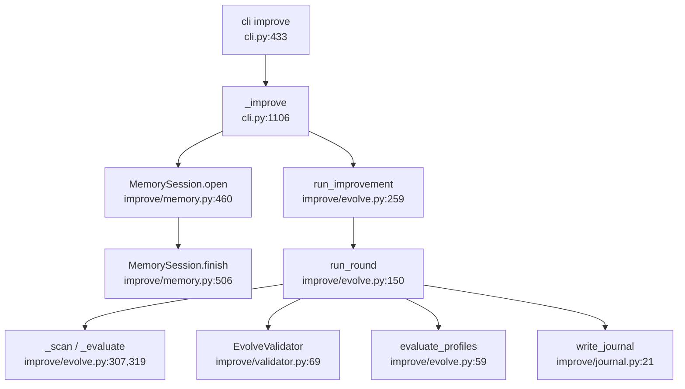
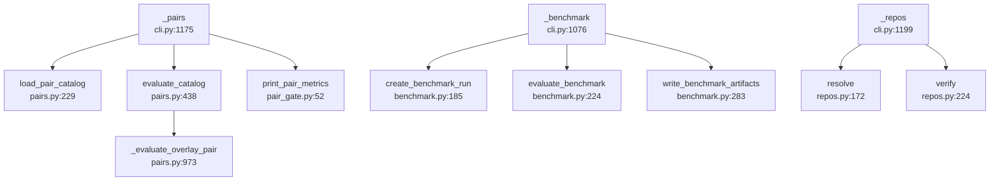
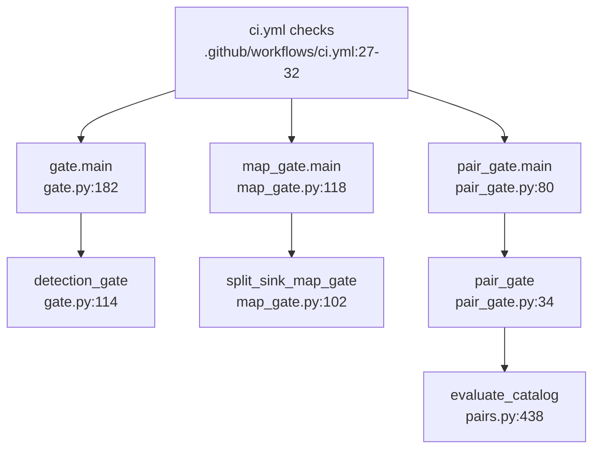
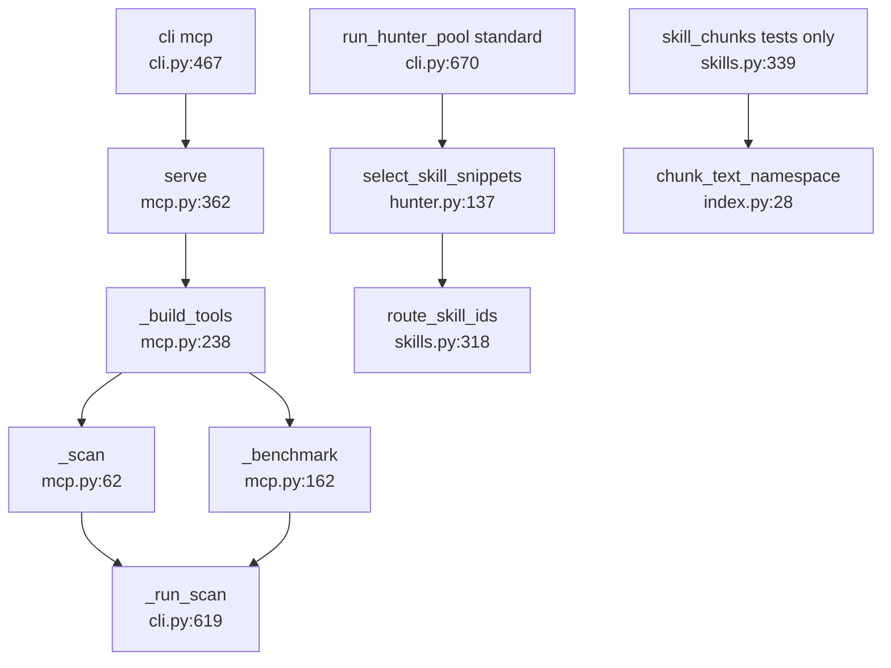

# U10 Periphery: improve, pairs/benchmark/repos, gates, MCP and skills

Traced read-only 2026-10-13.

## (a) improve/ (1,175 lines: evolve 416, memory 549, validator 125, journal 53)
`ousast improve` (cli.py:237-281, 433) → `_improve` (1106): holdout split of the pair catalog (1129), manifest
and target (1130-1131), optional `MemorySession` (1133, 1170) → `run_improvement` (evolve.py:259) loops
`run_round` (150): `_scan`/`_evaluate` (307, 319; `benchmark.evaluate_benchmark`), propose status edits (126)
plus memory proposals (176-183), `EvolveValidator` (validator.py:69), replay boot `_load_with` (333), rescan;
accept only if recall ≥ floor, FP < ceiling, score and matched count do not drop (212-214) plus `evaluate_profiles`
(59, 220-228); write the ledger on accept (231), always the journal (`_record` 378 → journal.py:21/45).
Writes `<target>/.openultrasast/calibration/rule_policy.json`, `improve_journal.json`, `rule_signals.json`,
and with `--memory` `memory_proposals.jsonl`, `signals.json`, outcome rows to the store (memory.py:355-380,
508, 519). Callers: cli.py:45, 1170; lazily plane/tasks/loop.py:69, 80, 194-195, 219-221; plane/memory.py:1002
→ loop.write_snapshot → improve.memory Guard; `loop-improve` task registered at plane/generate.py:380,
loop.py:269. Nothing under benchmarks/, dagger/, .github imports it. No active spec names the command; only
.kiro/steering/overview.md:65 and docs (README.md:220, 314; docs/memory.md, examples.md, index.md,
threat-model.md; ops/ax/README.md:101). Tests: test_improve, test_improve_memory, test_cli_improve,
test_subtraction_complete (:67-89), test_gate.py:135-136.

## (b) pairs.py (1,207), benchmark.py (504), repos.py (285)
`ousast pairs` (cli.py:283-294) → `_pairs` (1175) → `load_pair_catalog` (pairs.py:229) → `select_slice`/
`select_profile`/`select_split` (649/661/667) → `evaluate_catalog` (438) → `_evaluate_overlay_pair` (973) or the
inventory path (876) → `result_payload` (673) or `pair_gate.print_pair_metrics` (pair_gate.py:52, cli.py:49).
`ousast benchmark` (cli.py:232) → `_benchmark` (1076) → `create_benchmark_run` (benchmark.py:185) → `_run_scan` →
`evaluate_benchmark` (224) → `write_benchmark_artifacts` (283). `ousast repos` (cli.py:296) → `_repos` (1199) →
`load_repo_recipes` (repos.py:92) → `select` (282) → `resolve` (172; `_fetch` 188 only with `--fetch` or
OPENULTRASAST_REPOS_NETWORK=1) → `verify` (224).

The hunter-learning-loop label path needs only `load_pair_catalog` (with `_load_catalog_file`, `PairCase`,
CatalogError) and `pair_cache_dir` (pairs.py:328): learn/labels.py:142, 615; learn/examples.py:292;
benchmarks/pairs/advisory-fixes/materialize.py:51 (loaded by benchmarks/valid/catalog.py:41). Other non-CLI
users: plane/harvest.py:131, loop.py:70, 222 (`load_pair_catalog`, `select_split`); improve/evolve.py:71
(`evaluate_catalog`, `select_tier`, `select_vendored`, `GATING_TIERS`); model/candidates.py:268
(`_materialize_side`, `_overlay_scan`, `_quick_scan`); benchmarks/learn/* (`_materialize_side`, `_targets`).
Only CLI/pair_gate/tests: `select_profile`, `result_payload`, `duplicate_groups`, `split_by_repository`,
`_header_lines`, `_body_digest`, `is_weak_label`, `pointer_recipe`, `load_mechanisms`, `load_datasets` (no
non-test caller), `build_pair_signals` (re-exported by improve only). benchmark.py is core (cli.py:18,
gate.py:22, map_gate.py:17, pairs.py:28, mcp.py:163, improve/evolve.py:21, plane/tasks/loop.py:68, 175).
repos.py callers: cli.py:68-77, push_inputs.py:18, benchmarks/{ranking/position.py:26, push/*.py, repos/measure.py:34}.

## (c) Gates (gate 205, map_gate 130, pair_gate 93)
`gate.main` (gate.py:182): for each of eight `LANGUAGE_MANIFESTS` (30-35) load `benchmarks/manifests/<name>.toml`
→ `benchmarks/fixtures/<name>`, quick scan (80), `evaluate_benchmark`; recall ≥ 0.90 and FP < 0.10 per language
and overall (114-146). `map_gate.main` (118): scans split-sink-{c,java,javascript,python} (24-29); planted sink
must be in the top hotspot band (69); Python map order must differ from hit-count order (96-99).
`pair_gate.main` (80): vendored `local` slice of benchmarks/pairs/catalog.toml must have pair_pass_rate 100%
(34-47). Callers: gate: ci.yml:28, dagger/ci.py:53, cli.py:42, loop.py:218 (constants), measure_php_quick.py:129,
many tests via `LANGUAGE_MANIFESTS`; map_gate: ci.yml:30, dagger/ci.py:54, model/audit.py:30, test_map_gate,
test_degradation_matrix; pair_gate: ci.yml:32, dagger/ci.py:55, **cli.py:49 (`print_pair_metrics`, module
level)**, model/audit.py:30, test_pair_corpus.py:11, 138, test_degradation_matrix. Deleting map_gate/pair_gate
breaks ci.yml:29-32, dagger/ci.py:54-55, every `ousast` command (cli.py:49), test_degradation_matrix.py:34, 41
(diffs against benchmarks/measurements/2026-09-06-gate-baseline.txt), test_map_gate, test_pair_corpus.py:138,
model/audit.py:30 `ROOTS`.

## (d) mcp.py (384), skills.py (372), index.py (74)
`ousast mcp` (cli.py:305, 467) → lazy `serve` (mcp.py:362) → `McpServer.handle` (306) → tools (238): `scan`
(62, quick/standard only, into `cli._run_scan`); `benchmark` (162, into benchmark + `_run_scan`); read-only
over run_dir JSON: `status` (81), `findings` (101), `get_finding` (128), `evidence` (143), `artifacts` (157),
`explain` (188), `export_report` (226); `propose_patch` (215) returns `not_implemented`. Only importer
cli.py:468. skills: cli.py:667-670 standard mode `run_hunter_pool` → `schedule_hunter_tasks` (hunter.py:70) →
`select_skill_snippets` (137) → `skills.route_skill_ids` (skills.py:318); ids stored as `selected_skills` on
the task and trajectory (hunter.py:96, 157) and end up in `traces/hunter_trajectories.jsonl` (cli.py:707-710);
detection is plain `quick_scan_findings` (151) and never reads the skills. `select_skill_context`, `skill_chunks`
(322, 339) only test_skills; index.py imported only by skills.py:15 for `skill_chunks`, otherwise test-only.
The `skills`/`mcp` strings in plane/manifests.py:556 and reconciler.py:130-132 are Workspace fields, not these
modules.

## Confidence
High on caller lists for gates, mcp, skills, index, the improve read/write sets and the CI dependencies;
medium on the "CLI or tests only" list for pairs.py. Not read: `propose_from_memory` (improve/memory.py:282);
whether ops/ runs `loop-improve`.
