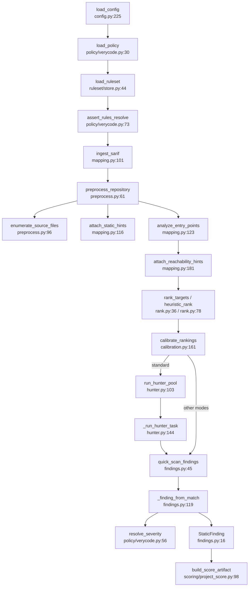

# U2 Shared core: the quick-rule path

Traced read-only 2026-10-13. `hunter.py` is the regex quick-rule pool, not the LLM hunter. No model call
anywhere on this path: `rank.py:32 complete_json` is a method on a Protocol used only by
`rank_targets_with_model` (rank.py:46), whose only caller is tests/test_rank.py:82.

## Happy path (`_run_scan`, cli.py:619)
1. `load_config` (cli.py:624 → config.py:225): loads `.env` into os.environ (config.py:77-92), reads TOML, rejects retired keys (config.py:236).
2. `load_policy` reads CWE_Score.tsv (policy/verycode.py:30-37); `load_ruleset` parses every rules `*.toml` by rglob, filters framework priors, applies the ledger overlay (ruleset/store.py:44-71); `assert_rules_resolve` (verycode.py:73).
3. `ingest_sarif` (mapping.py:101) → `write_static_hints` (mapping.py:240).
4. `preprocess_repository` (preprocess.py:61): `enumerate_source_files` with `git ls-files` (preprocess.py:96, 240), `build_file_target` + `detect_language` + `detect_tags` (114, 130, 146), `attach_static_hints` (mapping.py:116), `_git_commit` (285), `write_preprocess_artifact` (90).
5. `uncovered_languages` (findings.py:78); `analyze_entry_points` (mapping.py:123-130) → `attach_reachability_hints` (mapping.py:181).
6. `rank_targets` without a model → `heuristic_rank` (rank.py:36, 78); reachability from hints (rank.py:112, 227); `calibrate_rankings` (calibration.py:161); `write_rankings` (rank.py:72).
7. Standard: `run_hunter_pool` (hunter.py:103) → `schedule_hunter_tasks` (70) → ThreadPool of 8 × `_run_hunter_task` → `quick_scan_findings` (151). Other modes: `quick_scan_findings` directly with emit floors (cli.py:675-685).
8. `quick_scan_findings` (findings.py:45) compiles rules (60-62) → `_finding_from_match` (119) → `resolve_severity` (verycode.py:56), `_reachability_for_line` (154) → `StaticFinding` (16).
9. `write_findings` (findings.py:113), `write_hunter_trajectories` (hunter.py:123), then score (`build_score_artifact`, scoring/project_score.py:98).

## Side effects
Subprocesses: `git ls-files -z` (preprocess.py:240), git commit hash (287). Writes: preprocess.py:93,
findings.py:116, rank.py:75, hunter.py:125, mapping.py:242/247, config.py:258; ruleset/store.py:102, 113 are
written by the learning loop, not scan. config.py:92 mutates os.environ. findings.py:42 loads PATTERN_RULES at
import time. The hunter pool computes `selected_skills` and `retrieval_context` (hunter.py:96-97, 112) but only
logs their ids; they never affect findings. **Bug:** the standard-mode pool skips
`min_emit_priority`/`min_emit_precision` (compare cli.py:670 with cli.py:683-684).

## Dependencies on other units
hunter.py:139 → skills.route_skill_ids (skills.py:318); preprocess.py:255 → model.layout.is_vendored (lazy);
findings.py:89 → model.partitions.FRONTENDS (lazy); config.py:11 → contracts.Contract. Same pipeline is also
called by gate.py:81-84, map_gate.py:52-54, pairs.py:794-815, plane/tasks/alerts.py:120-122, push/quick.py:87-90,
improve/evolve.py:311-314, hunter_tools.py:232/307.

## mapping.py (1,087 lines): who imports what
| Function | Importers |
|---|---|
| ingest_sarif :101, attach_static_hints :116, write_static_hints :240, write_entry_points :245 | cli.py / preprocess.py (+ tests) |
| analyze_entry_points :123 | cli, gate, map_gate, pairs, hunter_tools, plane/tasks/alerts, learn/features, improve/evolve, push/quick, push/runner; 7 tests; 6 benchmarks |
| attach_reachability_hints :181 | cli, gate, map_gate, pairs, plane/tasks/alerts, push/quick, improve/evolve |
| php_hook_callbacks :134 | model/scan.py, model/taint.py; 2 benchmarks |
| verifier_evidence_candidates :188, semgrep_mapping_tasks :204, codeql_mapping_tasks :218, differential_mapping_record :232, sharp_edge_record :236 | **tests only** (test_mapping.py); their records MappingTaskRecord, DifferentialMappingRecord, SharpEdgeRecord (:39, :48, :56) are produced nowhere else |

## Overlap check
- policy/ (CWE severity table) vs push/policy.py (revision/capability admission): different things.
- scoring/ `REACH_MULT` (project_score.py:15) duplicates `_BASE_REACH_MULT` (calibration.py:255).
- calibration.py: only cli.py:27 and tests import it.
- contracts.py (base `Contract`), model/contracts.py (question/scope schemas), push/contracts.py (push schemas, builds on model/contracts): layered, not duplicates.

## Confidence
High on the call chain; medium on importer lists (name greps with -w). Not traced: parsers inside
mapping.py:250-1087, skills routing internals, families.toml consumers beyond model/taxonomy.py:32.
