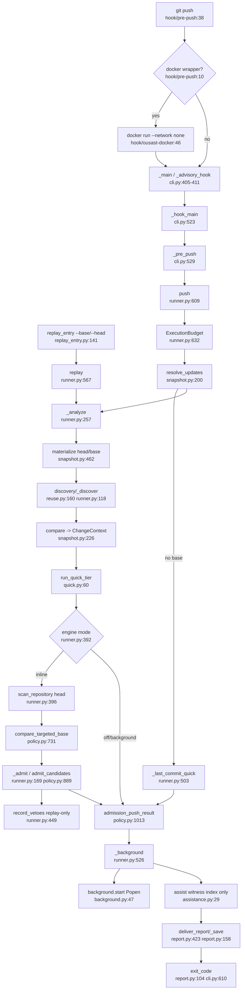

# U3 Pre-push hook

Traced read-only 2026-10-13. Key finding for the hunter spec: **in the shipped configuration admission can never
produce a finding.** `eligibility.json` has no `"enabled": true` entry (grep count 0), verdicts are NO-GO or
experimental, so every candidate gets `capability_unavailable` or `capability_disabled` (policy.py:913-919).
Engine hits appear only as advisory lines (background.py:113-145, report.py:241). The hook default deadline is
30 s (hook/pre-push:24, cli.py:182, config.py:196); 300 s is the replay benchmark's `long_deadline` arm
(benchmarks/unseen/replay.py:25); the background engine defaults to 900 s (cli.py:210).

## Happy path
1. Git runs `push/hook/pre-push:6-38` → `ousast pre-push . --artifact $dir/push-$$.json --deadline ${OUSAST_PUSH_DEADLINE:-30} --mode advisory --remote NAME URL`; docker wrapper if present (:10-12); prior hook chained (:34-36).
2. `_advisory_hook` (cli.py:513) → `_hook_main` (523); argument errors become exit 0 "check did not run" (412-415). `_pre_push` (529) builds `PushConfig` (config.py:196), duplicates stdin (570), calls `runner.push` (584).
3. `push()` (runner.py:609) creates one `ExecutionBudget(started + deadline, allowance=2)` (632); bounded work runs in a forked child via `_prepare` (56-115).
4. Refs: `_prepare(updates)` 1 MiB cap (638-640) → `SnapshotAdapter.resolve_updates` (snapshot.py:200) → `parse_updates` (124), `_resolve` with merge-base (167, 191). No base → `_last_commit_quick`, quick only (runner.py:646-654, 503-523).
5. `_analyze` (runner.py:257): provenance (322-327, 131); optional `ArtifactCache` only with `--cache-dir` (328-341).
6. Snapshots: `materialize(head)`, `materialize(base)` (344-351, snapshot.py:462) into `mkdtemp("ousast-snapshot-")` (485).
7. Discovery: `reuse.discovery(..., discover=_discover)` for head and base (356-363); `_discover` (118) uses preprocess, mapping, `regions_for`; `ReusingBackend` (365-385).
8. Attribution: `adapter.compare` → `ChangeContext` (386, snapshot.py:226, diff-tree 270); `_uncovered_languages` (212, 389).
9. Quick tier: `head_spans` → `_prepare(run_quick_tier)` (385-391; quick.py:47, 60); matches kept only on a changed line or in a changed function (quick.py:121-130); "advisory, not admitted, never blocking" (quick.py:35).
10. Engine tier (`--engine inline` default): head `scan_repository(..., ScanBudget(max_model_calls=0))` (288, 396-406); base `policy.compare_targeted_base` (410-423, policy.py:731) → `compare_evidence` (policy.py:489) → `CandidateDelta`s.
11. Admission: `AdmissionCandidate` with `CapabilityKey`, `dependency_gaps` (428-446) → `_prepare(_admit)` (447) → `_admit` (169) → `load_registry` (eligibility.py:152) + `admit_candidates` (policy.py:889).
12. Vetoes only with explicit replay + `--experimental-record-vetoes` (449-457, 180-209; vetoes.py:412); never on the hook path (cli.py:550-551).
13. `deadline_exhausted`, `analysis_incomplete` appended (465-477); `admission_push_result` (488, policy.py:1013); merge across comparisons (676-686) → `PushReport` (707); remote URL stored as sha256 only (700).
14. `_background` (526): `background.previous()` always; `background.start()` only with `--engine background` (719-727).
15. `assist(report, config=model_config)` (730-732) returns at once without `--model-config` (assistance.py:31-32); the hook never passes it.
16. `_deliver` (560) → `deliver_report` (report.py:423) → `_save` forked, atomic, 0o600 (158, 120) → `render_report` (340); CLI prints (cli.py:595); chained hook (596-605); exit = `int(push_disposition == "block")` (report.py:104-105), only possible in `mode == "blocking"` (policy.py:1029-1031).

Replay: `replay.py:19-50` packages `hook_flags=["--deadline", N]`; `replay_entry.py:141-156` runs
`ousast pre-push <case> --base B --head H --artifact out/push.json --deadline N` through `runner.replay`
(runner.py:567); subprocess timeout N+30; exit 0 or 1 accepted (:159).

## Side effects
Artifact JSON at `${OUSAST_ARTIFACT_DIR:-$XDG_CACHE_HOME|~/.cache}/openultrasast/push/push-<pid>.json`, atomic
`.partial-<uuid>`, 0o600 (report.py:120-150), refused inside the repo (runner.py:561). Snapshots in
`$TMPDIR/ousast-snapshot-*`, removed after (snapshot.py:480-485, 648). Cache only with `--cache-dir` outside the
repo (runner.py:310, 328). Background results under `<artifact dir>/engine/<sha16(repo)>/` (background.py:29-33,
60-104). Git: rev-parse, cat-file, check-ref-format, merge-base, diff-tree, ls-tree, cat-file blob, all with
`-c protocol.allow=never -c core.hooksPath=/dev/null` (snapshot.py:63-570); no fetch. Subprocesses: forked
children (`_prepare` runner.py:66, `_save` report.py:168), Joern (cpg/backend.py:641, 1303, 1428), detached
background CLI (background.py:69-101), chained hook (cli.py:600). Model calls: none by default
(`max_model_calls=0` runner.py:288; `assist` at most one call, only with `--model-config`, assistance.py:89-110).

## External dependencies
Core: `enumerate_source_files`/`build_file_target` (runner.py:28, 121-122), `detect_language` (quick.py:69),
`analyze_entry_points` (runner.py:22, 123), `attach_reachability_hints` (quick.py:68), `PATTERN_RULES` /
`quick_scan_findings` (quick.py:67, 89), `rank_targets`, `load_policy` (quick.py:70-71). Engine: `JoernBackend`,
`engine_runtime_identity`, `joern_version` (runner.py:21), `scan_repository` (26), `regions_for`,
`declared_sources`, `layout_facts` (24-27); policy.py:19-22 imports `model.pipeline._arbitrate_all` and
`model.ladder.Rung`. LLM client: `model.endpoint.ChatEndpoint`/`resolve_chat_endpoint` (assistance.py:18).
push_scoring: `_metrics`, `score` (eligibility.py:18, 163-167) on every admission.

## Where an LLM detection tier plugs in
Defects enter admission at runner.py:428-447: the tuple of `AdmissionCandidate`s from `delta.candidates` goes
to `_admit` (169) → `admit_candidates(candidates, capabilities=...)` (policy.py:889, origin-agnostic per its
docstring :890). A hunter tier adds its candidates before runner.py:447. A candidate must carry (policy.py:61-75,
837-845; gates 906-967): a `CandidateDelta` with family, `site` = `"{path}:{line}:"`, `defect_id`, a non-null
`witness`; `rung == Rung.ENTAILED` (else `insufficient_rung`; :933-935 says a non-engine producer needs its own
protocol); `novelty`/`reason` from four allowed pairs with non-empty `change_evidence` (:941-946); matching
base/head OIDs and semantics; a `head_operation: EvidenceOperation` whose (language, family, mechanism) matches
the `CapabilityKey` and whose operation symbol is in the capability's `operation_symbols`; and an enabled PASS
`CapabilityAdmission` from eligibility.json (none exists today) with empty `dependency_gaps`. Hunter output that
cannot meet that bar can mirror the quick tier: an advisory, never-admitted payload on `PushReport`
(runner.py:499, report.py:143). `assistance.py` cannot add a finding: it asks for an index only (22-26), accepts
exactly `{"selections":[{defect_id, witness_index}]}` over existing admitted ids (120-140), replaces only
`model_assistance` (153).

## Off the happy path
- `vetoes.py`: only via `_record` under `--experimental-record-vetoes`, rejected outside replay (cli.py:550); importer runner.py only; `benchmarks/push/m1a_record_vetoes.py` needs it.
- `install.py`: install-time only (cli.py:476).
- `cache.py` / `reuse.ReusingBackend`: inactive by default (no `--cache-dir` in the hook); `reuse.discovery` still runs.
- `background.py` start: off unless `OUSAST_PUSH_ENGINE=background`; does not work through Docker (ousast-docker:17).
- `assistance.py`: no-op on the hook path.
- `eligibility.py`: always runs, yields no enabled capability; admission is structurally empty.
- `push_inputs.py`: only `benchmarks/push/{measure,m1a_record_vetoes,transfer_replay}.py` and one test.
- `push_scoring.py`: production (eligibility.py:18) plus benchmarks/push/measure.py:20 and tests.

## Confidence
High for runner, CLI, assistance, quick, background, admission, report. Medium for snapshot.compare internals
(snapshot.py:226-460), `compare_evidence` (policy.py:489-730), cache/reuse bodies. Not verified: eligibility
bindings vs current provenance (`eligibility_provenance_mismatch`, eligibility.py:159-160); ops/install-pre-push.
