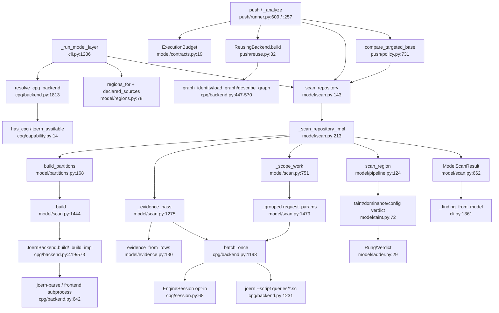

# U4 Engine: CPG backend and model layer

Traced read-only 2026-10-13.

## Happy path A, standard scan (no deadline)
1. cli.py:804 → `_run_model_layer` (1286), early return if disabled (1300).
2. `resolve_cpg_backend` (cpg/backend.py:1813) → `has_cpg` (cpg/capability.py:14) → `semantic.engines.joern_available` (engines.py:25); `JoernBackend` or `NullBackend`; `cpg_unavailable` degradation (cli.py:1310-1312).
3. `regions_for(..., shipped=declared_sources(root))` (model/regions.py:78, model/shipped.py:45; cli.py:1315); `coverage_rows` (model/report.py:87; cli.py:1324).
4. `run_stage("model", scan_repository(...))` (cli.py:1332); no `execution_budget`, so no deadline.
5. `scan_repository` (model/scan.py:143): drop vendored regions (164-165), reject duplicate question ids (167), `_scan_repository_impl` (213) inside a finally that disposes graphs and closes the session (187-198).
6. `load_families` (model/taxonomy.py:201; scan.py:233).
7. `build_partitions` (model/partitions.py:168; scan.py:244): `os.fwalk` no-follow, bucket by `LANGUAGE_BY_EXTENSION`, copy each language into `mkdtemp("ousast-input-")` (249), `build(scratch, frontend)` (280) via `scan._build` (scan.py:1444) with `vendored_directories` as exclude.
8. `JoernBackend.build` (backend.py:419) → `_build_impl` (573): `mkdtemp("ousast-cpg-")` (584), readability precondition (600), then sharded frontend (609) / JS-TS direct frontend + `_apply_overlays` (630-638) / `joern-parse --output cpg.bin` (642-643) with frontend retry (648). Returns `CpgResult` with run, run_batch, run_batch_once, cleanup (655-663).
9. `_evidence_pass` (scan.py:1275; called 345): taint requests `evidenceOnly` via `_portioned_evidence` (1252) and `cpg.run_batch("taint")` → `evidence_from_rows` (model/evidence.py:130; scan.py:1338); `order_by_evidence` (1399; 359).
10. `_scope_work` (751; 401): scoping and tier-0 pruning.
11. Query phase per kind (434-524): `_grouped` (1479) with each arbiter's `request_params` (taint.py:22, dominance.py:30, config_value.py:22); `_batched` (969) → `run_batch_once` → `JoernBackend._batch_once` (backend.py:1193): writes `<scratch>/<kind>-requests-*.json` (1222-1224), tries the session (1229), else `joern --script queries/<kind>.sc --param cpgFile=… --param requestsFile=…` (1231-1242) via `_run` (1514, Popen, process group killed on timeout); `extract_payload` (1250). `__census__` checks empty graph/shards (scan.py:490-509).
12. Arbitration (540-586): prefetched `CpgResult` per question (548) → `scan_region` (model/pipeline.py:124) → `_arbitrate_all` with taint/dominance/config verdicts; rungs on the ladder (model/ladder.py:29 `Rung`, 45 `Verdict`): ENTAILED = graph decided (pipeline.py:139-146); CORROBORATED and SUSPICION only from a judge (151-181); `enumerate_candidates` only with a judge (scan.py:556-558).
13. Graph-gap demotion (591-655), `_deduplicated`/`_ordered` (659), `ModelScanResult` (662); CLI `_finding_from_model` (cli.py:1361).

## Happy path B, pre-push (with deadline)
`push()` (runner.py:609) → `ExecutionBudget` (632; replay 586) → `_analyze` (257) with `JoernBackend()` (290) and
optional `ArtifactCache` (315); `discovery` wraps `_discover` (118); `ReusingBackend.build` (push/reuse.py:32) →
`graph_identity` (backend.py:447), cache hit `load_graph` (522) else `build` + `describe_graph` (494, seals a
`GraphArtifact` from `census.sc`) + `cache.publish`. `scan_repository(..., execution_budget, ranking_mode=
"evidence", change_context)` (runner.py:396), client withheld (scan.py:177), `max_model_calls=0` (runner.py:288),
`affected_context` (regions.py:258; scan.py:363). Base via `compare_targeted_base` (policy.py:731, 774).
Deadline enforcement: `_within_deadline` (scan.py:1435) with `_arbitration_reserve` (884), `_build` pre-checks
(1449-1462), partition walk checks (partitions.py:182-273), `_time_available` (backend.py:1377), `_run_bounded`
(1414-1471: timeout capped at deadline, cancel window, partial stdout harvested), `_cleanup_limit` (1399);
`deadline_exhausted` appended (scan.py:203, runner.py:458).

## Side effects
JVMs: `joern-parse` or a frontend, then `joern --script` once per query kind, killed as process groups
(backend.py:1514-1550, 1659); optional `joern --server` under `OUSAST_ENGINE_SESSION=1` with a budget
(session.py:132-137; backend.py:65, 405, 1319). No Docker inside U4; the container boundary is the hook's
`ousast-docker` wrapper. Files: `$TMPDIR/ousast-input-*` (partitions.py:249), `$TMPDIR/ousast-cpg-*` with
cpg.bin, `*-requests-*.json`, `engine-session/` (backend.py:584, 1222, 1324), removed via cleanup (scan.py:1425);
stale trees swept only without a budget (backend.py:586-587, 1638). Push-only `ArtifactCache` 0700 outside the
repo (push/cache.py:35-44; runner.py:286). Standard scan has no graph cache.

## The CPG↔Model cycle
cpg/backend.py:37 and cpg/session.py:44 import exactly one name, `ExecutionBudget` (model/contracts.py:19-34): a
frozen dataclass over `openultrasast.contracts.Contract` with two floats and a `__post_init__`. No model logic,
so it can move to a shared contracts module. Reverse couplings: model/partitions.py:14 imports the private
`_DeadlineExpired`, `_remove_owned_tree` from cpg; cpg/artifact.py:151 imports the same two lazily.

## Dependencies
Out: semantic (`joern_available` cpg/capability.py:11; `load_facts` scan.py:31, layout.py:14, specs.py:24;
obligations facts specs.py:25; `parse_file`/obligations candidates.py:107, 215-217); core (`Contract`
model/contracts.py:15, cpg/artifact.py:13; `LANGUAGE_BY_EXTENSION` partitions.py:15; `php_hook_callbacks`
scan.py:1521; redaction pipeline.py:31; `StaticFinding` report.py:20; pairs candidates.py:268 `ceiling` only).
In: cli.py:1302-1306, 1322, 1705; push/runner.py:20-27, 218; push/policy.py:22; push/reuse.py; push/cache.py;
learn/slice.py:18; learn/features.py:26, learn/labels.py:47, plane/tasks/features.py:55 (taxonomy);
plane/tasks/repo_facts.py:28, preprocess.py:255 (layout); findings.py:86 (`partitions.FRONTENDS`).

## Removal candidates
- `model/audit.py`: no src importer; maintainer `__main__` tool (audit.py:45, 255); tests/test_module_audit.py, tests/test_search_demo_replay.py:200, measurement 2026-09-08-module-audit.json.
- `model/report.py`: only `coverage_rows` live (cli.py:1322); `SliceRow`, `overfitting_gap`, `render`, `render_findings` (24-75) only tests/test_model_report.py.
- `cpg/queries/vocabulary.sc`: only tests/test_cpg_queries_compile.py:32 and benchmarks/push/ontology_gap.py:102.
- `model/candidates.py`: only with a judge (scan.py:556); push never reaches it; `ceiling`/`labeled_*` serve cli.py:1705 only.
- Conditional, not dead: cpg/session.py (opt-in), cpg/artifact.py sealing (push with cache_dir). `model/shipped.py` is live (cli.py:1306, runner.py:27, 123).

## Confidence
High on the chain, subprocess boundary, deadline plumbing; medium on unused-module claims. Not read in detail:
`_batched`/`_PortionSizer` (scan.py:969-1232), `_build_sharded` (backend.py:765-1115), session internals,
`.sc` bodies, `taint.verdicts` ranking (taint.py:131-312).
