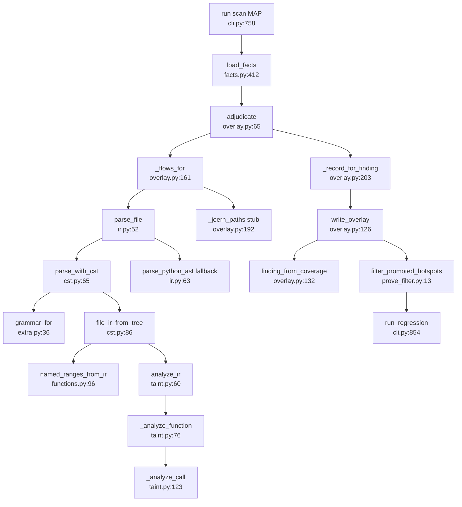
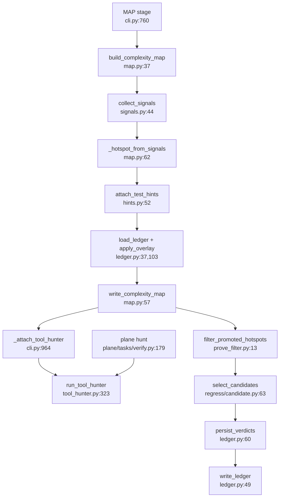

# U5 Semantic layer (tree-sitter) and complexity map

Traced read-only 2026-10-13. Correction: `prove_filter` acts on hotspots, not findings, and runs only in deep
mode before regress (cli.py:847). MAP runs in standard and deep (stages.py:15-16).

## (a) Overlay path, under Stage.MAP (cli.py:758)
1. `load_facts` (cli.py:770 → facts.py:412) reads `ruleset/semantic/*.toml` (facts.py:16, 179-213), memoised (420-422); FactLoadError → degradation (cli.py:771-773).
2. `adjudicate` (overlay.py:65) → `_flows_for` (161): per target read text (170), `parse_file` (ir.py:52) → `parse_with_cst` (cst.py:65) with `grammar_for` (extra.py:36) → `file_ir_from_tree` (cst.py:86) → FileIR of FunctionIR with Binds and CallSites (ir.py:10-50). Python falls back to `parse_python_ast` (ir.py:59-60); other languages `language_unsupported` (61).
3. `named_ranges_from_ir` (functions.py:96); `analyze_ir` (taint.py:60) → `_analyze_function` (76): parameters start TAINTED, up to 8 fixpoint passes (`_bind_state` 101), `_analyze_call` (123) emits TaintPath, Demotion or incomplete.
4. `_joern_paths` (overlay.py:192) probes `joern_available` but `joern_flow` always returns `()` (engines.py:42-47).
5. `_record_for_finding` (overlay.py:203) → promote / demote / unadjudicated; unmatched taint paths become coverage records (94-121). `write_overlay` (126); `finding_from_coverage` (132) → findings.
6. Deep + sandbox: `filter_promoted_hotspots` (prove_filter.py:13) → `run_regression` (cli.py:854).

Obligations (default on, config.py:181): `_check_obligations` (cli.py:1388) → `parse_file`, `load_declared_policy` (policy.py:59) → `check_obligations` (check.py:55: find_operations, find_discharges, sibling_sets, consistency_anomalies, OrderDominance dominance.py:27) → `adjudicate_intent` **LLM call** (intent.py:26, 47) → `findings_to_static` (check.py:145) → `rank_obligations` (cli.py:800).

## (b) Complexity MAP path
`build_complexity_map` (cli.py:760 → map.py:37) → `collect_signals` (signals.py:44: nesting via
`measure_nesting` 86, adjacent tests, tags, reachability hints, `_score` per (path, function)) →
`_hotspot_from_signals` bands high ≥ 6, medium ≥ 3 (map.py:62-102) → `attach_test_hints` (hints.py:52, 79) →
`apply_overlay(load_ledger)` (map.py:47-48, ledger.py:37, 103) → `write_complexity_map` (map.py:57).
Consumers: `_attach_tool_hunter` passes the top `max_hunter_hotspots` to `run_tool_hunter` (cli.py:964,
tool_hunter.py:323) and rewrites the map (cli.py:1007); deep mode `filter_promoted_hotspots` →
`regress/candidate.select_candidates` (candidate.py:63) with `hotspot_key`, `select_forced_candidates`
(ledger.py:33, 142); `plane/tasks/verify.py:179-186` builds synthetic Hotspots for the hunter; map_gate.py:18, 96.
After regress `persist_verdicts` (cli.py:872 → ledger.py:60, 81, 49) writes the ledger for the next scan.

## Side effects
`grammar_for` builds a new `Language(...)` on every call, no cache, once per parsed file (extra.py:46-53,
cst.py:68). `joern_available` runs `joern --help` (5 s timeout) once per target from `_joern_paths` and again in
`joern_flow`, uncached and pure overhead since `joern_flow` returns `()` (engines.py:33-47, overlay.py:193).
Writes `<run>/overlay.json`, `<run>/complexity_map.json`, and into the scanned repo
`.openultrasast/calibration/complexity_ledger.json` (ledger.py:49-57 via cli.py:872). Reads ruleset TOMLs and
the target's `.openultrasast/obligations.toml` (config.py:183). Network: `adjudicate_intent` (intent.py:47).

## Facts the hunter annotation model can reuse (hunter-learning-loop R3)
| Fact | Producer | Without Joern? |
|---|---|---|
| Enclosing function at a line | `function_at` (functions.py:136) over `named_function_ranges` (120) / `named_ranges_from_ir` (96) | yes (regex scan; Python uses ast, functions.py:126-133) |
| Callers of a function | not in U5; `learn/features.py:371` (`callers`), `plane/tasks/verify.py:128` (`callers_of`) | n/a, U5 IR has CallSites per function (ir.py:22-40) but no caller index |
| Entry points | `mapping.analyze_entry_points` (consumed by check.py:84, 87) | yes |
| Source/sink/sanitizer roles | `load_facts` SourceFact/SinkFact/SanitizerFact (facts.py:37-80, 412); matched by `_source_in`, `_sink_for`, `_sanitizer_for` (taint.py:222-238); already reused by learn/slice.py:21, learn/roles.py:38 | yes |
| Def-use within a function | Bind/CallSite (ir.py:11-30), taint state (taint.py:76-98), TaintPath.names (taint.py:16) | yes, needs tree-sitter or Python ast |
| Guards/obligations | `find_operations`, `find_discharges` (operations.py:47, 76), `OrderDominance.dominates` (dominance.py:32), `check_obligations` (check.py:55); sanitizer demotions with `dominating_fact` (taint.py:136-146) | yes, order-based only |

## Dependencies
U5 imports findings.StaticFinding, policy, preprocess.FileTarget, ruleset.frameworks. Imported by cli.py:37-38,
82-90, 1403-1442; hunter_tools.py:224, 254-257, 319; pairs.py:41-44, 838-840; model/candidates.py:107, 215-217;
model/specs.py:24-25; model/layout.py:14; model/scan.py:31; learn/roles.py:38; learn/slice.py:19-21;
learn/features.py:164, 487; mapping.py:154; cpg/capability.py:10; map_gate.py:18; tool_hunter.py:13;
regress/candidate.py:10-11; plane/tasks/verify.py:179; benchmarks/valid/hunter_arm.py:15.

## Removal candidates (no non-test caller)
- `prove_filter.promoted_findings` (prove_filter.py:28): test-only; cli.py:848-852 reimplements it inline.
- `engines.joern_flow` stub (engines.py:42-47) and `taint.merge_joern_paths` (taint.py:277): Joern is never used on the semantic path.
- `engines.tree_sitter_available`: export + tests only. `taint.analyze_file` (taint.py:53): test-only.
- `obligations/shapes.py` public API (`derive_obligation` 111, `explain_skip` 139, `obligation_mechanisms` 406, `is_obligation_row` 401, `ObligationShape` 41): test-only; private helpers live via operations.py:19.
- `check_obligations(store_shapes=())` is always empty (cli.py:1438, "the store was deleted"), so `_known_fix`, `_usable_shape` (check.py:252-258) are dead in practice.
- obligations package as a whole is **live** (cli.py:1403-1444, hunter_tools.py:251-285, pairs.py:834-862, model/candidates.py:217-222). All public complexity/* functions are live.

## Confidence
High on call chains; medium on dead-symbol claims (greps over src, tests, benchmarks). Not read: cst.py `_KIND`
tables, signals._score internals, find_discharges, siblings, policy, run_regression, map_gate beyond :96; whether
`hunter_tools.flows` is registered as a hunter tool.
