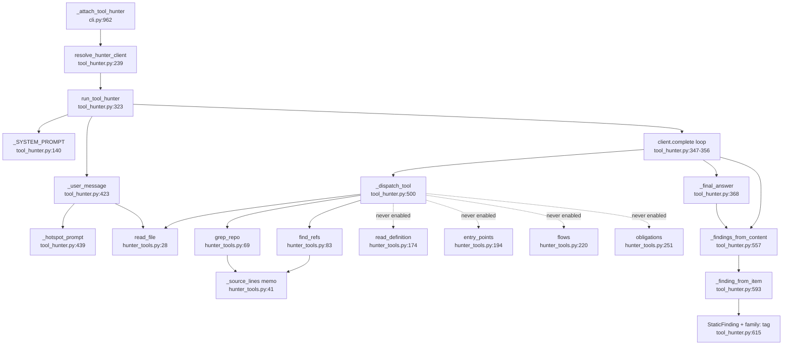
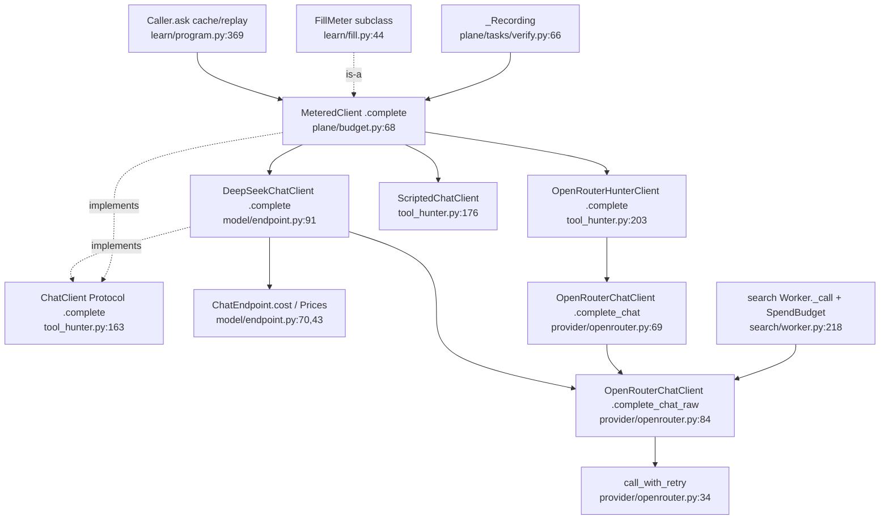

# U6 LLM hunter and model client

Traced read-only 2026-10-13. The hunt path is clean. Below it: seven chat-client types or wrappers with two call
methods, four separate usage-to-cost paths, four curated tools that no caller ever enables, and a prompt that
names only the three default tools.

## Happy path of one hunt
1. `cli.py:976` `_attach_tool_hunter` → `resolve_hunter_client` (tool_hunter.py:239): `OPENULTRASAST_HUNTER_CLIENT` scripted/dump/unsafe → `scripted_hunter_client` (246-252); `DEEPSEEK_API_KEY` → `DeepSeekChatClient(OpenRouterChatClient(base_url=DeepSeek), endpoint=ChatEndpoint(prices=price_of("deepseek-flash")))` (253-259); `OPENROUTER_API_KEY` → `OpenRouterHunterClient.from_env()` (260-262); else None and the CLI skips (cli.py:977-978).
2. `run_stage("tool_hunter", run_tool_hunter(root, hotspots, client, model, max_steps=4))` (cli.py:980-988; DEFAULT_MAX_STEPS tool_hunter.py:30).
3. `run_tool_hunter` (323): `[]` if max_steps<=0 (339); `_tool_schemas(tools)` (341, 417); `DEFAULT_TOOL_NAMES = ("read_file","grep_repo","find_refs")` (33).
4. `_SYSTEM_PROMPT` (140-145) names only those three and asks for path, line, title, rationale (no family).
5. `_user_message` (423): context files first via `read_file` (429-434) for prefix caching; question last, `user_prompt` or `_hotspot_prompt` (439-454: hotspot JSON with path, function_name, score, band, rationale).
6. Tool loop (347-356): `client.complete(model, messages, tools=schemas)` (348); `_assistant_tool_message` replays `reasoning_content` (457, 473-475); `_tool_result_message` per call (479) → `_run_tool` (488, errors in-band, output cut at 16*max_chars 496-497) → `_dispatch_tool` (500-529) → hunter_tools `read_file` (28), `grep_repo` (69), `find_refs(root, symbol, None)` (83; mapping index always None, tool_hunter.py:528), optional `read_definition` (174), `entry_points` (194), `flows` (220), `obligations` (251). Paths clamped by `clamp_repo_path` (hunter_tools.py:15); `_source_lines` memo shared (41-59).
7. Ending: content with no tool used, or empty → `[]` (358-360); JSON → `_findings_from_content` (361-363); prose or out of steps after tools → `_final_answer` (364-368): one extra `complete(..., tools=[], json_object=False)` asking for path, line, title, rationale **and family** (388-405).
8. `_findings_from_content` (557) accepts a bare array, `{"findings":[...]}` or `{"value":[...]}` (561-569) via `_load_json` (581).
9. `_finding_from_item` (593): clamp path (600); `StaticFinding` with `evidence_level="suspicion"`, `confidence="low"`, id `tool-hunter:<path>:<line>` (615-631); `tags=[*tags, "family:<family>"]` when given (611-614, 628); `ranking_priority` from hotspot score (629); sorted by id (578). CLI dedups and caps (cli.py:989-1000).

`Caller` wraps `MeteredClient` (program.py:371-372; hunter_arm.py:65); verify.py's `_Recording` wraps it (181,
267, 378). The CLI hunt (cli.py:976) passes the bare client: no meter.

## Side effects
Every call POSTs `{base_url}/chat/completions` (openrouter.py:100-112), `temperature: 0` (94), 3 retries with
backoff on 429/5xx (34-52, 115). DeepSeek adds `thinking: disabled`, `response_format`, `logprobs`
(endpoint.py:164-175) and re-calls once on empty JSON (135-144): one `complete` = up to 2×3 HTTP attempts. A hunt
costs at most max_steps+1 calls. Tools read only inside the repo root; `entry_points`, `flows`, `obligations`
re-run `preprocess_repository` and quick-scan/adjudication or IR parsing over every target, uncached
(hunter_tools.py:304-308, 232-234, 268-274, 170-171). The hunter writes nothing; `Caller.ask` writes
`responses/<sha>.json` (program.py:412-413). Usage: `DeepSeekChatClient.usage` one row per raw call
(endpoint.py:98, 181-183); `cost_usd` via `ChatEndpoint.cost` (147-151, 78-88); `MeteredClient._absorb_rows`
diffs and prices (budget.py:154-167), raises `BudgetExhausted`/`AccountError` (107-116, 141-145). The
`OpenRouterHunterClient` path records no usage (tool_hunter.py:223 uses `complete_chat`): a meter sees zero.

## Duplication inside the unit
Chat-client types: `ChatClient` Protocol `.complete` (tool_hunter.py:163); `ScriptedChatClient` (176);
`OpenRouterHunterClient` adapter over `complete_chat` (203; drops `json_object`, records no usage 222-223);
`DeepSeekChatClient` `.complete/.bounded/.cost_usd` over `complete_chat_raw` (endpoint.py:91);
`OpenRouterChatClient` `.complete_chat/.complete_chat_raw/.complete_json` (openrouter.py:56, 69, 84, 128);
`MeteredClient` (budget.py:68) + `FillMeter` (learn/fill.py:44); `Caller.ask` (program.py:369, 397). Thin
wrappers: `_Recording` (verify.py:66), `_CountingClient` (model/scan.py:1628). Related: `RankerClient.complete_json`
(rank.py:31), `StubModel.complete_chat_raw` (search/worker.py:153-163), `_NoModel`/`_RefusingChat`
(verify.py:121, experiments.py:1003). Two resolvers: `resolve_hunter_client` (tool_hunter.py:239) and
`resolve_chat_endpoint` (endpoint.py:192); the hunter ignores config models and prices against
`DEFAULT_DETECTOR_MODEL` not the model it runs (tool_hunter.py:258); the OpenRouter branches build different
wrappers (tool_hunter.py:262 vs endpoint.py:221). Three "scripted flags" sets (tool_hunter.py:36-39,
endpoint.py:39). Four cost paths: `ChatEndpoint.cost`→`cost_usd` (endpoint.py:78, 147; push/assistance.py:103-110);
`cost_of` + `_absorb_rows` (budget.py:59, 158, arithmetic copied from the first per budget.py:60; `Caller.usd`
program.py:404-406, 420-423; `verify._sum_usage` 232-244); `SpendBudget`/`SpendReservation` (budget.py:260-322)
driven by search/worker.py:218-270 which repeats the DeepSeek extra_body logic (249-259); `_CountingClient.cost_usd`
(scan.py:1628-1640). Shape mismatch: `DeepSeekChatClient.usage` is a list (endpoint.py:98), `MeteredClient.usage`
a dict (budget.py:95); `Caller.ask` reads a dict (program.py:405), hence the shim in hunter_arm.py:56-65.

Dead tools: no `run_tool_hunter(` call in src or benchmarks passes `tools=` (cli.py:982, verify.py:189,
hunter_arm.py:245, benchmarks/archive/*). Only tests/test_hunter_curated_tools.py:143 enables `read_definition`,
`obligations`. So `read_definition`, `entry_points`, `flows`, `obligations` plus their schemas (tool_hunter.py:94-137)
and dispatch branches (505-521) are dead in production; `find_refs` mapping-record branch (hunter_tools.py:86-101,
118-164) too. Prompt mismatch: `_SYSTEM_PROMPT` names only 3 tools (141) and asks for no `family` (143) while
`_final_answer` asks for `family` (394); verify.py overrides the prompt (190).

## Dependencies
`complexity.map.Hotspot` (tool_hunter.py:13; inline at verify.py:178-186); `findings.StaticFinding` (14),
`quick_scan_findings` (hunter_tools.py:222, 232); preprocess (hunter_tools.py:8, 113, 305, 318);
`mapping.analyze_entry_points` (196, 202, 275, 279); `rank.rank_targets` (223, 232); semantic adjudicate, facts,
ir, obligations, dominance, functions (224-322); `config.ObligationsConfig`/`ResolvedConfig`. Cycle:
model/endpoint.py:22 imports tool_hunter; tool_hunter.py:254 lazily imports model.endpoint; plane/budget.py:16-17
imports both.

## Confidence
High on the happy path, client stack and dead tools. Not read in full: learn/fill.py, learn/experiments.py,
model/scan.py; callers of `complete_json` and `resolve_chat_endpoint` beyond push/assistance.py:84, learn/cli.py:171, 204.
