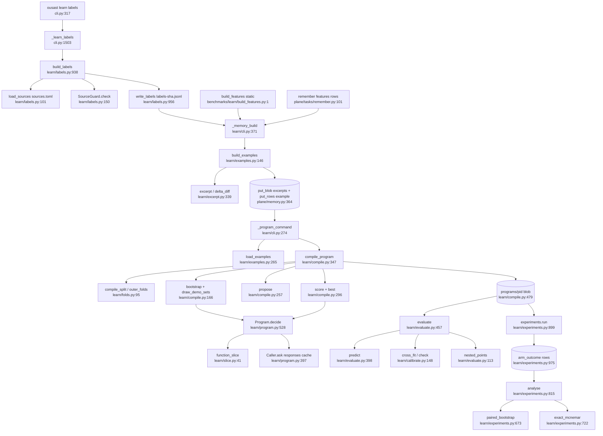
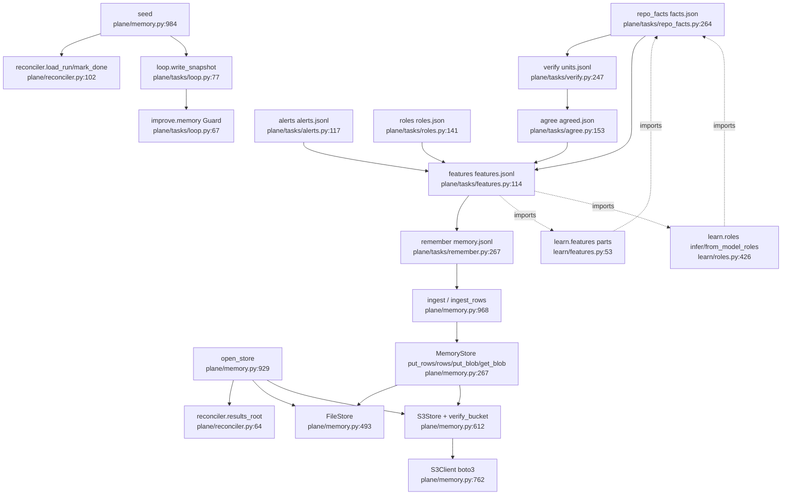

# U7 Learn harness, memory store, plane fact tasks

Traced read-only 2026-10-13. Corrections to the brief: `learn memory build` does not call features, roles or
slice; it reads feature records from `--features` JSONL and `kind=features` store rows (produced by
benchmarks/learn/build_features.py or the plane `features`/`remember` tasks); slice.py runs when a prompt is
built (program.py:41). `learn/fill.py` (learn/cli.py:167) and `plane/tasks/agree.py` (runner.py:133 via
agree.yaml) are live. The lazy `plane.tasks.alerts` import at learn/features.py:484-486 is inside
`build_for_scan`, which only tests call.

## Happy path
1. `ousast learn labels` (cli.py:317-324, 466) → `_learn_labels` (1503) → `build_labels` (labels.py:938) → `load_sources(sources.toml)` (101; refuses unknown kinds, duplicates, excluded files) → `LabelBuilder.run` (501) reading every file through `SourceGuard` (126-167) → `Clone` cache `~/.cache/openultrasast` (374, 53) → `snapshot` (871), `write_labels` → `OUT/labels-<sha16>.jsonl` (956; cli.py:1516-1517).
2. Feature records: static profile `benchmarks/learn/build_features.py:58-79` (learn.features, learn.roles); plane profile: `features` task then `remember` writes `kind=features` rows.
3. `learn memory build` (learn/cli.py:102 → `_memory_build` 371): `load_sources`, `read_jsonl` labels + features, store `features` rows (383), `SideReader` (examples.py:274) → `build_examples` (146): refuses `origin: user` and unlisted sources (167-171); `excerpt`/`delta_diff`/`function_bounds` (excerpt.py:339, 383, 302) with `identities_of` redaction (173); `put_blob("excerpts")` (213); `example` rows (216); `put_rows` (229).
4. `learn memory embed` (optional): `_memory_embed` (342) → `embed_excerpts`, vectors at `embeddings/<slug>/<sha>` (embeddings.py:67-80).
5. `learn compile`: `_program_command` (274): `open_store`, `load_spec(compile.toml)` (compile.py:80), `load_examples` (examples.py:265), `EmbeddingCache`, `_caller` (241) = `MeteredClient` + `Caller`. `compile_program` (compile.py:347): `compile_split` + `outer_folds` + `assert_disjoint` (364-367); `bootstrap` via `Program.decide` (166) + `draw_demo_sets` (212); `propose` one call at temperature 0.7 (257); `score` with `balanced_brier` (296); `best` (315); `program_id` = sha256 of canonical JSON (328); `put_blob("programs", name=pid)` (479).
6. `learn evaluate`: `load_program` hash-checked (compile.py:484), `Program(spec_of(...))`; `compile_split`, `outer_folds(exclude=split.groups)`, `targets`/`unevaluable_families` (learn/cli.py:312-314); `predict` (evaluate.py:398), `evaluate` (457): `cross_fit` (calibrate.py:148), `check`/`offered` (197, 221), `nested_points` (evaluate.py:113), `summary`/`strata` cluster bootstrap (318-363). Report to stdout and `--out`; nothing to the store.
7. `learn experiment`: `_experiment` (learn/cli.py:114); `register` (experiments.py:364, put_row 403); `units` → `freeze_units` (466); `run` (899): `check_registered`, `read_units`, `program_folds`, seeded coin for arm order, one `Program.decide` per arm, `put_row(outcome_row)` (975), optional early stop (766), summary row (987); `analyse` (815): `paired_units`, `paired_bootstrap` (673), `exact_mcnemar` (722), `sequential_looks`, optional TOST, `decide` (795); `--record` writes `result_row` and `benchmarks/experiments/<id>/result.json` (learn/cli.py:141-144, experiments.py:67).

## Side effects
Chat calls through `Caller.ask` (program.py:397), cached as `responses/<request_key>` (413; key = model, params
digest, messages, temperature, salted sample 356); `--replay-only` raises `ReplayMiss` (404); endpoint from
`resolve_chat_endpoint` (learn/cli.py:254); `--budget-usd` enforced by `MeteredClient`, exit 3 when hit
(321-323). Embeddings via OpenRouter (356), cached. Plane tasks `verify` (verify.py:336) and `roles`
(roles.py:95) also call models, metered, resumable through units.jsonl. Files: labels jsonl + snapshot, clones in
`~/.cache/openultrasast`, `--out` reports, `benchmarks/experiments/<id>/result.json`, units file; git subprocesses
(experiments.py:327-329). Default store `$OUSAST_RESULTS|~/ousast-results/plane/memory` (memory.py:938,
reconciler.py:64-65); layout `repos/<repo>/<pin>.jsonl` (389), `facts/<sha>.json`, excerpts, programs,
responses, embeddings, `index.jsonl` (432); FileStore atomic writes (529-533), 1 GiB free check (106). S3 via
`OUSAST_MEMORY=s3://…`, boto3 lazy (771), `verify_bucket` once per store (620-624), S3 Select reads (733).
`seed` writes `<run>/<task>/facts.json`, `summary.json`, snapshot `rows.jsonl`/`index.json` (1016-1019;
loop.py:94-102).

## The Learn↔PlaneTasks cycle
learn → plane.tasks: labels.py:48, features.py:27, roles.py:35, excerpt.py:35 import `repo_facts` tables and
helpers (`_EXCLUDED_DIRS`, `DECLARATION`, `GLOBAL`, `_declared_name`, `declared_functions`, `enclosing`,
`product_files`, `KEYWORDS`); features.py:484-486 imports `alerts.covers`, `engine_languages`, `quick_languages`
(test-only path). plane.tasks → learn: features.py:34-54 (18 `learn.features` parts + `learn.roles`),
roles.py:33-34 (`learn.roles.MODEL_ROLE_KINDS`, `learn.schema`), remember.py:42 (`learn.schema.validate_record`).
What learn takes is pure tables and helpers (repo_facts.py:30-146, alerts.py:56-74). `features` and `roles`
task logic can move into learn/ (case_features :114, recorded_case; chunks/parse_roles/classify/assemble
roles.py:61-127), leaving `main()` wrappers because the runner resolves `openultrasast.plane.tasks.<command>`
by name (runner.py:24, 133). `repo_facts` and `alerts` tables are also used by plane/generate.py:72,
plane/harvest.py:46, remember.py:44, plane/engine_alerts.py:39-41 and benchmarks/learn/*: they belong in a
neutral module both sides import.

## The Memory→Plane inversion
memory.py:933 (`open_store`) imports `reconciler.results_root` only for the default path, lazily because
reconciler.py:51 imports `open_store` at top. memory.py:989 (`seed`) imports `load_run`, `run_dir`,
`_read_json`, `mark_done`; memory.py:1002 imports `tasks.loop.write_snapshot` (which pulls improve.memory,
loop.py:67-70). `seed` belongs with orchestration (callers cli.py:1645): move it to reconciler.py or
plane/seed.py; `results_root` to a leaf module. `ingest` (968) has no plane dependency.

## Test-only code
`folds.leave_one_source_out` (129), `leave_one_framework_out` (138): tests only. `roles.load_roles` (539): no
caller at all. `features.build_for_scan` (467): only tests/test_learn_schema.py:15. `plane/tasks/features.py:202
recorded_case`: only tests/test_plane_features.py. Live: fill.py, schema.py (11 importers), agree.py, slice.py.

## Confidence
High on dispatch, compile/evaluate/experiment flow, store API, the lazy imports and cycle edges. Not read in
detail: `LabelBuilder.run` (labels.py:501-838), retrieve.py, bootstrap internals, `run_rule`/`analyse_rule`,
S3 `verify_bucket`/`_select`, verify/agree/loop internals.
