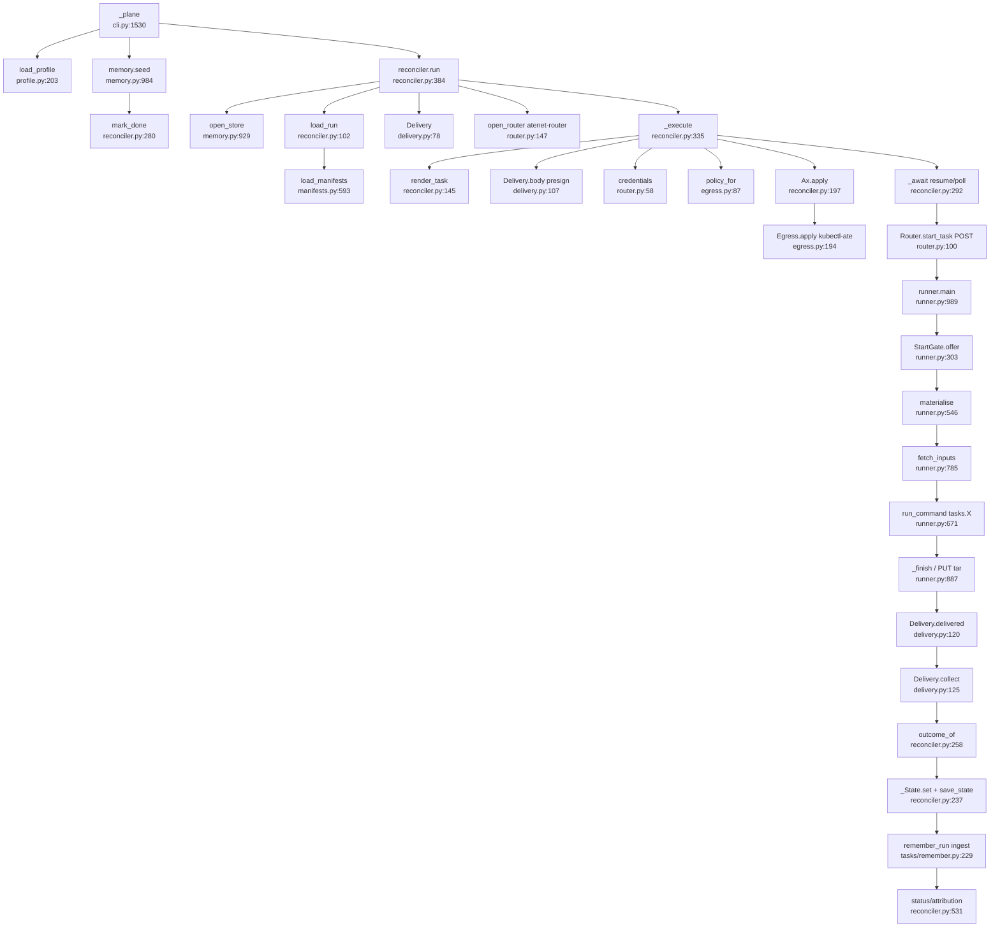

# U8 Plane executor (ax)

Traced read-only 2026-10-13. Correction: `ousast plane run` never calls generate.py; it reads Run/Task/Model/
Workspace YAML written earlier by `plane workspaces --validation-set` (increment) or `plane harvest`.
Dockerfile.runner is at repo-root `plane/Dockerfile.runner`.

## Happy path of `ousast plane run <manifest>`
1. cli.py:464 → `_plane` (1530) → `load_profile` (1534, profile.py:203).
2. `_plane_memory("seed")` (1542, 1633) → `memory.seed` (memory.py:984) → `reconciler.mark_done` (280) for reusable facts.
3. `reconciler.run` (384): `open_store` before the lock, no fallback (396, memory.py:929); `Delivery(store, run, base)` (397); `state.json` seeded on rerun (398-401); `_acquire_lock` (269, 402).
4. `load_run` (102) + sibling `tasks/`, `models/`, `workspaces/` (105-107) via `load_manifests` (manifests.py:593) → `parse_manifest` (562) → `check_run_tasks` (545).
5. Optional legacy receiver if `OUSAST_DELIVERY=receiver` (409-412, egress.py:233).
6. `open_router` (router.py:147): `kubectl port-forward svc/atenet-router :80` in `ate-system` (43, 168-169) unless `router_url`/`OUSAST_ROUTER_URL` (160-163); reconciler.py:431.
7. Scheduling loop (432-457): producers, `serialize` labels, `--workers`; one `worker` thread per task (419-427).
8. `_execute` (335): `render_task` (145) builds Model/Workspace/Task docs with `OUSAST_RUN/TASK/OUTPUT_DIR`, `OUSAST_BUDGET_*`, `OUSAST_INPUTS`, `OUSAST_GIT_PINS`, writes `<run>/<task>/task.yaml` (348); `delivery.body` (delivery.py:107) presigns PUT `runs/<run>/<task>/output.tar` and GET per input; `delivery.reset` (114); `credentials(model)` (router.py:58) reads `secretKey.key` from host env, `StartError` names the variable never the value; `policy_for` (egress.py:87) grants TLS passthrough 443 to store, git hosts, model hosts; `ax.apply` (reconciler.py:197) → `egress.apply` (egress.py:194, `kubectl-ate create/update egress-policy`) → `egress.settle` sleeps 11 s (229).
9. `_await` (292): `ax resume task` (202), `ax get task` (207); on Running calls `Router.start_task` (router.py:100): `POST START_PATH` with header `ate-target-actor: <atespace>/<task>` and body `{run, task, credentials, delivery}` (107-110); done when `delivery.delivered` (delivery.py:120) sees the tar.
10. Runner in the container: `/usr/local/bin/ax-task-runner` → `python -m openultrasast.plane.runner` (Dockerfile.runner:27); `main` (runner.py:989) → health server (999-1003) → `_run_once` (906): `_prepare` parses `AX_TASK_YAML` (860); `gate.arm/wait` (924-930), `StartGate.offer` (303) checks credential names and delivery URLs (`parse_delivery` 257, https hostname only) → 202; `_materialise_once` (972) → `materialise` (546) git clone/fetch at pins; `fetch_inputs` (785); `run_command` (671) → `Child` (610) runs `python -m openultrasast.plane.tasks.<cmd>` (`task_module` 600), credentials only in the child env (684); `summary_after` (650) → `_finish` (887) → `_deliver_output` (821) → `deliver` (719) PUTs the tar (`build_tar` 694); marker `<state>/<task>.done.json` (900); serves until SIGTERM (1013-1015).
11. `delivery.collect` (125): downloads, extracts after rejecting symlinks, hardlinks, traversal (136-138); `publish` (155); `done.json` (150); then `ax.delete`, `egress.delete` (reconciler.py:371-374); `outcome_of` (258) reads summary.json.
12. `_State.set/_flush` (237-251) → local state.json mirrored via `delivery.save_state` (173); final status (470-475).
13. `_plane_memory("ingest")` (1549) → `remember_run` (tasks/remember.py:229); failure reported, not fatal (1660-1662).
14. `plane status` → `reconciler.status` (531) → `attribution` (510) → attribution.json.

Credentials: read on the host only (router.py:58-72), travel only in the start POST body (107), never in
ActorTemplate env (reconciler.py:358); router errors redacted (router.py:113-116, 126, 130, `redact` 50); the
runner logs status and reply text only (runner.py:357), child stderr redacted (621); delivery logs use
`safe_url` (713, 743). No log line prints a key.

## Side effects
Host subprocesses: `ax apply/resume/get/delete` (reconciler.py:191-228), `kubectl-ate get/create/update
egress-policy` (egress.py:174-216), `kubectl port-forward` (router.py:168-169), receiver-mode `kubectl get svc`
(egress.py:133). Store: `runs/<run>/{state.json, <task>/output.tar, <task>/<artifact>, <task>/done.json}`
(delivery.py:11-16), presigned URLs (96-105), seed/ingest rows. Local `$OUSAST_RESULTS/plane/<run>/` (lock,
state.json, task.yaml, outputs, attribution.json; reconciler.py:64-69). Container: git clone/fetch
(runner.py:422-530), child `python -m`, HTTP on 80, marker in `/workspace/.ousast-state` (134). Sleeps: 11 s
egress settle, 3 s poll (reconciler.py:296).

## Dependencies and callers
Memory: `open_store` (929), `RUNS_PREFIX` (593), presign (547-555, 751-755). Budget: budget.py:16-17 imports
`Prices` (model.endpoint) and `ChatClient` (tool_hunter); the reconciler only exports `OUSAST_BUDGET_*`
(158-159). generate.py:67 is `price_of`, a price lookup, plus tasks.verify/repo_facts (72-73) and reconciler
helpers (71). learn: harvest.py:119 (`learn.excerpt.function_bounds`), 198 (`learn.labels.Clone`). Callers of
`reconciler.run`: only cli.py:1544 and ops/ax/smoke-run.sh:17. benchmarks/ax/batch.py:28 imports plane.memory
and runs its own `ax` CLI calls (62, 246), not the reconciler; search/coordinator.py:22-23 imports budget and
memory only; benchmarks/unseen/{draft.py:842, eligibility.py:332} import `reconciler.results_root`.

## What the replay and the hunter arm use
benchmarks/unseen/replay.py has no plane import (uses benchmarks.ax.batch → plane.memory only);
benchmarks/valid/hunter_arm.py:21 uses `plane.budget.MeteredClient` only. None of the executor modules are on
their path.

| Module | Callers |
|---|---|
| engine_alerts.py | cli.py:1597; benchmarks/learn/engine_pairs.py:37 (`docker_command`, `frozen_source`, `read_record`); benchmarks/learn/engine_trace.py:37 (`export_pin`); tests; model/audit.py:69 |
| harvest.py | cli.py:1579; `declares` used by benchmarks/learn/build_features.py:75 and engine_trace.py:635; tests |
| workspaces.py | cli.py:1570; tests/test_plane_reconciler.py:35; model/audit.py:80 |
| profile.py | live: cli.py:1532, reconciler.py:52, 390, doctor.py, ops/ax/*.sh, tests |
| generate.py | cli.py:1578 (`repin_templates`), 1668 (`increment`); harvest.py:43; tests |

## Removal candidates (never on `run`)
engine_alerts.py (its helpers would move to benchmarks/learn first), harvest.py (`declares` needs a home),
workspaces.py (no benchmark or ops caller), generate.py (manifest producer for harvest/increment only),
receiver mode in egress.py:128-160, 233-324 and runner.py:829-840 ("task 2.6 removes it", reconciler.py:409,
egress.py:106; ops/ax/up.sh:121-123 still creates the Service). doctor.py is live via `plane doctor`.

## Confidence
High on run/execute/await/start/runner/collect and credential handling. Medium on caller lists. Not read:
`memory.seed` body beyond 984-1020, tasks/remember.py, `materialise` internals, profile/doctor/engine_alerts/
harvest bodies, ops/ax/*.tmpl, prepare-substrate.py.
