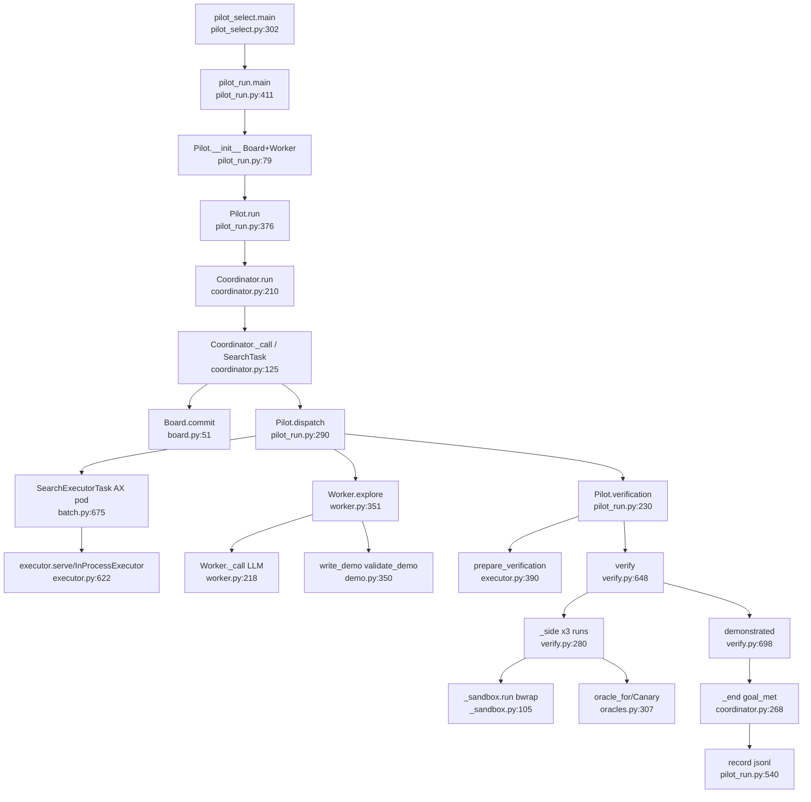
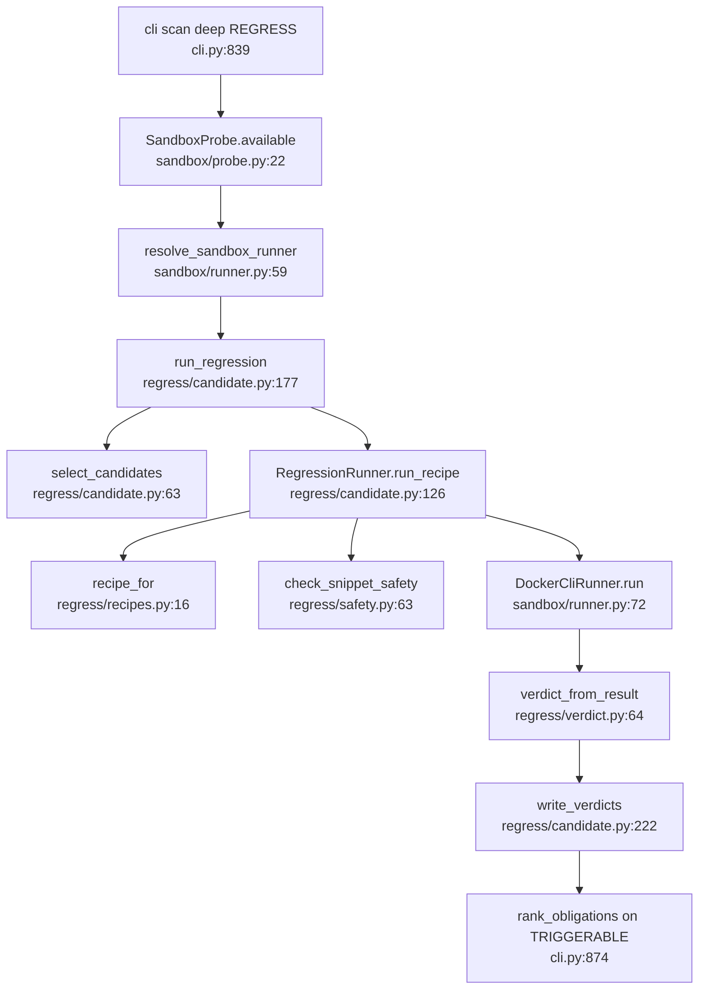

# U9 Search with proof, sandbox, regress

Traced read-only 2026-10-13. fossil-mcp's "unreachable Coordinator" is half wrong: `Coordinator` is live
(benchmarks/search/pilot_run.py:39, 378); `BatchExecutor` really has no src or benchmarks caller.

## Happy path A, search with proof (pilot)
1. `pilot_select.main` (pilot_select.py:302) writes `benchmarks/search/private/pilot.json` (310, 330) and a public record (311, 349).
2. `pilot_run.main` (pilot_run.py:411): validates manifest (466-505), `OpenRouterChatClient(max_attempts=1)` (509), `FileStore`/`open_store` (520), `AXLane` (522); dry run uses `probe.materialise` and `StubModel` (529-531, 60).
3. `Pilot.__init__` (79): `Board(store, "pilot-…")` + candidate hint commit (105-116), `Worker(...)` (117).
4. `Pilot.run` (376) → `Coordinator(self.board, self.dispatch, budget=SearchBudget(retries=0))` (378) `.run()`.
5. `Coordinator.run` (coordinator.py:210) seeds `bootstrap` (214-229); explore intent → `_call("explore")` (285).
6. `Coordinator._call` (125): reserve spend, `SearchTask` (28/149), checkpoint `_save` (85) → `Board.commit` (board.py:51) → `put_blob` (63); `executor(task)` (160) = `Pilot.dispatch`.
7. `Pilot.dispatch` (290) explore (327): `_executor` (178) opens an AX `SearchExecutorTask` (189) running `python -m openultrasast.search.executor` in the pod (batch.py:735) with the repo cloned (pilot_run.py:193); the worker's executor is `remote.client` (`ObjectStoreExecutor`, batch.py:752).
8. `Worker.__call__` (worker.py:471) → `explore` (351) → `_call` (218) reserves budget, `client.complete_chat_raw` (251); tools via `Worker.tool` (283): read_file/grep/run → `executor.submit` → pod `serve` → `InProcessExecutor.execute` (executor.py:622, 120, 197).
9. `write_demo` → `validate_demo` (demo.py:350) writes `demo/demo.json` (worker.py:294-310); `finish` → `load_demo` + `validate_oracle` (440-446) returns a fact with `demo`.
10. Coordinator stores the fact (coordinator.py:300-313); next loop `_call("verify")` (246).
11. `Pilot.dispatch` verify (297) → `Pilot.verification` (230): VM lane per revision `prepare` (217) → `SearchExecutorTask.prepare` → `prepare_verification` (batch.py:758-760, executor.py:206) → `extract_checkout` (verify_task.py:161), `validate_spec` (219), `verify(...)` (pilot_run.py:282); AX lane `verify(..., task_dispatcher=AXSideDispatcher)` (252-271) → `python -m openultrasast.search.verify_task` (search_verify.py:94) → `task_main`/`run_side`/`verify_side_task` (verify_task.py:279, 273; verify.py:632).
12. `verify` (verify.py:648): `_sandbox.isolation_check` (673); `_side` for affected and safe (690); `_side` (280) runs 3 fresh runs (327): `oracle_for` (399), `Canary.fresh` (402; oracles.py:307, 30), app launched via `_sandbox.run` (bwrap, _sandbox.py:105, 125), `oracle.observe` (verify.py:556).
13. `demonstrated` only if 3/3 affected observe and 0/3 safe do (697-698) → `VerificationRecord`.
14. `dispatch` returns outcome, `evidence_refs=["verify:owned"]` (318-324); coordinator appends `verified-…` and `_end("goal_met")` (256-268); `Pilot.run` fills spend and metrics (396-403) → `output.write` (540), summary (547-567).

## Happy path B, deep-mode regress
cli.py:66 imports `run_regression`; at 839 if REGRESS requested, `resolve_sandbox_probe().available()` (840)
runs `docker info` (sandbox/probe.py:22-33); `resolve_sandbox_runner()` (845) → `DockerCliRunner`
(runner.py:59-64); `run_stage("regress", run_regression(...))` (856-870) → `candidate.run_regression`
(candidate.py:177) → `select_candidates` (63) with `complexity.ledger.select_forced_candidates` (81); per
hotspot `_proposed_snippet`/`snippet_for` (203, 153) → `RegressionRunner.run_recipe` (126) → `recipe_for`
(recipes.py:16) → `run_snippet` (141) → `check_snippet_safety` (safety.py:63) → `DockerCliRunner.run`
(runner.py:72: `docker run --rm --network none --read-only …` 113-137); `verdict_from_result` (verdict.py:64):
`triggerable` on non-zero exit or oracle, `not_triggerable` on exit 0 (91-99); `write_verdicts` → verdicts.json
(cli.py:871, candidate.py:222); `persist_verdicts` (872); obligations re-ranked on TRIGGERABLE (874-877).

## Side effects
Model: `complete_chat_raw` with DeepSeek settings (worker.py:251; client pilot_run.py:509), reserved against
`SpendBudget` (228, 238). AX: an executor pod per explore/prepare (pilot_run.py:189, batch.py:735), verify pods
in AX lane (search_verify.py:94), cap 32 tasks (pilot_run.py:213). Local: bwrap (_sandbox.py:125, 194), Chromium
`BrowserExecutor` for xss (pilot_run.py:286). Files: `benchmarks/search/private/runs/<uuid>/…` (demo.json,
built-*, verify-demo, boards/), `--out` jsonl opened with "x" (517). Regress: `docker info`, `docker run`,
scratch seed dir (runner.py:74), verdicts.json, complexity_ledger.json.

## Overlap between regress/ and search/
| | search/ | regress/ |
|---|---|---|
| Sandbox | `_sandbox.run` bwrap+seccomp (_sandbox.py:105); `_run_task` (verify.py:576); AX pods | `DockerCliRunner.run` (sandbox/runner.py:72) |
| Shared types | `SandboxJob`/`SandboxResult` from `..sandbox` (_sandbox.py:24, verify.py:29) | same (candidate.py:15) |
| Verdicts | demonstrated / inconclusive / no_oracle / could_not_run / could_not_build; no negative (verify.py:660, 692-701) | triggerable, not_triggerable, already_covered, inconclusive (verdict.py:10-26) |
| Oracle | owned canary oracles per family (oracles.py:30, 307), differential 3 vs 3 | exit code or optional callable (verdict.py:91-99), single run, not differential |

The only production caller of regress/ is cli.py:66, 858; all other references are tests. `run_recipe(oracle=…)`
is never passed an oracle in production (candidate.py:205).

## Coordinator and BatchExecutor
`Coordinator` is reachable (pilot_run.py:378; tests). `BatchExecutor` (coordinator.py:426-484): only
tests/test_search_coordinator.py:177, 189; the pilot uses `SearchExecutorTask` and `AXSideDispatcher`.
`coordinator.main` (487), `worker.main` (worker.py:530), `verify.main` (verify.py:714): shims with no in-repo
invoker (the `-m` launches target only search.executor and search.verify_task). Retry path `lane="docker"`
(coordinator.py:202-205) unreachable from the pilot (retries=0). `probe.probe`/`main` (probe.py:157, 239) used by
tests and benchmarks/ax/search_probe.py; only `materialise` (39) in dry runs. Fake sandbox runner/probe are
env-flag test doubles.

## Dependencies
Memory: `FileStore` (plane/memory.py:493), `open_store` (929); `Board` uses put_blob/get_blob (board.py:63, 42).
Budget: `BudgetExhausted` (budget.py:23), `SpendBudget` (260); `search/budget.py:8` `SearchBudget`, 49
`verification_timeout`. LLM: provider/openrouter.py:56, 84; `price_of` (pilot_run.py:26-33, 425).
benchmarks/ax: batch.py:675-762 (`SearchExecutorTask`, `prepare`), 498 (`dispatch`, BatchExecutor only),
search_verify.py:56 (`AXSideDispatcher`), 48. plane/tasks/verify.py:179 uses `complexity.map.Hotspot`, the
same type regress uses (candidate.py:11); search/ does not. Regress also uses complexity/ledger.py and
`config.SandboxConfig`.

## Confidence
High on call chains, verdict sets, Coordinator/BatchExecutor callers (benchmarks/search/private excluded). Not
read in full: `_side` build/readiness/HTTP driver (verify.py:345-560), `_prepare_verification`
(executor.py:390-488), recipes/safety bodies.
