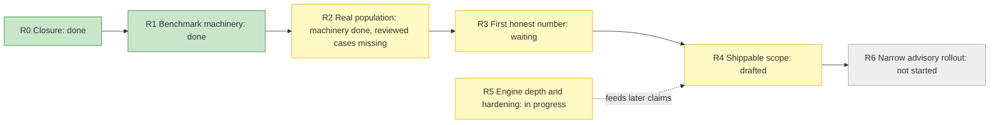

# OpenUltraSAST

[](https://doi.org/10.5281/zenodo.24012764)

OpenUltraSAST is an experimental static security analyser. It aims to check security on
repositories it has never seen. It scans a checkout or the commits a `git push` would publish. It
distinguishes what it can prove from what it suspects.

The safety net is not released yet. A scan and the pre-push hook are advisory, and nothing
blocks a push. Detection on repositories the tool has never seen has not met its release gate.
[Status and roadmap](#status-and-roadmap) says where the project stands.

## What you can run today

- A quick scan of a checkout. It is deterministic and needs no Docker, network or API key.
- The pre-push hook, in any repository. It runs the quick rules on the lines a push changes, names
  every check it could not run, and never blocks the push.
- A standard scan, with the Joern engine. It follows a value across statements and files. It needs
  Joern: the Docker image, or the host install.
- A coding agent. An agent that can run shell commands needs nothing but the CLI. `ousast mcp`
  exposes the same work to an MCP client.

A scan combines up to four parts:

- language-scoped pattern rules;
- a tree-sitter overlay (a syntax tree of each file, built by the tree-sitter parser);
- a Joern code property graph (a graph of the program's syntax, control flow and data flow);
- optionally, a model. It is asked only the question the graph cannot settle.

Every finding includes its supporting evidence. When a scan cannot check something, it records
a degradation instead of reporting a clean result.

Where a repository's application can be built and run, an experimental proof arm goes further. It
demonstrates a finding by executing it. The issue triggers on the vulnerable revision and not on
the fixed one, which makes the finding reproducible. Pilot demonstrations exist. The arm is parked
until the roadmap's step R4 needs it, and it is not shipped.

## Install and first scan

Pick the tier you need. Tier 1 and Tier 2 are for everyone. Tier 3, model work over whole
repositories on the plane, is for maintainers. Tier 4, a Kubernetes deployment, is planned and not
done. Both are in the documentation: [ax on this host](docs/ops/ax/README.md) and
[Deployment](docs/deployment.md).

### Tier 1: quick scan, no Docker

The core install depends only on PyYAML. From a checkout, `uv sync` (or `pip install .`) installs
the `ousast` entry point. `uv sync --group dev` adds the test and lint tools.

```bash
uv sync
uv run ousast scan /path/to/repo --mode quick
uv run ousast scan . --mode quick --fail-on verified   # CI: exit 1 on any evidence-verified finding
```

This runs the language-scoped pattern rules, entry-point reachability hints, ranking,
verification and scoring. It is deterministic and reproducible. It needs no network and no keys.

The same install gives you the advisory pre-push hook for any repository. It runs the quick rules
on the lines a push changes, names every check it could not run, and never blocks a push:

```bash
cd /path/to/your/repository && ousast pre-push install    # remove: ousast pre-push uninstall
```

What it cannot do:

- There is no engine. It cannot follow a value across statements or files.
- The PHP quick rules are a low-precision, in-sample development set. Per-rule precision lower
  bounds run from 0.03 to 1.0 on the real pins
  (`benchmarks/measurements/2026-09-30-php-quick-rules/measurement.json`).

The optional `semantic` extra (`uv sync --extra semantic`) installs the tree-sitter grammars for
the overlay.

### Tier 2: standard and deep scans (Docker)

`standard` and `deep` need Joern. The Docker image includes the tool and
Joern v4.0.625. It also includes `php-cli`, which the PHP frontend needs. Each release publishes the image
to GHCR. It is big: a JRE plus about 2 GB of Joern. Pull it instead of building, and tag it with the name the
shell wrapper uses:

```bash
docker pull ghcr.io/norandom/openultrasast:2.0.1   # the last full release; a prerelease is tagged with its version
docker tag ghcr.io/norandom/openultrasast:2.0.1 openultrasast:dev   # or build: docker compose build
```

The shell wrapper runs `ousast` in the container. It builds the image only if `openultrasast:dev`
is missing. Your directory is mounted read-only and the container network is off. For the pre-push
hook, use `ousast pre-push install --docker`: Git cannot call a shell function, so it installs the
script `ousast-docker` beside the hook.

```bash
source /path/to/OpenUltraSAST/ops/shell/ousast.sh   # PowerShell: ops/shell/ousast.ps1
ousast scan . --mode standard                       # the graph decides; no model is asked
ousast-with-judge scan . --mode standard            # network on, the model is asked (DEEPSEEK_API_KEY)
```

`docker compose build` and `TARGET=/path/to/repo docker compose run --rm ousast scan /target` do
the same without the wrapper. Create `reports/` first (`mkdir -p reports`): compose does not create it,
because a directory Docker creates is root-owned and the image runs as an ordinary user. Findings land there.

Details, including the host install, are in [ops/README.md](ops/README.md).

Keys and store settings live in `.env` in the working directory. The file is gitignored;
`.env.example` lists the names.

- Every LLM call uses `DEEPSEEK_API_KEY`.
- `OPENROUTER_API_KEY` is used for embeddings only (`ousast learn memory embed`).
- `.env` never overrides a variable already exported in your shell. If a key change seems to have
  no effect, `unset` the stale export.

The plane's memory store and the optional S3 bucket are maintainer topics:
[Memory](docs/memory.md) and [RustFS setup](docs/rustfs.md). Nothing in a scan needs them.

## Scan modes

There are three modes. Each adds to the one before.

- `quick` runs the pattern rules, hints, ranking, verification and score. It needs nothing.
- `standard` adds a complexity map, the semantic overlay, authorization obligations and the Joern
  model layer. The model layer builds one code property graph per repository. It decides taint,
  guard-dominance and configuration questions on that graph. A model is asked only the residual
  question. Without a key, that question is skipped and only the graph's entailed findings are
  reported.
- `deep` requests the REGRESS stage, which was retired on 2026-10-13: the scan records a
  `regress_retired` degradation and otherwise equals `standard`. Execution proof now comes from the
  search-with-proof arm.

A missing engine is a recorded degradation (`cpg_unavailable`, `regress_retired`), never a
clean result.

`--fail-on never|findings|verified|worth-fixing` sets the exit code. `--config openultrasast.toml`
loads settings. Every run writes `manifest.json`, `findings.json`, `verification.json`,
`score.json`, `report.md`, `report.sarif` and `trace/events.jsonl` under
`~/.cache/openultrasast/runs/<scan-id>/`, or under `$XDG_CACHE_HOME/openultrasast/runs/` when that
variable is set to an absolute path. The scan prints that path (`run_dir=<path>`).
`OPENULTRASAST_RUNS_DIR` moves the run directory. Runs older than 30 days are removed from the
default location, and `OPENULTRASAST_RUNS_RETENTION_DAYS` sets the number of days.
[Examples](docs/examples.md) has the details: a relative run directory, the retention notice, and
where `ousast benchmark` and its MCP tool write.

`ousast pre-push` (experimental) analyses the commits a push would publish against their base.
First, the quick rules run on the changed lines. Then the engine compares head with base, and only
new or worsened defects become candidates. It is advisory by default, and it prints one line per
check it could not run. Its capability registry is empty, so it emits no normal alert today. An
engine finding the push introduced is shown as advisory. Install, settings, skip reasons and a CI
recipe: [docs/scanning.md](docs/scanning.md#first-run-install-the-hook-on-any-repository).

Flows and the per-language rule table: [docs/scanning.md](docs/scanning.md).

## How detection works

The tool reads code in three ways, from cheap to expensive:

1. Text: regex quick rules, one statement at a time.
2. Tree: the tree-sitter CST (concrete syntax tree) and an IR (intermediate representation) per
   function. The overlay and the obligations use it.
3. Graph: the Joern CPG. It is the only one that follows a value across statements, calls and
   files.

Quick rules cover C/C++, Python, JavaScript/TypeScript, Java with Groovy templates, and PHP. Each
rule runs only against files of its language.

What each technique can establish, with the code it comes from and what it misses:
[docs/detection-techniques.md](docs/detection-techniques.md). The stage order and the evidence
ladder (a state machine, not a label a model may assign), the central CWE policy and the project
score: [docs/architecture.md](docs/architecture.md).

## Status and roadmap

The project works through a seven-step plan, the ladder. It is at R3, the first honest number: one
governed run that measures detection on real repositories the tool was not tuned on. That run has
not happened. It waits on independently reviewed cases, which do not exist yet. No detection arm
has met the release gate on unseen repositories. On two frozen populations the engine found 1 of 11
and then 0 of 17 of the known vulnerabilities; [Where we stand](docs/where-we-stand.md) gives the
record behind each figure. Work on the engine runs alongside and does not wait for R3.



| Step | What it gives you | State on 2026-11-28 |
| --- | --- | --- |
| R0 Closure | The blocked engine work is unblocked, and the backlog is pushed. | Done, 2026-11-20 |
| R1 Benchmark machinery | The machinery that measures detection fairly. | Every subtask is checked |
| R2 Real population frozen | Real repositories to measure on. | Machinery checked. The independently reviewed cases are still missing |
| R3 First honest number | Recall and false alarms on repositories the tool has never seen. | Waiting on the reviewed cases |
| R4 Shippable scope declared | The exact families a release may claim. | Drafted. Provisional until R3 has been read |
| R5 Engine depth and hardening | Better detection in the static engine. | In progress |
| R6 Narrow advisory rollout | A first release, with a stated scope. | Not started |

Past milestones:

| Date | Milestone | Result |
| --- | --- | --- |
| 2026-09-14 | The release path: prove usefulness, then speed and transfer. | Accepted |
| 2026-09-16 | M1a: the detection shown, with every veto recorded. | Met, on a fixture repository (NodeGoat) |
| 2026-09-17 | M2: the same analysis fast enough for a push. | Measured and not met |
| 2026-10-02 | The pre-push hook on any repository. | Operational and advisory |
| 2026-10-30 | The third admission read of the access-control arm. | NO-GO. The arm is parked |
| 2026-11-06 | Checkpoint v2.1.0-alpha.1. | The project stops trying to block a push on the static analyser alone |
| 2026-11-20 | R0 Closure, and the ladder replaces the earlier plans. | Done |
| 2026-11-23 | Population v4 for M4 frozen: 11 cases. | Frozen, not scanned |

The release milestones M1 to M5, the status of 2026-11-06 and the rules that bind every step are
in [Roadmap](docs/roadmap.md). The release history is in [RELEASE_NOTES.md](RELEASE_NOTES.md).
Every figure has its record in [Where we stand](docs/where-we-stand.md).

## Documentation

The documentation site is published at <https://norandom.github.io/OpenUltraSAST/>. Its sources are
in `docs/` and `mkdocs.yml`; to preview it locally, run `uv sync --extra docs && uv run mkdocs serve`.
Every page, by what you want to do:

| Page | For |
| --- | --- |
| [Documentation home](docs/index.md) | The site's home page: the three layers, how they connect, and where to go next |
| [End-to-end examples](docs/examples.md) | Walkthroughs from a first quick scan to an MCP client; where a run is written and how long it is kept |
| [Scanning](docs/scanning.md) | The three scan modes, the quick rules per language, the pre-push hook with its install, settings, skip reasons and a CI recipe |
| [Pre-push security for developers](docs/pre-push-for-developers.md) | What the hook checks for you, and its honest limits |
| [Use case: catch, prove, fix, re-verify](docs/use-case-fix-and-reverify.md) | The loop from a finding to a proven fix |
| [Threat model](docs/threat-model.md) | What the tool trusts and what it does not: untrusted code, secret redaction, egress, budgets, the `deep` sandbox |
| [Architecture](docs/architecture.md) | The scan pipeline, the evidence ladder, the CWE policy, the project score, calibration |
| [Detection techniques](docs/detection-techniques.md) | The program analysis under a scan, with the code it comes from and what it misses |
| [Roadmap](docs/roadmap.md) | Past milestones, the present state and what is next |
| [Where we stand](docs/where-we-stand.md) | The state in one page, every figure with its record |
| [Evaluation](docs/evaluation.md) | How anything is measured on code the tool was not tuned on |
| [The plane on ax](docs/plane.md) | Maintainers: model work over whole repositories as Runs of isolated Tasks |
| [Memory](docs/memory.md) | Maintainers: the store that holds what plane runs and the decision engine learned |
| [Memory and detection](docs/memory-and-detection.md) | Maintainers: how stored rows are meant to improve decisions |
| [Decision engine](docs/decision-engine.md) | Maintainers: the learned classifier, in development; its design, evaluation slices and A/B protocol |
| [Token ergonomics](docs/token-ergonomics.md) | Maintainers: where model tokens go at runtime and in the maintainers' own sessions |
| [Engine and pre-push](docs/ops/README.md) | Operations: the engine image, the Docker wrapper and the host install |
| [ax on this host](docs/ops/ax/README.md) | Operations: bring-up and doctor instructions for the plane's local cluster |
| [Engine traces on kube-ax](docs/ops/ax/engine-traces.md) | Operations: dispatching an engine trace run to AX tasks, with a Docker fallback lane |
| [Deployment](docs/deployment.md) | How the plane was deployed, and what moving it to a separate Kubernetes cluster would take |
| [RustFS setup for the memory store](docs/rustfs.md) | The bucket policy and the admin steps for the S3 store |

## For maintainers and contributors

```bash
uv run pytest                 # tests, incl. the 90/10 detection gate
uv run ruff check .           # lint
uv run ruff format --check .  # format
uv run mypy src/openultrasast # types
uv run python -m openultrasast.gate       # standalone detection gate
uv run python -m openultrasast.pair_gate  # local vuln-vs-fix pairs
uv run python dagger/ci.py    # containerized CI pipeline
```

Two parts are in development, and a scan needs neither of them: the agentic plane for model work
over whole repositories ([The plane on ax](docs/plane.md)) and a learned decision engine
([Decision engine](docs/decision-engine.md)). The benchmark and pair commands that maintainers run
are in [Examples](docs/examples.md). Other maintainer commands: `ousast repos` (pinned
known-vulnerable checkouts) and `ousast model candidates` (what the candidate enumerator can reach).

For [OpenCode](https://opencode.ai) there are two project skills in `.agents/skills/`:

- `openultrasast-scan`: modes and their prerequisites, `--fail-on`, the evidence ladder, recorded
  degradations and run artifacts.
- `openultrasast-triage`: false-positive reasons, what an adjudication may feed, and fixing and
  re-scanning.

`ousast mcp` runs a narrow MCP (Model Context Protocol) server over stdio. It has ten tools:
`openultrasast.scan`, `status`, `findings`, `get_finding`, `evidence`, `artifacts`, `benchmark`,
`explain`, `propose_patch` and `export_report`. No tool runs a shell, Docker or a free-form
command.

```jsonc
{ "command": "uv", "args": ["run", "ousast", "mcp"] }
```

The `kiro-*` skills, `AGENTS.md` and the Kiro-style specifications under `.kiro/` are the
maintainer's development tooling. Users can ignore them.

## Licence

OpenUltraSAST is licensed under the [Apache License 2.0](LICENSE). Third-party material keeps its
own terms:

- Joern (Apache-2.0) is downloaded at image build time.
- The tree-sitter wheels of the `semantic` extra are MIT.
- The published benchmark cases were licence-checked one by one. v1's OpenCVE case is BUSL-1.1, see [RELEASE_NOTES.md](RELEASE_NOTES.md).
