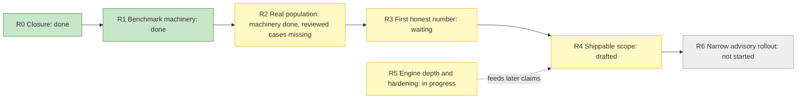

# Roadmap

State on 2026-11-28. The project is at step R3 of its ladder, the first honest number. That is one
governed run (task 11.6 of the valid benchmark) that measures detection on real repositories the tool
was not tuned on. The run has not happened: the independently reviewed cases it needs do not exist
yet. The position this page rests on was refreshed on 2026-11-25 and read again on 2026-11-28.

What you can run today does not wait for it: a quick scan of a checkout, an advisory pre-push hook for
any repository, and the Joern engine in Docker. None of it blocks a push. No detection arm has met the
release gate on unseen repositories, so every result is advisory. The next action is the governed run
once the cases are reviewed, then the final gate (task 11.7: compatibility, security, boundary and
regression). Work on the engine runs alongside and does not wait for it.

The only detection figures on this page are the two recall counts quoted in the status of 2026-11-06.
Every figure, with its record, is in [Where we stand](where-we-stand.md) and [Evaluation](evaluation.md).

## Where this is going

On every push, from a hook or CI, OpenUltraSAST answers for the changed code. It stays advisory for
every vulnerability family. It blocks a push only for families whose precision has been proven on
repositories it has never seen. Two numbers decide that: recall on changes that introduce a
vulnerability, and false alarms on ordinary changes. Both are measured on unseen repositories.

## The ladder

The ladder of 2026-11-20 is the plan in force. It replaced the earlier orderings and lowered no bar.
R5 runs alongside R3 and R4; it does not wait for them.

| Step | What must be true to move on | State on 2026-11-28 |
| --- | --- | --- |
| R0 Closure | The blocked engine work is unblocked and the backlog is pushed. | Done, 2026-11-20. |
| R1 Benchmark machinery | Tasks 6.5 to 9.3 of the valid benchmark: sealed pre-spend diagnostics, a retry authority seam, lease-protected heads, an atomic admission lifecycle for several arms, and an operator entry point. | Every subtask is checked. |
| R2 Real population frozen | Four independently reviewed cohorts of real repositories, in at least two families across Python and JavaScript/TypeScript, a population of ordinary changes, and a baseline. | The machinery is checked. The reviewed cohorts do not exist. |
| R3 First honest number | One governed admission run on the frozen population. Its GO or NO-GO is bound to the population it spent, and a NO-GO names the missing capability. | Waiting on the reviewed cohorts. |
| R4 Shippable scope declared | The release claims exactly the families whose claims survived R3, and it meets the [M4 gates](evaluation.md#independent-populations-and-the-m4-gates). | Drafted. Provisional until R3 has been read. |
| R5 Engine depth and hardening | The capabilities a NO-GO names are built: control dependence, modelled sinks, framework and sanitizer knowledge in the engine, a harness that reports the cause of its own failure, a faster engine start, and the PHP transfer once its runtime is unblocked. | In progress. |
| R6 Narrow advisory rollout | Eligibility is bound to the exact runtime, query, facts, ranking and policy that passed, and the packaged push experience is revalidated. | Not started. |

## Release milestones

The ladder is the order of work. Release readiness is judged by five milestones, and only by evidence.

| Milestone | What it proves | State on 2026-11-28 |
| --- | --- | --- |
| M1a | One real security change is detected, and every veto is recorded. | Met on 2026-09-16, on a fixture repository (NodeGoat). |
| M1b | Only the vetoes that matter are repaired. | Two records disagree. The ladder's position says met on the same fixture. The milestone record says not verified. |
| M2 | The same analysis is fast enough for a push: 30 seconds warm, 2 seconds to cancel and report. | Measured and not met on 2026-09-17. A changed-code scan spent most of its 30 second budget building a whole-repository graph. The accepted direction is to reuse the graph across revisions. That work is not scheduled. |
| M3 | The shared design transfers to PHP and Python. | Partial. The PHP transfer is blocked by its runtime. |
| M4 | Independent cases establish useful detection and low noise. | Pending M3. No spent population has passed its gates. Its 11 frozen cases have not been scanned. |
| M5 | A narrow advisory rollout, bound to what passed. | Not started. The eligibility registry was last written on 2026-09-13 and admits no capability today. |

## Past milestones

| Date | Milestone | Result |
| --- | --- | --- |
| 2026-09-14 | The release path: prove usefulness, then speed and transfer. | Accepted. |
| 2026-09-16 | M1a: the detection shown, with every veto recorded. | Met, on a fixture repository (NodeGoat). |
| 2026-09-17 | M2: the same analysis fast enough for a push. | Measured and not met. |
| 2026-10-02 | The pre-push hook on any repository. | Operational and advisory. |
| 2026-10-30 | The third admission read of the access-control arm. | NO-GO. The arm is parked. |
| 2026-11-06 | Checkpoint v2.1.0-alpha.1. | The project stops trying to block a push on the static analyser alone. |
| 2026-11-20 | R0 Closure, and the ladder replaces the earlier plans. | Done. |
| 2026-11-23 | Population v4 for M4 frozen: 11 cases. | Frozen, not scanned. |

## The status of 2026-11-06

The README carried this status until 2026-11-28. It is kept here as the record of that day.

- No blocking hook capability is enabled; the pre-push hook is advisory only.
- Two independent populations (case sets frozen before any scan) have been spent on the static
  engine: recall was 1 of 11, then 0 of 17. [Where we stand](where-we-stand.md) gives the record
  behind each figure. The learned decision engine ranks findings but does not block for any family.
- Static abstract interpretation could not prove the precision needed to block a push, and the
  project no longer tries to meet those gates that way. Work then focused on a dynamic proof arm.
  It builds and runs a repository's app and demonstrates a finding by a differential: the issue
  triggers on the vulnerable revision and not on the fixed one. Execution establishes the finding as
  ground truth, so it can justify a block without calibration. Pilot demonstrations exist, including
  one executed on the cluster. The arm was being qualified, not shipped.
- The release gate is a measured catch-rate and false-alarm number on repositories the tool has
  never seen (see [Evaluation](evaluation.md)). Until that number exists, treat all output as
  advisory.

Every detection change must show an improvement in a controlled measurement on held-out repositories.

## What changed after that day

- The ladder of 2026-11-20 made one governed admission run on real repositories the next product
  milestone. No product milestone outranks it.
- The access-control admission arm was parked after three NO-GOs in a row.
- Proof by search is parked until R4 needs it. The model lane stays at the proposal stage.
- The local cluster that runs the plane is stopped since 2026-11-24. A wider Kubernetes deployment
  of the plane waits for a re-plan.

## Open parts

Work that is not done, with the page that describes it and the step that closes it. The states are
those the records hold today.

| Open part | State today | Described in | Closed by |
| --- | --- | --- | --- |
| Reviewed cohorts of real repositories | None exist. The tasks that prepare them are ticked, on synthetic review batches. | [Evaluation](evaluation.md#independent-populations-and-the-m4-gates) | R2 |
| The governed admission run (task 11.6) and the final gate (task 11.7) | Not run. | [Evaluation](evaluation.md#independent-populations-and-the-m4-gates) | R3 |
| An admitted pre-push capability | None. The eligibility registry was last written on 2026-09-13. | [Pre-push security for developers](pre-push-for-developers.md) | R6 |
| Engine depth: control dependence, modelled sinks, sanitizer and framework knowledge | Open. The PHP transfer is blocked by its runtime. | [Detection techniques](detection-techniques.md#8-what-each-technique-misses) | R5 |
| Graph reuse across revisions (M2, the 30 second gate) | Accepted on 2026-09-17. No open task owns it. | [Architecture](architecture.md#the-scan-pipeline) | Not scheduled; no step owns it |
| The proof arm | A pilot, parked until R4 needs it. | [Use case: catch, prove, fix, re-verify](use-case-fix-and-reverify.md#honest-status) | R4, if it needs it |
| The plane on a separate Kubernetes cluster | Planned, not done. The local cluster is stopped since 2026-11-24. | [Deployment](deployment.md#b-a-separate-kubernetes-cluster-planned) | R4 or R6, after a re-plan |
| The qualification M4 | Pending M3. Its 11 cases are frozen and unscanned. | [Evaluation](evaluation.md#independent-populations-and-the-m4-gates) | R4 (M4) |
| The decision engine | In development, not adopted. The roadmap does not schedule its adoption. | [Decision engine](decision-engine.md) | Not on the ladder |

## Rules at every step

- The benchmark population measures. It never trains.
- Two admission NO-GOs in a row park an arm.
- Every zero proves that its instrument read non-zero input.
- Historical evidence stays frozen.
- No detection number is quoted unless it comes from the valid benchmark, and every number is
  published with its record.
- Counts of finished tasks say how the build is going. They say nothing about release readiness.

## What is not on the path

A second code property graph engine, an execution stage inside a scan (`deep` equals `standard`),
and a server mode are deferred.
